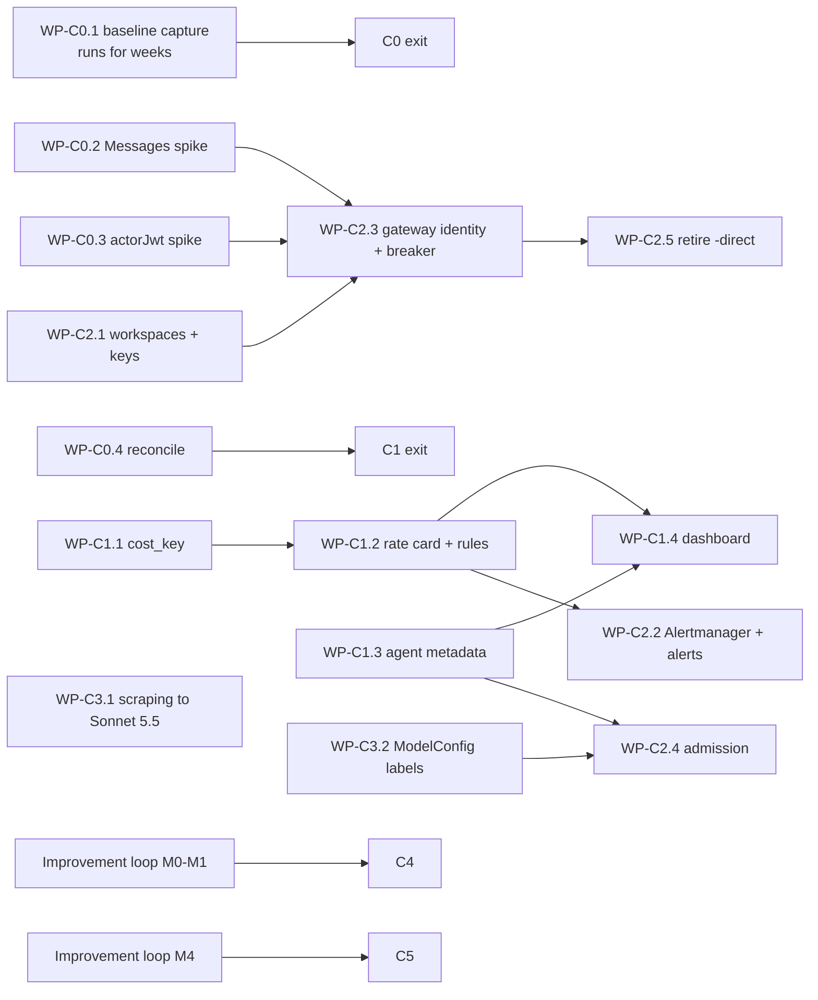

# AI Cost Management — Implementation Plan

**Story:** [`.ai/stories/cost-management.md`](../stories/cost-management.md) (architecture, decisions, rationale)
**Status:** Ready to start (C0–C3); C4/C5 gated on the improvement loop
**Updated:** 2026-11-22
**Clusters:** mlops (agents, `ai-gateway`, admission), application (collector, Prometheus, Grafana, Alertmanager)

This plan is the build order for the story. Design reasoning stays in the story; this file lists what to change, where, how to verify it, and how to back it out. Work packages (WPs) are sized to one PR each unless noted.

## 0. Ground rules

- No new long-running service. The only new deployable allowed is a metadata exporter (WP-C1.3), and only if kube-state-metrics cannot do the job.
- Changes to `ai-gateway` and admission go through `task platform:ai:deploy CLUSTER=mlops`. Observability changes go through the application overlay deploy.
- Every WP ships with a verification step that reads **live** state (Prometheus, `kubectl`, gateway response). A rendered manifest is not evidence.
- Secrets use SOPS + ksops only. No plaintext keys in values, CRs or env.
- Changes to agents outside this repo (sigmahealth) are proposed in that repo. This plan does not depend on them landing, except where marked **[external]**.
- If a spike invalidates a WP's approach, stop and report it with the alternative. Do not substitute silently.

## 1. Sequencing



| Week | Work | Why this order |
| --- | --- | --- |
| 1 | C0.1 start, C2.1, C1.1, C1.2, C3.1, C3.2 | Get data accruing against a priced, capped baseline from day one |
| 1–2 | C0.2, C0.3, C0.4, C2.2, C1.3 | Spikes decide C2.3; reconciliation decides whether the C1 numbers can be trusted |
| 2–3 | C1.4, C2.3, C2.4 | Gateway and admission land after the spike verdicts |
| 3+ | C2.5, C3.3–C3.5, C0 exit (≥20 tasks) | Cleanup and model-selection work that needs the baseline |
| gated | C4, C5 | Need improvement loop M0–M1 and M4 respectively |

## 2. Phase C0 — Baseline and spikes

### WP-C0.1 Baseline capture

**Goal:** ≥20 `medday-developer` tasks with calls, tokens by kind, wall time and outcome.

Steps:
1. Add `platform/ai/scripts/cost-baseline.sh`. For a time window it queries the application Prometheus and writes one row per window: `invoke_agent` count, `chat` count, `execute_tool` count, tokens by kind (`input`, `output`, `cache_read`, `cache_write`), and estimated USD at the current rate card.
2. Per task, take the A2A `contextId` from the invocation and pull the matching trace from Tempo (the `invoke_agent` root span). Record task duration and outcome by hand in `.ai/context/runbook/cost-baseline.md` until C4 automates it.
3. Re-run weekly. The C0 exit check is mechanical: ≥20 rows with an outcome recorded.

Verify: the script's 7-day total matches the Grafana "Estimated spend" tile within rounding.

### WP-C0.2 Spike: kagent ADK on the `ai:` Messages backend

**Question:** Can the kagent ADK harness use `/anthropic-ai` (`AgentgatewayBackend anthropic-messages`), so the gateway parses token usage and can apply **token** limits?

Steps:
1. Scratch `ModelConfig claude-opus-5-spike` with `anthropic.baseUrl: http://ai-gateway.ai.svc.cluster.local/anthropic-ai`, `stream: true`, `promptCaching: true`.
2. Scratch AgentTemplate + Agent on `Harness kagent`, with one MCP tool and a 3-turn prompt that forces tool use.
3. Check: no 4xx from the gateway (Loki `service_name="ai-gateway"`); tool calls round-trip; the second turn shows `cache_read_input_tokens > 0` on the `chat` span; the gateway trace carries `gen_ai.usage.*`.
4. Delete the scratch resources.

Outcomes:
- **Pass:** C2.3 uses `rateLimit.local[].tokens` on `anthropic-messages`.
- **Fail:** C2.3 uses `requests` per `Minutes` on a passthrough backend with `policies.auth`. Record the failing payload error.

### WP-C0.3 Spike: `actorJwt` identity at the gateway

**Question:** Can Substrate-minted Actor JWTs give the gateway an identity that cannot be spoofed, and keep the Anthropic key out of the Actor?

Steps:
1. On the C0.2 scratch ModelConfig: drop `apiKeySecret` and set `actorJwt: {audiences: [ai-gateway]}`.
2. On a scratch HTTPRoute, add an `AgentgatewayPolicy` with `traffic.jwtAuthentication` against the Substrate issuer JWKS. Find the issuer and JWKS URL in `ate-system`; the `substrate-identity-bootstrap` Job creates the JWT pool Secrets.
3. On the backend, set `policies.auth.secretRef` to the Anthropic key.
4. Check three things: (a) the request reaches Anthropic and succeeds; (b) the gateway access log shows the validated subject, and **write down which claim names the Agent**; (c) `kubectl exec` / atelet inspection of the Actor shows no `ANTHROPIC_API_KEY` or Authorization secret in its env.
5. Negative test: a `curl` from a pod with no JWT gets 401.

Outcomes:
- **Pass:** record the claim name (it replaces `jwt.sub` in C2.3).
- **Fail:** fall back to per-route limits and a gateway-held key, with no per-agent identity at the gateway. Agent attribution still works through spans. Update the story §5.

### WP-C0.4 Reconcile telemetry against the Console

Steps:
1. Pick one UTC day with medday traffic. Export Console usage for the workspace/key: input, output, cache read, cache write.
2. Compare with `increase(gen_ai_usage_*_tokens_total[1d])` for that day.
3. Answer specifically: does `gen_ai_usage_input_tokens` **include** cache read and write tokens? The current dashboard subtracts them, which assumes it does. If it doesn't, fix the C1.2 rule formula.

Exit: within 5% per token kind, or the gap is explained and fixed in C1.2.

### WP-C0.5 Spike: compaction events

Steps: from Tempo, pull five `compact_events` spans from medday traces and check their attributes and timing against `tokenThreshold: 60000` (sigmahealth-harness). Determine whether they are real summarizer calls (on the local vLLM) or bookkeeping spans.

Outcome: a one-paragraph note in the story. If compaction is firing early and resetting the cache prefix, it becomes a C5 item.

### WP-C0.6 Repo/live drift

- `solutions-architect`: the repo says `claude-opus-5-gateway`, live runs `llmd-vllm-config`. Decide which is intended; either deploy the repo version or revert it. If it goes paid, it is the first agent on the gateway path and gets a `cost-owner` label in C2.4.

## 3. Phase C1 — Price and attribute

### WP-C1.1 Composite cost key in the application collector

**File:** `platform/observability/kubernetes/apps/opentelemetry/overlays/application/otel-collector.yaml`

Steps:
1. Add `transform/cost_key` to the traces pipeline, before the exporters:
   ```yaml
   transform/cost_key:
     error_mode: ignore
     trace_statements:
       - context: span
         conditions:
           - span.attributes["gen_ai.usage.input_tokens"] != nil or span.attributes["gen_ai.usage.output_tokens"] != nil
         statements:
           - set(span.attributes["ai.cost_key"], Concat([resource.attributes["service.name"], span.attributes["gen_ai.request.model"]], "|"))
   ```
2. In every `sum.spans.*` entry, replace the `gen_ai.request.model` attribute with `ai.cost_key`, keeping `default_value: unknown|unknown`. Keep exactly one grouping attribute; a second one multiplies the sum.
3. Traces pipeline processors: `[batch, attributes, transform/cost_key]`.

Verify: `count by (ai_cost_key) (gen_ai_usage_output_tokens_total)` shows `medday-developer|claude-opus-5`. Watch for the metric reset: the old series (labelled by model) stops and the new one starts, so in Grafana `increase()` across the switchover is undercounted for one window. Note the deploy time.

Rollback: revert the file; the old series resume.

### WP-C1.2 Rate card, budgets and spend recording rules

**New file:** `platform/observability/kubernetes/apps/prometheus/overlays/application/rules/ai-cost.yaml`
**Edit:** `.../overlays/application/kustomization.yaml`, adding it to `resources`.

Contents (`PrometheusRule`, groups):
1. `ai-cost.rate-card`: `ai:model_price_usd_per_mtok{model, kind}` for:

   | model | input | output | cache_read | cache_write_5m | cache_write_1h |
   | --- | --- | --- | --- | --- | --- |
   | claude-opus-5 | 5 | 25 | 0.50 | 6.25 | 10 |
   | claude-opus-4-5 | 5 | 25 | 0.50 | 6.25 | 10 |
   | claude-sonnet-5-5 | 2 | 10 | 0.20 | 2.50 | 4 |
   | claude-haiku-4-5 | 1 | 5 | 0.10 | 1.25 | 2 |

   Cache multipliers (0.1x read, 1.25x 5m write, 2x 1h write) follow the dashboard's existing assumption. Confirm them against the Anthropic pricing page in the same PR, and add a `rate_card_version` label (e.g. `2026-11-22`).
2. `ai-cost.tokens`: `ai:llm_tokens:rate5m{agent, model, kind}` per kind, split from `ai_cost_key` with `label_replace`. The `input` kind is computed as `input − cache_read − cache_write`, unless C0.4 shows that `input` already excludes cache tokens.
3. `ai-cost.spend`: `ai:spend_usd:rate5m{agent, model}` and `ai:spend_usd:increase1d{agent, model}`.
4. `ai-cost.budgets`: `ai:budget_usd_monthly{workspace="homelab-agents"} 150`, `{workspace="homelab-chat"} 50`, plus `ai:budget_usd_daily_alert{agent="*"} 10` as the default per-agent daily alert line.

Verify: `ai:spend_usd:increase1d` summed over a day equals the C0.4 Console figure within 5%. `promtool check rules` passes in CI (WP-F.1).

### WP-C1.3 Agent metadata from the live cluster

**Goal:** a series `ai_agent_info{agent, cost_owner, tier, model_config}` built from live `Agent`/`AgentTemplate` objects in mlops `ai`.

Option A (preferred): kube-state-metrics `customResourceState` for `agents.api.kagent.dev` and `agenttemplates.api.kagent.dev`. It exports `metadata.labels["ai.homelab/cost-owner"]` and `spec.template.ref.name`; joining the template to `spec.modelConfig.name` happens in a recording rule. mlops runs no Prometheus, so the KSM pod needs to be scraped by the mlops OTel collector (`prometheus` receiver) and forwarded over the existing mesh export.

Option B (fallback): a CronJob `ai-cost-audit` in `ai` (every 5m, read-only RBAC on Agents/AgentTemplates/ModelConfigs) that pushes the same gauge over OTLP to `otel-agent-collector`.

Decide by checking whether mlops already has kube-state-metrics (`kubectl --context mlops get deploy -A | grep kube-state`). Record the choice in the story's open questions.

Verify: `ai_agent_info{agent="medday-developer"}` exists in application Prometheus. It will carry `cost_owner=""` until C2.4 / [external] labelling.

### WP-C1.4 Dashboard

**File:** `platform/observability/kubernetes/apps/grafana/overlays/application/dashboards/ai-traffic.yaml`

1. Rewrite the "Cost and token usage" row on recording rules:
   - Estimated spend (range): `sum(increase(ai:spend_usd:rate5m[$__range]))`, written as a sum over `ai:spend_usd:increase1d` for multi-day ranges.
   - Spend by agent, by model, by cost owner (`* on(agent) group_left(cost_owner) ai_agent_info`).
   - Calls per invocation, per agent.
   - Cache read share, per agent.
   - Month-to-date vs budget, per workspace.
   - Unattributed tokens (`agent="unknown"`).
2. Delete the `paid_model`, `price_in` and `price_out` template variables.

Verify: the old and new spend tiles agree for a window before C1.1 rolled out. After that, the new tile is the reference.

**C1 exit:** spend matches the Console within 5% for one day; unattributed tokens are zero; medday appears in "spend by agent".

## 4. Phase C2 — Guard

### WP-C2.1 Anthropic workspaces and keys (manual + SOPS)

Steps (Console, manual; no API exists for limits):
1. Create workspace `homelab-agents`: monthly limit **$150**, alerts at 50% and 80%.
2. Create workspace `homelab-chat`: monthly limit **$50**, alerts at 50% and 80%.
3. Create one API key in each workspace.
4. In the repo: add `platform/ai/kubernetes/llm-providers/anthropic/secret-agents.enc.yaml` (`anthropic-key-agents`) and `secret-chat.enc.yaml` (`anthropic-key-chat`), and list both in `secrets-generator.yaml`.
5. Point `anthropic-openai` (OpenWebUI) `policies.auth.secretRef` at `anthropic-key-chat`. Agent paths switch keys in C2.3.
6. Once nothing uses the old Default-Workspace key, revoke it in the Console (after C2.5).

Record both numbers in the story as placeholders; re-baseline after the C0 exit.

Verify: a request through `/claude` returns an `anthropic-workspace-id` response header matching `homelab-chat`.

Rollback: switch `secretRef` back to `anthropic-api-key`.

### WP-C2.2 Alertmanager receiver and cost alerts

Files:
- `platform/observability/kubernetes/apps/prometheus/overlays/application/values.yaml`: add `alertmanager.config` with a route for `team=ai-cost` to a webhook receiver. The target is an n8n webhook in the application cluster (`n8n` lives there) or ntfy. The URL secret goes in via SOPS (`alertmanager.alertmanagerSpec.secrets` or an `AlertmanagerConfig` CR).
- `.../rules/ai-cost.yaml`: add an `ai-cost.alerts` group:

| Alert | Expr (sketch) | For | Severity |
| --- | --- | --- | --- |
| `AIAgentDailySpendHigh` | `ai:spend_usd:increase1d > on() group_left ai:budget_usd_daily_alert` | 15m | warning |
| `AIWorkspaceMonthToDateHigh` | month-to-date per workspace > 0.8 × `ai:budget_usd_monthly` | 1h | warning |
| `AISpendBurst` | `sum by (agent) (ai:spend_usd:rate5m) * 3600 > 10` | 10m | critical |
| `AIUnattributedTokens` | `sum(ai:llm_tokens:rate5m{agent="unknown"}) > 0` | 15m | warning |
| `AISpendTelemetryMissing` | paid `chat` spanmetrics rate > 0 and `absent(ai:spend_usd:rate5m)` | 15m | warning |
| `AIAgentWithoutOwner` | spend by agent `unless on(agent) ai_agent_info{cost_owner!=""}` | 30m | warning |

Workspace mapping: agents map to `homelab-agents`, and `service.name` of the OpenWebUI/gateway path maps to `homelab-chat`. Encode this as a small `ai:agent_workspace` info rule.

n8n side: one workflow `ai-cost-alert` that formats the alert and notifies. No automatic actions (non-goal).

Verify: `amtool alert add` a synthetic `AISpendBurst` and confirm the notification arrives.

### WP-C2.3 Gateway identity, key custody and runaway breaker (after C0.2 + C0.3)

Files in `platform/ai/kubernetes/llm-providers/anthropic/`:
1. `messages-backend.yaml` (or a new passthrough backend, if C0.2 failed): add `policies.auth.secretRef: anthropic-key-agents`.
2. New `policies/paid-agents-jwt.yaml`: an `AgentgatewayPolicy` targeting the paid agent route(s), with `traffic.jwtAuthentication` against the Substrate issuer from C0.3.
3. New `policies/paid-llm-breaker.yaml`: `traffic.rateLimit.local`:
   - C0.2 pass: `{unit: Hours, tokens: 5000000, key: <claim from C0.3>}`.
   - C0.2 fail: `{unit: Minutes, requests: 60, key: <claim>}`.
   - C0.3 fail: no `key`, so the limit is per route.
4. Replace each paid model's gateway ModelConfig (`models/claude-opus-5-gateway.yaml`, new `claude-sonnet-5-5-gateway.yaml`): `baseUrl` to the chosen path, `actorJwt.audiences: [ai-gateway]`, remove `apiKeySecret`. Label them `ai.homelab/route: gateway`.
5. Label `claude-opus-5-direct` and `claude-opus-4-5` with `ai.homelab/route: direct`.

Thresholds: set from C0.1 p99 tokens per hour per agent × 2.5. The 5M figure is the starting point from three tasks.

Verify:
- the scratch Agent from C0.3 succeeds through the new path;
- a load script sending > limit tokens/hour from one Actor gets 429, while a second Actor is unaffected (or, with per-route limits, both are throttled — record which);
- `anthropic-workspace-id` = `homelab-agents`.

**[external]** Open a PR in `sigmahealth/agents` changing `model.configName` from `claude-opus-5-direct` to `claude-opus-5-gateway` and fixing the mismatched values comment. Until it merges, medday stays direct and only the workspace cap and alerts protect it.

Rollback: delete the two policies and restore `apiKeySecret` on the gateway ModelConfig. Agents keep working on the old key.

### WP-C2.4 Admission: paid agents need a cost owner

**New dir:** `platform/ai/kubernetes/admission/` (add to the mlops overlay `resources`).

Resources:
1. `ConfigMap ai-paid-modelconfigs`: a list of ModelConfig names labelled `ai.homelab/paid=true`, plus the `direct` subset. Generated in CI from `llm-providers/**/models/*.yaml` (WP-F.1), so the policy never has to look up another object.
2. `ValidatingAdmissionPolicy paid-agent-cost-owner` (`paramKind: ConfigMap`), matching `CREATE`/`UPDATE` on `agenttemplates.api.kagent.dev` and `agents.api.kagent.dev` in `ai`:
   - AgentTemplate: if `spec.modelConfig.name` is in the paid list, require `metadata.labels['ai.homelab/cost-owner']` to be non-empty.
   - AgentTemplate: deny if `spec.modelConfig.name` is in the `direct` list, unless labelled `ai.homelab/direct-exception` with a reason annotation.
   - Agent: require `ai.homelab/cost-owner` whenever its referenced template is paid. If a template lookup isn't possible, require the label on **every** Agent, which is simpler and probably fine.
3. `ValidatingAdmissionPolicy modelconfig-platform-only`: deny `CREATE`/`UPDATE` of `modelconfigs.api.kagent.dev` unless `request.userInfo.username` is the platform deploy identity, or the request has a break-glass group.
4. Bindings start with `validationActions: [Warn, Audit]` for one week, then switch to `[Deny]`.

Before switching to Deny:
- label this repo's paid agents (`scraping-service-agent`, `solutions-architect` if paid) with `ai.homelab/cost-owner: homelab`;
- **[external]** add `ai.homelab/cost-owner: sigmahealth` to the medday chart's AgentTemplate and Agent labels.

Verify: `kubectl apply --dry-run=server` of an unlabelled paid AgentTemplate warns (Warn phase) and is rejected (Deny phase). `helm upgrade` of medday with labels succeeds.

Rollback: delete the bindings. Policies without bindings do nothing.

### WP-C2.5 Retire direct paths

After C2.3 + [external] land and `AIAgentWithoutOwner` has been quiet for a week:
- delete `claude-opus-5-direct` and `claude-opus-4-5` (or keep one, labelled direct-exception, for break-glass);
- revoke the Default-Workspace key.

Verify: `kubectl --context mlops -n ai get agenttemplates -o json | jq '[.items[].spec.modelConfig.name] | unique'` contains no `-direct` names.

**C2 exit:** synthetic loop gets 429; an alert reaches a human; unlabelled paid agents are rejected; no direct references remain.

## 5. Phase C3 — Select model

### WP-C3.1 `scraping-service-agent` → `claude-sonnet-5-5`

Files:
1. New `platform/ai/kubernetes/llm-providers/anthropic/models/claude-sonnet-5-5.yaml`: `model: claude-sonnet-5-5`, `promptCaching: true`, `cacheTTL: 5m`, labels `ai.homelab/tier: standard`, `ai.homelab/paid: "true"`. Becomes `-gateway` + `actorJwt` in C2.3. Add it to `kustomization.yaml`.
2. `platform/ai/kubernetes/agents/scraping-service-agent.yaml`: `modelConfig.name: claude-sonnet-5-5`, add `ai.homelab/cost-owner: homelab`.
3. Structured output: check whether kagent 1.0.1's Anthropic provider passes `strict: true` tool schemas or `output_format`. If it does, enable it for the final-answer tool. If not, add a final-step instruction plus schema validation and one retry in the prompt, and file an upstream issue.

Verify: run three existing scraping tasks (a known Craigslist JSON API and a Reddit RSS target, which have working egress) and validate the output against the caller schema with `jq`/`check-jsonschema`. Compare tokens and cost against the Opus run from the same task where one exists.

Rollback: one-line revert of `modelConfig.name`.

### WP-C3.2 ModelConfig labels

Add `ai.homelab/tier` (`local|standard|premium`), `ai.homelab/paid` (`true|false`) and `ai.homelab/route` (`gateway|direct|local`) to every ModelConfig under `platform/ai/kubernetes/llm-providers/`. Delete or refresh the stale `claude-3-5-sonnet` and `claude-sonnet-4` (check `kubectl get agenttemplates` references first).

Verify: `kubectl --context mlops -n ai get modelconfigs -L ai.homelab/tier,ai.homelab/paid,ai.homelab/route` has no blank columns.

### WP-C3.3 Local-tier subagent for medday **[external]**

Propose in `sigmahealth/agents`: a `subAgent` tool pointing at a local-tier template (`llmd-vllm-config`) for repo search and test-output summarization, with inputs capped to fit the active vLLM profile's context (4k on 14B-AWQ, 32k on 7B-AWQ). This needs the C0.1 baseline to show tool-output tokens are a large share; otherwise skip it.

### WP-C3.4 Software-factory role defaults

`platform/ai/agents/software-factory/chart/values.yaml`: when roles get real tools, set per-role `modelConfig` (architect/reviewer `claude-opus-5-gateway`, developer `claude-sonnet-5-5-gateway`, tester `llmd-vllm-config`) and set the `ai.homelab/cost-owner` label from `.Release.Name` in the chart labels helper. Low priority until the factory runs real work.

### WP-C3.5 Guidance

Add "no model switching mid-loop" and the §11 onboarding checklist to `platform/ai/README.md` (the user keeps rationale in READMEs, not inline comments).

## 6. Phase C4 — Cost per verified success

**Gate:** improvement loop M0 (execution contract, learning Postgres schema) and M1 (per-run OTLP export, verifier).

### WP-C4.1 Contract fields

Add to the execution event schema (`platform/ai/learning/contracts/event.schema.json`, per improvement-loop §11) and to migration `agent_learning.executions`:
`input_tokens, output_tokens, cache_read_tokens, cache_write_tokens BIGINT; cost_usd NUMERIC(10,4); rate_card_version TEXT; cost_owner TEXT`.

### WP-C4.2 Pricing in capture

In `agent-learning-capture` (n8n), after the OTLP export step: sum `gen_ai.usage.*` over `chat` spans of the exported session (from the same file agentevals scores) and price it. The rate card should be read from a single source: a JSON rendering of `ai-cost.yaml` generated in CI (WP-F.1) and published as a ConfigMap, so Prometheus and the loop cannot drift apart.

### WP-C4.3 Panel

Grafana Postgres datasource on learning Postgres; panel `sum(cost_usd) / NULLIF(count(*) FILTER (WHERE verification_status = 'passed'), 0)` (all attempts' cost over verified successes), by agent, model and week.

**C4 exit:** every verified execution row has `cost_usd`; the per-task sum for one week matches Prometheus spend for the same agents within 10%. Background and unattributed spend explain the gap.

## 7. Phase C5 — Reduce

**Gate:** improvement loop M4. Each item is a proposal → paired baseline/candidate run on the frozen task set → human approval, exactly as in improvement-loop §9. The comparison metric is cost per verified success, with verified success rate as a guard that must not drop.

| Order | Experiment | Arms | Specific risk |
| --- | --- | --- | --- |
| 1 | Turn reduction for medday (batch tool calls, trim tool output) | current skill vs candidate skill | fewer checks per change |
| 2 | Medday model | Opus 5 vs Sonnet 5.5 | regression on multi-file changes |
| 3 | Scraping model | Sonnet 5.5 vs Haiku 4.5 | 200K context ceiling; include the largest fixture page |
| 4 | Cache TTL | `5m` vs `1h` | 1h write premium is wasted unless gaps exceed 5m |
| 5 | Compaction threshold | per C0.5 | context loss |
| 6 | Escalation | Sonnet-first + one Opus retry on verified model-addressable failure vs Opus-only | needs improvement-loop failure classes |

## 8. Fitness functions (WP-F)

### WP-F.1 CI job

**New:** `.github/workflows/ai-cost-checks.yaml` (current CI only builds docs), running on PRs touching `platform/ai/kubernetes/llm-providers/**` or `platform/observability/**/rules/ai-cost.yaml`:
1. `promtool check rules` on `ai-cost.yaml`.
2. `scripts/check-modelconfigs.py`: every ModelConfig has the tier, paid and route labels; every paid `spec.model` has `input`, `output` and `cache_read` rate-card rows; every paid model has at least one `route=gateway` ModelConfig.
3. Generate `ai-paid-modelconfigs` ConfigMap data (WP-C2.4) and the rate-card JSON (WP-C4.2), and fail if the committed copies differ.

**Explicit limit:** CI sees only this repo. It cannot check which ModelConfig an external agent picks. That is covered by WP-C2.4 (admission) and `AIAgentWithoutOwner` (audit).

### WP-F.2 Cluster checks

Covered by WP-C2.4 and the WP-C2.2 alerts. No extra work beyond those WPs.

## 9. Definition of done (story level, C0–C3)

- [ ] ≥20-task baseline recorded; telemetry reconciles with the Console within 5%.
- [ ] Spend by agent, model and cost owner on the dashboard, from git-versioned rates.
- [ ] Two capped workspaces; the Default Workspace key revoked.
- [ ] A runaway loop is throttled at the gateway and notified through Alertmanager.
- [ ] Unlabelled paid agents are rejected at admission; no `-direct` references remain.
- [ ] `scraping-service-agent` on Sonnet 5.5 with schema-valid output.
- [ ] The onboarding checklist is in `platform/ai/README.md`, and one external agent (medday) has followed it.

## 10. Risk register

| Risk | Likelihood | Impact | Mitigation |
| --- | --- | --- | --- |
| kagent ADK breaks on the `ai:` backend | medium | token limits unavailable | request limits on passthrough (C0.2 fallback) |
| `actorJwt` doesn't reach in-cluster gateway / no agent claim | medium | no per-agent breaker | per-route limits; spans still attribute (C0.3 fallback) |
| Cost-key switch resets counters | certain | one-window dip in history | note the deploy time; compare before and after |
| Admission Deny blocks a medday upgrade before [external] labels land | medium | agent can't deploy | one-week Warn/Audit phase first; exception label |
| kagent alpha upgrade changes `service.name` or span shape | medium | attribution silently drops | `AISpendTelemetryMissing`, `AIUnattributedTokens` |
| Workspace cap hit mid-month | low at $150 | all agents stop | 50%/80% Console alerts + daily Prometheus alerts; re-baseline after C0 |
| Sonnet 5.5 schema drift on scraping | low–medium | bad JSON to callers | structured outputs / validate + retry (C3.1) |
| Rate card goes stale on a price change | low | wrong numbers | `rate_card_version` label; CI forces a row for every model |
