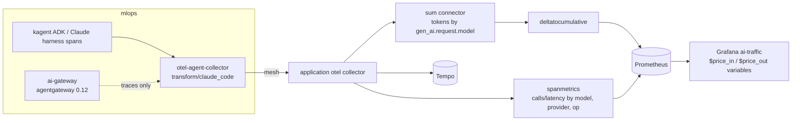

# AI Cost Management

**Status:** Proposed
**Updated:** 2026-11-22
**Scope:** Every kagent `Agent` in namespace `ai` on mlops, wherever its chart lives (this repo, `sigmahealth/agents`, future repos)
**Related:** [Agent Improvement Loop](./improvement-loop.md) · [Agent Evaluations](./agent-evaluations.md) · [Task Management](./task-framework.md) · [Roadmap](../ROADMAP.md)
**Supersedes:** `.ai/plans/ai-cost-optimizer-implementation-plan.md`
**Implementation plan:** [`.ai/plans/cost-management-plan.md`](../plans/cost-management-plan.md)

## 1. Objective

Know what every paid model call costs, which agent made it, and whether the task it served succeeded. Stop runaway spend before the invoice does. Reduce **cost per verified successful task** without lowering task quality.

The plan adds **no new service**. Cost is handled with telemetry, git-versioned config, gateway policy, admission policy, and the provider's own spend limits. Per-task cost and escalation belong to the improvement loop, which already owns task records and verification.

**Design constraint: it must work for agents that are not in this repo.** The first paid agent (`medday-developer`) is a Helm chart in `sigmahealth/agents`, and later agents may come from anywhere. So cost identity never depends on scanning this repo's chart tree. It comes from three things every agent has at runtime:

1. **`service.name` on its spans.** kagent sets it to the Agent name, and spend is grouped by it.
2. **The ModelConfig it references.** v1alpha3 requires the ModelConfig to be in the Agent's namespace, and ModelConfigs are platform-owned in this repo. An external chart can choose a model only by naming one of ours. This is the point where the platform controls pricing, routing, and credentials for every agent.
3. **Labels on the live `Agent` object.** These are enforced at admission, not checked in CI.

### Sequencing / where this fits

| Phase | Depends on | Can start |
| --- | --- | --- |
| C0 Baseline + spikes | nothing | **now** |
| C1 Price and attribute | nothing (#121 is merged) | **now** |
| C2 Guard | C0 spikes for the gateway parts; the workspace cap and alerts depend on nothing | workspace cap and alerts **now**; gateway breaker after C0 |
| C3 Select model | nothing (the scraping downgrade is one ModelConfig) | **now** |
| C4 Cost per verified success | **Improvement loop M0–M1** (execution record, OTLP export per run, independent verifier) | not before those land |
| C5 Reduce | **Improvement loop M4** (paired baseline/candidate evals) for any claim of "cheaper *without* quality loss" | trial runs are possible earlier, but there is no defensible result without M4 |

**Why start now and not after the improvement loop.** The C0 baseline needs at least 20 real tasks and there are 3. That data builds up with calendar time, not effort. The cheap, durable pieces (rate card in git, workspace spend caps, alert receiver, scraping downgrade) cost a few hours and are worth landing first, so that every task from today onward is priced, attributed and capped. When the improvement loop reaches M1, C4 then has history to compare against instead of starting from zero.

What really has to wait: C4 needs a per-run execution record with a verified outcome, and that does not exist anywhere yet. Without it, "cost per verified success" is just "cost per task". C5's savings claims need the M4 paired comparison. Before then, a cheaper model that looks fine on three tasks is an anecdote.

## 2. What we actually spend today

Measured on 2026-11-22 from `gen_ai_usage_*_tokens_total` in the application Prometheus. These counters exist only since #121, so they cover a few hours.

| Signal | Value |
| --- | --- |
| Paid consumers with traffic | **one**: `medday-developer`, chart at `sigmahealth/agents/medday-developer/chart` (Helm release `medday-developer-0.4.0`) |
| Harness / model | `sigmahealth-harness` (native kagent ADK) / `claude-opus-5-direct` (bypasses `ai-gateway`; the chart's values comment says "gateway ModelConfig" but names `-direct`) |
| Invocations / LLM calls / tool calls | 3 / 175 / 231 (~58 LLM calls per task) |
| Input tokens | 2.11M: 91% cache read, 4% cache write, 5% uncached |
| Output tokens | 42k |
| Estimated spend at $5 / $25 per MTok | ~$3.06 (~$1 per task) |
| Spend split | output 34%, cache reads 31%, cache writes 19%, uncached input 16% |

What this tells us:

- **Prompt caching already works.** 91% of input is cache reads, and cache writes average ~500 tokens per call, which is normal growth from one turn to the next. Caching is not the lever.
- **Turn count is the lever.** Each of the ~58 calls per task re-reads a ~11k-token cached prefix and adds output. To cut cost, cut calls per task or prefix size. Discounting tokens further will not help much.
- **Three tasks is too thin a baseline.** C0 needs at least 20.

Other paid paths, all low or no traffic right now:

| Path | Model | Notes |
| --- | --- | --- |
| `scraping-service-agent` | `claude-opus-4-5` direct | **Decided:** move to `claude-sonnet-5-5` (C3) |
| `solutions-architect` | repo: `claude-opus-5-gateway`; live: `llmd-vllm-config` | #121 not yet applied; it becomes the first paid agent on the gateway path |
| OpenWebUI | `/claude` → `anthropic-openai` (`ai:` backend, gateway-held key) | Tokens parsed by the gateway, but gateway metrics are not scraped (mlops has no Prometheus) |
| kagent memory | `openai-embeddings` | Small; no token telemetry |
| Laptop Claude Code | `/anthropic` passthrough with caller's own credential | **Out of scope**: not billed to the platform key, emits no `gen_ai` spans |

Every other agent (sre-team, workflow-agent, software-factory defaults, documentation, youtube, compaction summarizers) runs on the local vLLM (`llmd-vllm-config`). Their marginal cost is GPU power only.

## 3. Current cost plumbing (what #121 built)



Gaps that matter for cost:

1. **Prices live in dashboard variables.** One `$paid_model` gets one input price and one output price. The numbers are not versioned, there is no per-model rate card, and alerts cannot use them.
2. **No per-agent attribution in metrics.** The sum connector groups only by model. It supports one grouping attribute; adding a second multiplies the sum.
3. **No enforcement anywhere.** `medday-developer` goes straight to `api.anthropic.com`. Nothing limits a runaway tool loop except the org's monthly tier cap.
4. **Alerts go nowhere.** Alertmanager has no receivers configured.
5. **No link between cost and outcome.** Prometheus knows spend; nothing knows which spend produced a verified success.
6. **Nothing stops a new agent from going direct.** Any chart, in any repo, can reference `claude-opus-5-direct` and nothing records it.

## 4. Why not the optimizer-service plan

The OpenAI-drafted plan is a reasonable generic design, but it does not fit this repo:

| Plan assumption | Reality here |
| --- | --- |
| New FastAPI service + Postgres + Redis for tasks, budgets, verification and escalation | The improvement loop already designs task records, verifiers, failure classes and baseline-vs-candidate comparison (learning Postgres + n8n). A second task system would compete with it. |
| Phase 1: turn on prompt caching and gateway token metrics | Caching is already at 91% read share. Token metrics already come from agent spans (#121). Gateway metrics have nowhere to go on mlops. |
| `medday-developer` runs the Claude Code harness | It runs the native kagent ADK harness |
| Redis budget reservations with leases | One operator and roughly $1 tasks. A reservation ledger costs more to run than it protects. |
| `platform/ai/k8s/`, ExternalSecrets | Repo uses `platform/ai/kubernetes/` and SOPS/ksops |
| Router picks a tier per task | kagent already selects the model by `AgentTemplate.modelConfig`. The software-factory chart already does it per role. |

## 5. Decision

Split cost management into four concerns. Each goes where the platform already holds that responsibility. None of them reads an agent's chart.

| Concern | Owner | Mechanism |
| --- | --- | --- |
| **Price and attribute** | Observability stack | Rate card per *model* as git-versioned Prometheus recording rules. Spend grouped by `service.name` (agent) × model, both emitted at runtime. Agent → cost owner/tier comes from labels on the live `Agent`. |
| **Guard** | Provider + gateway + admission + Alertmanager | Anthropic workspace spend limit (hard monthly cap); agentgateway token rate limit keyed on Actor identity (runaway-loop breaker); `ValidatingAdmissionPolicy` that rejects paid Agents without a cost owner; budget alerts |
| **Select model** | Platform ModelConfigs + agent charts | The platform publishes tiered, gateway-routed ModelConfigs; charts pick one by name. No model switching mid-loop. |
| **Cost per verified success, escalation, experiments** | Improvement loop | Cost fields on the execution record, computed from that run's trace; escalation is a retry policy in the coordinator; savings experiments use M4 paired comparisons |

### Cost identity: `actorJwt` (default; revisitable)

The gateway must know *which agent* a request belongs to before it can rate-limit per agent. There are two options:

| | `defaultHeaders: {x-ai-budget-key: <agent>}` | **`actorJwt` (chosen)** |
| --- | --- | --- |
| Where identity is set | On the ModelConfig, which is **shared**: per-agent identity means one ModelConfig per agent per model | Minted by Substrate per Actor; one ModelConfig per model serves every agent |
| Spoofable | Yes, by any caller that can reach the gateway | No, the gateway validates the signature |
| Anthropic key location | Agent runtime env (`apiKeySecret` is read into the Actor's sandbox) | **Gateway only.** The Actor holds a 15-minute JWT and the gateway backend attaches the real key |
| Works without the gateway holding the key | Yes | No: needs a gateway-held key on the Messages path (backend `policies.auth`, as `anthropic-openai` already does) |
| Maturity | Plain CRD field | kagent 1.0.1 alpha. JWT claim layout, and whether Substrate injects for an in-cluster gateway destination, are **unverified** |

**Decision: `actorJwt`.** The multi-repo constraint settles it. `defaultHeaders` turns "every new agent" into "every new agent also needs a platform ModelConfig PR", which is exactly the coupling we are trying to avoid. `actorJwt` also removes the Anthropic key from every agent sandbox, including sandboxes running code from charts we don't review. Correction to an earlier framing: the key was never *in* external charts (they reference a ModelConfig by name, and the Secret stays in `ai`). The exposure is at runtime, inside the Actor.

**Fallback if the C0 spike fails:** gateway-routed ModelConfigs with no per-agent header, and a rate limit per *ModelConfig* (per route) instead of per agent. That is coarser, but it keeps the "one ModelConfig per model" property. Do not fall back to per-agent ModelConfigs.

**Revisit when** kagent leaves alpha, or if Substrate's egress injection ever bypasses `ai-gateway`.

### Target architecture

```mermaid
flowchart TB
  subgraph Anthropic[Anthropic Console]
    WS1[workspace: homelab-agents<br/>$150/mo]
    WS2[workspace: homelab-chat<br/>$50/mo]
  end

  subgraph mlops[mlops / ns ai]
    VAP[ValidatingAdmissionPolicy<br/>paid Agent needs cost-owner label<br/>and a gateway ModelConfig]
    AG[Agents from any repo<br/>medday-developer, scraping, architect, ...]
    MC[platform ModelConfigs *-gateway<br/>actorJwt, tier label]
    GW[ai-gateway<br/>jwtAuthentication + token rate limit per Actor<br/>backend attaches workspace key]
    SUB[local-tier subagents]
    V[vLLM local]
    VAP -. admits .-> AG
    AG --> MC --> GW
    AG --> SUB --> V
  end

  GW --> WS1
  OW[OpenWebUI /claude] --> GW --> WS2

  AG -. spans service.name=agent .-> COL[collectors<br/>ai.cost_key = agent and model]
  COL --> P[(Prometheus)]
  RC[PrometheusRule<br/>rate card + budgets + spend recording rules] --> P
  P --> G[Grafana cost panels]
  P --> AM[Alertmanager] --> N8N[n8n / notify]

  subgraph Loop[Improvement loop]
    CAP[capture workflow] -->|cost from exported OTLP| LDB[(learning Postgres<br/>executions.cost_usd)]
    VER[verifier] --> LDB
  end
  AG -. trace .-> CAP
  LDB --> G
```

Enforcement layers, from hardest to softest:

1. **Anthropic workspace spend limit.** This is the only real dollar cap. It is monthly, set in the Console, and cannot be configured through an API or GitOps. One workspace per budget domain, with its key held only by the gateway backend.
2. **Gateway token rate limit.** Tokens per hour per Actor. This catches a loop that would burn the monthly cap in an afternoon. It counts tokens, not dollars, and cache reads count in full, so thresholds come from the observed p99.
3. **Admission.** A paid Agent without a cost owner, or one pointing at a `-direct` ModelConfig, is rejected at `helm install` time, whichever repo it came from.
4. **Prometheus budget alerts.** Daily and rolling 30-day spend per agent and per cost owner. These notify only. Automatic cluster mutation is a non-goal, consistent with the improvement loop.

### Budgets

| Workspace | Monthly limit | Console threshold alerts |
| --- | --- | --- |
| `homelab-agents` | **$150** | 50%, 80% |
| `homelab-chat` | **$50** | 50%, 80% |

Rationale: observed spend is ~$1 per task, so $150 leaves room for about 150 agent tasks a month. That is high enough not to cause nuisance alerts at current volume, and low enough that a runaway loop (the observed burst rate is ~$3/hour per agent, and a loop runs unattended around the clock) is visible within a day through the Prometheus alerts, long before the cap.

**Both numbers are placeholders.** Re-baseline them once C0 has at least 20 tasks of real data. They are **alert thresholds and a provider backstop, not task-level enforcement**: hitting the workspace limit stops *every* agent in the workspace, which is the intended failure mode for a homelab but not a budgeting tool.

## 6. Tradeoff analysis

| Attribute (weight) | A: Optimizer service (OpenAI plan) | **B: Telemetry + config + policy (recommended)** | C: Gateway-centric (global rate-limit service with CEL dollar cost, ext_proc router for all traffic) |
| --- | --- | --- | --- |
| Time to value (3) | 2: weeks before first number | **5**: rate card and alerts in days | 3 |
| Operational burden (3) | 1: new service, DB, Redis, adapter to alpha kagent APIs | **5**: no new deployables | 2: rate-limit service + Redis, ext_proc, gateway on every path |
| Enforcement strength (2) | 3: soft reservations, in-flight overrun | 4: provider hard cap + gateway breaker + admission | **5**: per-request dollar-weighted limits |
| Attribution fidelity (2) | 4 | 4: agent×model in metrics, per-task via traces | 3: only what passes the gateway |
| Fit with existing plans (3) | 1: duplicates improvement loop | **5**: extends #121 and the improvement loop | 3 |
| Breaks Claude Code / ADK wire format risk (2) | 3 | 4: `ai:` backend only where verified | 1: needs body parsing on every path |
| **Weighted total (max 75)** | 32 | **69** | 42 |

**What B gives up:** there is no hard per-task dollar cap. A single task can overspend its share until either the gateway breaker trips or the workspace cap is hit. At about $1 per task, that is acceptable. If paid traffic grows 50x, revisit C's global limiter with a CEL cost expression. Its CRD support is already in agentgateway 0.12, so this is an upgrade path, not a redesign.

## 7. Phases

### C0: Baseline and spikes

- [x] Locate the `medday-developer` chart: `sigmahealth/agents/medday-developer/chart`. Its `model.configName` (currently `claude-opus-5-direct`) is the main cost knob, and it already names a platform ModelConfig.
- [ ] Capture at least 20 `medday-developer` tasks: calls per task, tokens by kind, wall time, outcome.
- [ ] **Spike (Messages backend):** point a test ModelConfig for the kagent ADK at `/anthropic-ai` (the `ai:` Messages backend). Verify tool use, streaming, `cache_control` and cache-read accounting. Claude Code failed on this backend; ADK is untested. The result decides whether C2 uses token limits (`ai:` backend) or request limits (passthrough + backend `policies.auth`).
- [ ] **Spike (`actorJwt`):** on a scratch Agent, set `actorJwt.audiences: [ai-gateway]` on a gateway ModelConfig. Confirm that Substrate injects the token for an in-cluster `ai-gateway` destination, that `ai-gateway` `jwtAuthentication` can validate it against the Substrate issuer, and **which claim names the Agent**. Record the claim for the C2 rate-limit key. On failure, take the §5 fallback.
- [ ] **Spike:** check what `compact_events` spans mean. There were 48 of them across 3 invocations, yet the average prompt (~12k) is far below the harness's 60k `tokenThreshold`.
- [ ] Reconcile one day of `gen_ai_usage_*` against Console usage. In particular, confirm that `input_tokens` includes cache tokens, as the dashboard's subtraction assumes.
- [ ] Resolve repo/live drift for `solutions-architect`.

**Exit:** a 20-task baseline exists, the token math reconciles with the Console within 5%, and both spike verdicts are recorded.

### C1: Price and attribute

- [ ] Application collector: derive `ai.cost_key = <service.name>|<gen_ai.request.model>` on spans with usage, and make it the sum connector's single grouping attribute in place of `gen_ai.request.model`. `service.name` is set by kagent from the Agent name, so this works for agents from any repo with no chart change.
- [ ] `platform/observability/kubernetes/apps/prometheus/overlays/application/rules/ai-cost.yaml`: rate card (per model), budgets (per cost owner), spend recording rules.
- [ ] Agent metadata series: `ai_agent_info{agent, cost_owner, tier, model_config}` from the **live** `Agent` objects. The preferred source is kube-state-metrics `customResourceState` on `agents.api.kagent.dev`. mlops has no Prometheus today, so this needs either a kube-state-metrics on mlops remote-writing to application or a small audit CronJob that pushes it over OTLP. Pick one in C1; both read cluster state, not a repo.
- [ ] Rebuild the `ai-traffic` cost row on `ai:spend_usd:*` recording rules, joined to `ai_agent_info` for cost-owner grouping. Remove `$paid_model`, `$price_in`, `$price_out`.
- [ ] Panels: spend by agent, by cost owner, by model; calls per invocation; cache read share per agent; unattributed tokens.

```yaml
- record: ai:model_price_usd_per_mtok
  expr: label_replace(label_replace(vector(5), "model", "claude-opus-5", "", ""), "kind", "input", "", "")
- record: ai:model_price_usd_per_mtok
  expr: label_replace(label_replace(vector(25), "model", "claude-opus-5", "", ""), "kind", "output", "", "")
- record: ai:llm_tokens:rate5m
  expr: |
    label_replace(label_replace(label_replace(
      sum by (ai_cost_key) (rate(gen_ai_usage_output_tokens_total[5m])),
      "agent", "$1", "ai_cost_key", "([^|]*)\\|.*"),
      "model", "$1", "ai_cost_key", "[^|]*\\|(.*)"),
      "kind", "output", "", "")
- record: ai:spend_usd:rate5m
  expr: |
    sum by (agent, model) (
      ai:llm_tokens:rate5m * on(model, kind) group_left ai:model_price_usd_per_mtok
    ) / 1e6
```

Kinds: `input` (uncached), `output`, `cache_read`, `cache_write_5m`, `cache_write_1h`. The snippet shows the pattern; the full file repeats it per kind and per paid model. Initial rate card rows: `claude-opus-5` $5/$25, `claude-opus-4-5` $5/$25, `claude-sonnet-5-5` $2/$10, `claude-haiku-4-5` $1/$5.

**Exit:** dashboard spend matches the Console within 5% for one day; `model="unknown"` tokens are zero; `medday-developer` shows a cost owner without any change to its chart beyond a label.

### C2: Guard

- [ ] Console: create workspaces `homelab-agents` ($150/mo) and `homelab-chat` ($50/mo) with 50%/80% threshold alerts. Mint keys and store them as SOPS secrets referenced **only by gateway backends**. Remove paid usage from the Default Workspace, which cannot be capped.
- [ ] Alertmanager receiver (n8n webhook or ntfy). No receiver exists today.
- [ ] Alerts: `AIAgentDailySpendHigh`, `AICostOwner30dBudgetExceeded`, `AISpendTelemetryMissing` (paid `chat` spans present but `ai:spend_usd` absent), `AIUnattributedTokens`, `AIAgentWithoutOwner` (an agent with spend and no `ai_agent_info`).
- [ ] Gateway ModelConfigs per paid *model* (not per agent), with `actorJwt` per the §5 decision. Move `medday-developer` from `-direct` to `claude-opus-5-gateway`; this is a one-line values change in its own repo.
- [ ] `ai-gateway`: `jwtAuthentication` for the Substrate issuer on the paid routes; backend `policies.auth` with the workspace key.
- [ ] `AgentgatewayPolicy` on the paid routes: `traffic.rateLimit.local` with `tokens` per `Hours`, keyed on the Actor claim from the C0 spike. If C0 rules out the `ai:` backend, use `requests` per `Minutes` on the passthrough instead.
- [ ] `ValidatingAdmissionPolicy` `paid-agent-cost-owner` (VAPs are already in use on mlops via Substrate): see §8.
- [ ] Retire the `-direct` ModelConfigs once nothing references them.

```yaml
apiVersion: agentgateway.dev/v1alpha1
kind: AgentgatewayPolicy
metadata:
  name: paid-llm-breaker
  namespace: ai
spec:
  targetRefs:
    - group: gateway.networking.k8s.io
      kind: HTTPRoute
      name: anthropic-messages
  traffic:
    rateLimit:
      local:
        - unit: Hours
          tokens: 5000000
          key: jwt.sub
```

`jwt.sub` is a placeholder for the claim the spike identifies. 5M tokens per hour is roughly 2.5x the observed burst.

**Exit:** a synthetic loop gets 429s from the gateway; a budget alert reaches a human; installing a paid Agent without `ai.homelab/cost-owner` is rejected; no Agent references a `-direct` ModelConfig.

### C3: Select model

- [ ] **`scraping-service-agent` → `claude-sonnet-5-5`.** Add `llm-providers/anthropic/models/claude-sonnet-5-5.yaml` (none exists; the directory has only 3-5-sonnet, 4-sonnet, opus-4-5, opus-5-direct, opus-5-gateway) and switch the AgentTemplate. The agent's job (`kubernetes/agents/scraping-service-agent.yaml:11-16`) is to take a URL, a goal and a caller-supplied JSON schema, drive Firecrawl MCP, and return strict JSON. That is structured extraction with tool use, not deep reasoning.
  - Opus 4.5 at $5/$25 → Sonnet 5.5 at $2/$10: **2.5x cheaper in both directions**, keeping 1M context (scraped pages get large) and reliable tool calling.
  - *Rejected: "Sonnet 4.5".* Prior generation. The nearest existing config is `claude-4-sonnet.yaml`, pinned to `claude-sonnet-4-20250514`, and the current-gen Sonnet 4.6 is $3/$15. Both are worse than Sonnet 5.5 on price and capability.
  - *Rejected: "GPT-4o".* No GPT-4o ModelConfig exists (only `gpt-4o-mini`). More importantly, a second paid provider means a second rate card, a second provider in attribution, and a spend limit outside Anthropic workspaces, which is extra cost plumbing for no capability gain. Keep paid agent traffic in one provider family while the cost model is being built.
  - *Not the default: Haiku 4.5* ($1/$5, 5x cheaper than Opus). Its 200K context is a real ceiling for large scrapes, and it predates adaptive thinking/`effort` (it still takes `budget_tokens`), so it behaves differently from the rest of the fleet. Trial it in C5.
  - **What makes the downgrade safe is structured outputs, not model tier.** Enforce the caller's schema with `strict: true` / structured outputs, so schema conformance is guaranteed by the API rather than by model diligence. Check whether kagent's Anthropic provider exposes it; if not, validate against the schema in the agent's final step and retry once.
- [ ] Label every ModelConfig `ai.homelab/tier: local|standard|premium` and `ai.homelab/paid: "true|false"`. The admission policy and dashboards key on these, not on model-name patterns.
- [ ] Refresh the stale `claude-sonnet-4` / `claude-3-5-sonnet` ModelConfigs, or delete them.
- [ ] `medday-developer`: delegate read-heavy exploration and log or test-output summarization to a local-tier subagent template, so the premium context grows more slowly. Constraint: one 12 GB GPU and one loaded checkpoint, shared with every compaction summarizer. The 14B-AWQ profile has a 4k context, so only small, bounded subtasks qualify. This is a change in the sigmahealth repo, proposed there.
- [ ] Software-factory: set per-role `modelConfig` defaults (architect/reviewer premium, developer standard, tester local) once the roles do real work.
- [ ] Never switch models inside a running tool loop. Switching invalidates the cached prefix and risks tool-call format mismatches.

**Exit:** scraping runs on Sonnet 5.5 with schema-valid output; every ModelConfig carries tier and paid labels.

### C4: Cost per verified success (depends on improvement loop M0–M1)

- [ ] Add to the improvement-loop execution contract: `usage.{input,output,cache_read,cache_write}_tokens`, `cost_usd`, `rate_card_version`, `cost_owner`.
- [ ] In `agent-learning-capture`, sum `gen_ai.usage.*` across the exported OTLP session (already fetched for scoring) and price it with the same rate card. Do not query Prometheus per task.
- [ ] Grafana panel on learning Postgres: `sum(cost_usd) / count(verified passed)` per agent, per model, per week.

**Exit:** each verified execution row carries its cost, and cost per verified success is charted.

### C5: Reduce (each item runs as an improvement-loop M4 paired experiment)

Ordered by expected value given the C0 spend split:

1. Fewer turns: skill changes that batch tool calls and trim tool output for `medday-developer`.
2. Sonnet 5.5 arm vs Opus 5 arm on the frozen medday task set.
3. Haiku 4.5 arm vs Sonnet 5.5 arm for `scraping-service-agent`, including the largest fixture pages to test the 200K ceiling.
4. `cacheTTL: 1h` vs `5m` (write premium 2x vs 1.25x), worth it only if turns are often more than 5 minutes apart (long `pnpm` runs).
5. Compaction threshold, depending on the C0 spike.
6. Escalation policy (standard first, premium retry only after a verified model-addressable failure), implemented in the n8n coordinator as a retry rule.

**Exit:** at least one change ships with lower cost per verified success and no drop in verified success rate.

## 8. Fitness functions

Split by what can see what. **CI in this repo cannot see agent charts in other repos**, so it only covers what the platform owns. The cluster-side checks are the honest answer for out-of-repo agents, because they apply to whatever actually gets installed.

| Check | Where | Covers | Cannot cover |
| --- | --- | --- | --- |
| Every Anthropic/OpenAI ModelConfig `spec.model` has `input`, `output`, `cache_read` prices in `ai-cost.yaml` | CI, this repo, over `llm-providers/**/models/*.yaml` | Every ModelConfig, since ModelConfigs are platform-owned | A ModelConfig created by an external chart (prevented at admission, see below) |
| Every ModelConfig carries `ai.homelab/tier` and `ai.homelab/paid` | CI, this repo | Same | Same |
| Paid ModelConfigs route through `ai-gateway` (or are on a reasoned allowlist) | CI, this repo | Whether a gateway path *exists* for each paid model | Whether any given agent *uses* it; that is chosen in the agent's own repo |
| **`paid-agent-cost-owner`**: an `AgentTemplate`/`Agent` whose ModelConfig has `ai.homelab/paid=true` must carry `ai.homelab/cost-owner`, and must not reference a ModelConfig labeled `ai.homelab/route=direct` | `ValidatingAdmissionPolicy` in `ai` (mlops) | **Every agent from every repo**, at install/upgrade time | Agents created before the policy existed (the audit catches them) |
| No ModelConfig is created outside this repo's Kustomize/Argo source | `ValidatingAdmissionPolicy`: ModelConfig writes only from the platform deploy identity | Prevents an external chart from bringing its own paid ModelConfig and key | Break-glass manual `kubectl` by an admin |
| `AIAgentWithoutOwner`: spend from a `service.name` with no `ai_agent_info` series | Prometheus alert (recurring audit) | Anything that spends without being registered, including pre-policy agents and non-kagent callers | Callers that emit no `gen_ai` spans (laptop Claude Code, by design) |
| `AIUnattributedTokens`: `ai:llm_tokens:rate5m{model="unknown"}` > 0 for 15m | Prometheus | Telemetry regressions in any harness | Same |
| `AISpendTelemetryMissing`: paid `chat` spanmetrics present, spend series absent | Prometheus | Rate-card gaps for new models | Same |

Cross-object CEL note: a VAP cannot directly read the referenced ModelConfig's labels from the Agent's admission request. Use `paramKind` with the ModelConfig list, or move the rule to the paid ModelConfig names via a param ConfigMap that CI generates from this repo's ModelConfigs. Confirm in C2; this is the least-proven piece of the enforcement design.

## 9. Non-goals

- A cost-optimizer service, task API, or budget-reservation ledger.
- Per-task hard dollar caps.
- Request-level model routing for agent traffic. `apps/ai/jev-routing` (undeployed classifier ext_proc) remains a candidate for OpenAI-compatible chat traffic only.
- Semantic or exact response caching. The tree advises against it for long-context conversations (`tree/infrastructure/kubernetes/ai/agent-runtime/17-agent-rate-limiting-cost-control.md`, §4.3).
- A second paid provider on agent paths while the cost model is being built.
- Laptop Claude Code spend.
- GPU power cost for the local tier.
- CI checks against external agent repos.

## 10. Decisions and open questions

Resolved 2026-11-22:

1. **Chart location:** `sigmahealth/agents/medday-developer/chart`. Scope widened to all agents from any repo (§1 constraint, §8, §11).
2. **Budgets:** `homelab-agents` $150/mo, `homelab-chat` $50/mo; placeholders to re-baseline after C0 (§5).
3. **Scraping model:** `claude-sonnet-5-5` (C3).
4. **Cost identity:** `actorJwt`, with a per-route fallback (§5). Revisitable.

Still open, each owned by a phase:

1. Does the kagent ADK work against the `ai:` Messages backend? (C0 spike)
2. Does Substrate's `actorJwt` reach an in-cluster gateway, and which claim names the Agent? (C0 spike)
3. How do Agent labels get into Prometheus on the application cluster: kube-state-metrics on mlops or an audit CronJob? (C1)
4. How does the admission policy see the referenced ModelConfig's labels? (C2)

## 11. Onboarding a new paid agent

The minimum any agent must do, from any repo, to show up correctly in cost attribution and pass admission:

1. **Reference a platform gateway ModelConfig by name**, e.g. `modelConfig.name: claude-sonnet-5-5-gateway`. Do not ship a ModelConfig or an API key Secret in your chart; admission rejects both.
2. **Label the `Agent` and `AgentTemplate`** with `ai.homelab/cost-owner: <owner>` (e.g. `homelab`, `sigmahealth`). Admission rejects a paid agent without it.
3. **Keep kagent's default `service.name`.** Don't override `OTEL_SERVICE_NAME` in the Harness; spend is grouped by it. If you need a different display name, use a resource attribute, not `service.name`.
4. **Keep default telemetry on.** Don't disable the harness's trace export; an agent with spend and no spans trips `AISpendTelemetryMissing`.
5. **Nothing else.** Pricing, rate limits, workspace caps and dashboards come from the platform. A new *model* (not a new agent) needs a platform PR: ModelConfig + rate-card row + tier/paid labels, which CI checks.

To verify after install: the agent appears on the `ai-traffic` "spend by agent" and "spend by cost owner" panels after its first paid call, and `AIAgentWithoutOwner` stays quiet.
