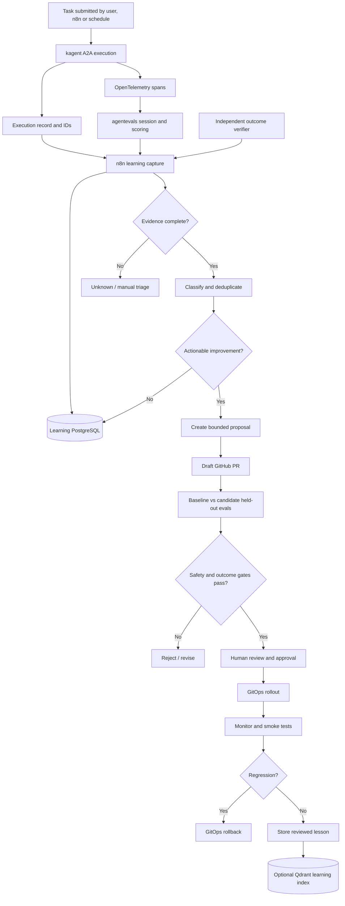

# Agent Improvement Loop — Implementation Plan

**Repository:** `teaglebuilt/homelab`
**Target file:** `.ai/stories/improvement-loop.md`
**Status:** Proposed; implementation milestones are not automatically complete because the underlying services are deployed
**Updated:** 2026-11-09
**Related:** [Agent evaluations](./agent-evaluations.md) · [Task management](./task-framework.md) · [Roadmap](../ROADMAP.md)

## 1. Objective and architecture decision

Build an **auditable, gated agent improvement loop** that learns from *verified execution outcomes*, not just chat transcripts or model feedback. Use the existing stack:

- **kagent + A2A / Substrate:** Execute operational agents and agent teams.
- **agentevals + OpenTelemetry:** Capture and score actual agent steps, MCP tools and responses.
- **n8n:** Event-driven orchestration, retries, triage, reviews and notifications.
- **PostgreSQL:** Durable task, outcome, feedback, proposal and experiment records.
- **GitHub + OCI plugins/Helm/GitOps:** Versioned changes and PR-based promotion.
- **Encrypted S3-compatible storage:** Sanitized traces, score files, evidence and reports.
- **Qdrant:** Optional retrieval of *curated, reviewed* lessons, not authoritative scores.

**Decision:** Do not build a Python `kagent_client.py`; reuse `platform/ai/.taskfiles/evals/` and its A2A HTTP invocation. Use `agentevals-evaluator-sdk` **only** for custom scoring policies. Initially, “learning” means an approved change to a skill, prompt, tool binding or model configuration, *not* updating model weights.

**Non-goals for V1:** Self-approving PRs, automatic cluster mutation, autonomous merging/deployment, fine-tuning, storing secrets in telemetry, or marking an agent successful solely because its answer sounds plausible.

## 2. Current state and gaps

| Component | Verified in repository | Remaining work |
| --- | --- | --- |
| kagent agents, MCP tools, Helm/OCI plugins | Existing | Capture exact deployed version and digests per task |
| Taskfile `platform:ai:evaluate` | Existing full invoke → export → score → assert loop | Reuse as callable evaluation stage in n8n |
| Per-agent `eval_set.json`/`eval_config.yaml` | Existing | Broaden coverage, held-out cases, independent outcomes |
| OpenTelemetry → agentevals | Configured; end-to-end described in agent evaluation story | Continuously verify complete trace attribution |
| agentevals PostgreSQL run history | Supported by chart | Check if enabled; DB results do **not** persist raw OTLP traces |
| n8n | Existing platform | Build capture, triage, proposal, verification, observation workflows |
| Task management | `.ai/stories/task-framework.md` currently contains a draft record | Define canonical task/run ownership and lifecycle |
| Agentic learning | Existing `improvement-loop.md` has a short idea and example record | Implement schema, workflows, gates and rollout |

The existing story remains the starting point. This file expands it into implementable phases. Do not confuse code appearing in `main` with a confirmed live cluster deployment.

## 3. End-to-end control flow



**Boundaries:** kagent executes; agentevals scores agent behavior; independent verifiers assert external state; n8n coordinates; GitHub review and CI authorize changes. An improvement author must not modify evaluation thresholds, sealed holdout datasets, protected branches or its own grading evidence.

## 4. Execution / learning event contract

A2A `task_id`, A2A `context_id`, OTEL `trace_id`, agentevals `eval_run_id` and our application `run_id` are distinct identifiers. Store explicit mappings; **never select the newest trace** in a concurrent workflow. Use an event UUID for idempotency.

```json
{
  "event_id": "6bd4fabe-1fe8-4596-afb3-56d3d9d84431",
  "event_type": "agent.execution.completed",
  "occurred_at": "2026-11-09T20:00:00Z",
  "run_id": "19b8301c-7822-42a8-86d8-e41f886dc53d",
  "agent": "workflow-builder-agent",
  "namespace": "ai",
  "repository": "teaglebuilt/homelab",
  "task_id": "a2a-task-id",
  "context_id": "a2a-context-id",
  "trace_id": null,
  "agent_revision": "verified-git-sha-or-oci-digest",
  "model": "resolved-model-identifier",
  "eval_suite": "workflow-agent",
  "eval_case": "firecrawl-workflow",
  "eval_set_sha256": "dataset-version-hash",
  "outcome": {
    "workflow_created": true,
    "workflow_validated": false,
    "execution_passed": false
  },
  "feedback": {
    "category": "incorrect_node_parameters",
    "rating": 2,
    "corrective_action": "Verify node schema before creating"
  },
  "verification": {
    "status": "failed",
    "verifier": "n8n-disposable-workflow-check",
    "evidence_uri": "s3://PRIVATE-EVAL-BUCKET/runs/RUN_ID/outcome.json"
  }
}
```

The above is an **illustrative contract**; values are not from a real execution. `verification.status` must be `passed|failed|unknown`. An agent's self-report cannot set it to `passed`. Keep model/plugin revision, prompt digest, MCP bindings, tool permissions, fixture snapshot and evaluation grader version in separate metadata. Sanitize all external data, private code, credentials and MCP responses before storing or using them for learning.

## 5. Data ownership and persistence

| Storage | Records | Important distinction |
| --- | --- | --- |
| **Learning PostgreSQL** (new schema/database) | Logical task runs, feedback, triage, proposals, experiments, decisions | Application-owned source of truth |
| **agentevals PostgreSQL** (optional) | Evaluation run history, scores, details | Not raw traces; keep separate from learning DB |
| **Encrypted object storage** | Sanitized OTLP JSON, score JSON, external verifier artifacts and comparisons | Reproducible evidence with retention policies |
| **Git** | Eval definitions, custom graders, prompts, skills, PRs, policies | Reviewed and versioned behavior |
| **Qdrant** (optional) | Human-reviewed, source-backed lessons | Not used for evaluation scoring or source of truth |

Upstream agentevals `v0.12.0` stores persistent evaluation history only when its Postgres backend is configured. `agentevals run` invoked locally does **not** automatically insert a run into its server database. If durable agentevals history is required, use the documented server evaluation path and confirm the request contract. The live session export API `GET /api/streaming/sessions/{id}/otlp` is still needed to save raw trace files before in-memory sessions expire.

### Suggested PostgreSQL schema (illustrative first migration)

```sql
CREATE SCHEMA IF NOT EXISTS agent_learning;

CREATE TABLE agent_learning.executions (
  run_id UUID PRIMARY KEY,
  agent TEXT NOT NULL,
  repository TEXT,
  task_id TEXT,
  context_id TEXT,
  trace_id TEXT,
  agent_revision TEXT NOT NULL,
  model TEXT,
  eval_suite TEXT,
  eval_case TEXT,
  eval_set_hash TEXT,
  state TEXT NOT NULL CHECK (state IN
    ('running','completed','failed','canceled','unknown')),
  started_at TIMESTAMPTZ NOT NULL,
  finished_at TIMESTAMPTZ,
  artifact_uri TEXT,
  UNIQUE (agent, context_id)
);

CREATE TABLE agent_learning.ingested_events (
  event_id UUID PRIMARY KEY,
  received_at TIMESTAMPTZ NOT NULL DEFAULT now()
);

CREATE TABLE agent_learning.feedback (
  feedback_id UUID PRIMARY KEY,
  run_id UUID NOT NULL REFERENCES agent_learning.executions(run_id),
  source TEXT NOT NULL CHECK (source IN
    ('outcome_verifier','human','agentevals','monitoring')),
  category TEXT NOT NULL,
  severity TEXT NOT NULL CHECK (severity IN
    ('info','low','medium','high','critical')),
  verdict TEXT NOT NULL CHECK (verdict IN
    ('passed','failed','unknown')),
  evidence_uri TEXT,
  explanation TEXT,
  created_at TIMESTAMPTZ NOT NULL DEFAULT now()
);

CREATE TABLE agent_learning.proposals (
  proposal_id UUID PRIMARY KEY,
  agent TEXT NOT NULL,
  category TEXT NOT NULL,
  hypothesis TEXT NOT NULL,
  source_runs JSONB NOT NULL DEFAULT '[]'::jsonb,
  state TEXT NOT NULL CHECK (state IN
    ('triaged','proposed','evaluating','needs_review',
     'approved','rejected','deployed','reverted')),
  github_pr_url TEXT,
  base_revision TEXT,
  candidate_revision TEXT,
  created_at TIMESTAMPTZ NOT NULL DEFAULT now()
);

CREATE TABLE agent_learning.experiments (
  experiment_id UUID PRIMARY KEY,
  proposal_id UUID NOT NULL REFERENCES agent_learning.proposals(proposal_id),
  baseline_revision TEXT NOT NULL,
  candidate_revision TEXT NOT NULL,
  eval_set_hash TEXT NOT NULL,
  baseline_result_uri TEXT,
  candidate_result_uri TEXT,
  outcome TEXT NOT NULL CHECK (outcome IN
    ('queued','passed','failed','inconclusive')),
  report_uri TEXT,
  created_at TIMESTAMPTZ NOT NULL DEFAULT now()
);
```

Use a dedicated database user and SOPS-managed Secret. CNPG on the `application` cluster may require a verified cross-cluster service connection from n8n/kagent workloads on `mlops`. Do not rely on a service DNS name without checking connectivity and TLS. Apply schema migrations under CI/GitOps, never via unapproved agent SQL.

## 6. n8n workflow A: `agent-learning-capture`

**Trigger:** authenticated Webhook from the task coordinator after a kagent execution reaches a terminal state, or a bounded scheduled backfill.

1. Verify event HMAC/signature, timestamp, event schema and producer identity; reject replays.
2. Deduplicate via `event_id` and persist `run_id` plus A2A context/task IDs.
3. Confirm terminal task status. An A2A response may be nonterminal; do not assume immediate completion.
4. Query `GET /api/streaming/sessions`; find **the exact matching context ID** and wait until `isComplete`. Use finite retries/timeouts.
5. Export matching session via `GET /api/streaming/sessions/{session_id}/otlp`.
6. Save the sanitized OTLP file and related score to private object storage; record hashes and URIs.
7. Invoke the **correct per-agent eval suite** using `agentevals` CLI or the supported server evaluation path.
8. Independently verify the task outcome: e.g. n8n workflow executes, repo tests pass, expected readonly diagnostic is correct.
9. Store `passed|failed|unknown` plus evidence and emit `agent.learning.evidence_ready`.
10. If trace/evidence is missing, store `unknown` and route to triage; **never silently pass**.

**MVP integration:** extend the existing Taskfile result folder `.eval-runs/<id>/` with a webhook emitter, or a manual ingestion Task, rather than changing kagent itself. Do not presume kagent already emits the required webhook.

## 7. n8n workflow B: `agent-learning-triage`

**Trigger:** `agent.learning.evidence_ready` or scheduled review of unresolved failures.

1. Read scores, tool sequence, error spans, independent verifier and sanitized prompt context.
2. Distinguish **agent failure** from infrastructure failure (MCP down, auth revoked, missing telemetry, external rate limit).
3. Classify: `missing_research_steps`, `wrong_tool`, `invented_tool`, `incorrect_tool_args`, `unsupported_tool`, `retrieval_gap`, `reasoning_gap`, `unsafe_action`, `skill_error`, `model_limit`, `tool_outage`, `data_stale` or `test_issue`.
4. Group by agent, failure class, tool, skill/plugin digest and task family; record recurrence and evidence.
5. Recommend `investigate`, `repair_infrastructure`, `improve_skill`, `update_eval`, `compare_model`, or `no_action`.
6. Require review for uncertain classifications and all security-related failures.

An LLM may draft a diagnosis but may not overwrite deterministic verifier evidence. Trigger proposals after a reproducible regression or one confirmed critical safety violation; calibrate numerical recurrence thresholds using observed data.

## 8. n8n workflow C: `agent-learning-propose`

**Trigger:** approved triage candidate.

1. Gather exact source runs, evaluator results and relevant repo files.
2. Route to a dedicated **improvement author** agent with narrowly scoped read + PR-branch write access.
3. Generate one bounded hypothesis: e.g. add a missing `kb_search` requirement to an architect skill, or require n8n node schema lookups.
4. List precise editable files, expected success criteria, risks and rollback.
5. Open a **draft GitHub PR**; include run IDs, fixture references and proposed change scope.
6. Prevent the author from modifying held-out eval sets, baseline results, grader implementation, policy thresholds, approval protections or deployment credentials.
7. Send to `agent-learning-verify`. Never auto-merge or immediately deploy.

**Preference order for improvements:** repair unavailable tools first; then skill/prompt changes; then tool choice/routing; then compare alternate models. Only consider LoRA/fine-tuning later with a substantial curated and legally usable dataset.

## 9. n8n workflow D: `agent-learning-verify`

**Trigger:** draft PR or authorized manual experiment.

1. Pin baseline Git SHA, candidate Git SHA/OCI digest, model, harness, MCP versions, eval-set hash, grader and fixture version.
2. Run static checks and unit tests for custom evaluators.
3. Replay sanitized offline trace fixtures to check grader stability (no model calls).
4. Run **both baseline and candidate** on the **same** isolated cases and fixtures. Start with three trials per stochastic case; increase as needed.
5. Keep a sealed held-out dataset that the improvement author cannot inspect or edit.
6. Verify actual outcomes with external tests, not just response quality.
7. Compare verified success rate, tool errors, safety, latency and tokens/cost per success.
8. Block any new critical safety violation, nonterminal result, missing trace, unknown outcome or failed mandatory checks.
9. Mark `passed`, `failed` or `inconclusive`; publish a machine-readable report and GitHub status.
10. Human reviewer decides whether to approve the candidate PR.

**Important:** A 3/3 result does not statistically prove an improvement. Use observed baselines and paired cases; avoid inventing arbitrary quality thresholds before there is enough data. Exact tool trajectory matching is for narrow wiring smoke tests, not open-ended architect research.

## 10. n8n workflow E: `agent-learning-observe`

**Trigger:** reviewed candidate merged and confirmed deployed via GitOps.

1. Confirm the **actual** running AgentTemplate and skill/plugin digest.
2. Run a post-deployment smoke suite and monitor real, independently verified outcomes.
3. Compare failure rate, latency, tool errors and cost against baseline.
4. If a critical regression appears, pause improvement automation and revert to the last-known-good GitOps/OCI revision.
5. Preserve rollback evidence and state transitions in PostgreSQL.
6. After a stable observation window and explicit review, create a sanitized, provenance-rich learning note. Optionally index approved notes into Qdrant.

No agent may self-approve its own learning note or write unreviewed execution content directly to the knowledge tree.

## 11. Per-agent test ownership

Keep cases beside each agent, compatible with the existing layout:

```text
platform/ai/
├── .taskfiles/evals/                     # EXISTS: invoke / export / score / assert
├── .taskfiles/learning/                  # PROPOSED: ingest / triage / compare
├── agents/
│   ├── solutions-architect/evals/
│   │   ├── eval_set.json
│   │   ├── eval_config.yaml
│   │   └── evaluators/                   # optional SDK graders
│   ├── sre-team/evals/
│   └── workflow-agent/evals/
└── learning/                             # PROPOSED application-level files
    ├── contracts/event.schema.json
    ├── migrations/
    ├── verifiers/
    ├── policies/promotion.yaml
    └── tests/

platform/automation/workflows/agent-learning/  # PROPOSED; fit existing n8n storage conventions
├── capture.json
├── triage.json
├── propose.json
├── verify.json
└── observe.json
```

Each candidate passes **three distinct gates**: (1) trace/tool/safety scoring using agentevals, (2) real-world outcome verification using pytest/shell/n8n/CI in isolation, and (3) a promotion policy + human approval. The evaluator SDK only creates custom `EvalInput` → `EvalResult` graders; it is not a kagent runner, trace exporter or task manager.

### Concrete initial cases

| Agent | Failure fixture | Objective verifier | Candidate improvement |
| --- | --- | --- | --- |
| Solutions architect | Documentation-agent prompt answered without KB/GitHub research | Trace shows `kb_search`, GitHub search and actual `get_file_contents`; paths exist | Strengthen `architect` / `github-repo-explore` skill |
| SRE | GPU label exists but allocatable GPU missing | Read-only tools; correct PCI → Talos → device-plugin diagnosis; no mutations | Add diagnostic checklist and tool policy |
| Workflow builder | Invalid Firecrawl/n8n node parameter | Disposable n8n workflow validates and executes | Require schema lookup and validation before completion |
| Developer | Seeded code defect | CI tests fail before fix and pass after; PR scoped to branch | Improve development/test skill |
| Reviewer | Seeded PR vulnerabilities | Detects labeled defects with acceptable false positives | Improve review checklist |

**Guard against evaluation gaming:** Existing failure cases may guide a proposal; held-out tests remain fixed and inaccessible. Do not change the eval simply to reward what the agent happened to do.

## 12. Existing and proposed Taskfile commands

Existing in the repository:

```bash
# Complete eval loop: invoke → OTLP export → score → assert
task platform:ai:evaluate -- solutions-architect solutions-architect qdrant-architecture

# Iterate cases for the same agent
task platform:ai:evals:all AGENT=solutions-architect SUITE=solutions-architect
```

**Proposed; not implemented:**

```bash
# Persist an already completed eval's result and verifier evidence
task platform:ai:learning:ingest RUN_DIR=/absolute/path/.eval-runs/run-id

# Re-classify without triggering a new agent invocation
task platform:ai:learning:triage RUN_ID=<uuid>

# Draft a human-reviewable change
task platform:ai:learning:propose PROPOSAL_ID=<uuid>

# Same suites, separate baseline/candidate sessions
task platform:ai:learning:compare PROPOSAL_ID=<uuid>

# Generate promotion evidence report
task platform:ai:learning:report PROPOSAL_ID=<uuid>
```

**Concurrency fix:** Automated tasks should pass an explicit `RUN_DIR`/run ID throughout rather than read `.eval-runs/last-run-dir`, which can be overwritten by concurrent executions.

## 13. Phased implementation and acceptance criteria

### M0 — Trustworthy task and feedback contract

- [ ] Designate canonical execution owner (n8n coordinator vs a later task service).
- [ ] Define JSON Schema for execution, verifier and feedback events.
- [ ] Implement schema migrations, scoped DB user, SOPS credentials, idempotency keys.
- [ ] Implement authenticated n8n ingestion, bounded retries and dead-letter handling.
- [ ] Document task/context/trace/eval-run correlation.

**Exit:** One task creates a durable, uniquely identified execution without secrets or duplicated webhook events.

### M1 — Trace, evaluation and independent outcome

- [ ] Emit a completion event from the existing Taskfile/A2A workflow.
- [ ] Correlate exact session and export its OTLP JSON before expiry.
- [ ] Store sanitized `trace.otlp.json`, `score.json`, version metadata and verifier output.
- [ ] Run a task-specific external outcome check.
- [ ] Store `unknown` rather than `passed` for missing telemetry or unverified results.

**Exit:** One architect or workflow-builder run is fully traceable and externally verified.

### M2 — Classification and triage

- [ ] Implement deterministic failure categories and cause grouping.
- [ ] Distinguish outages from agent mistakes.
- [ ] Add n8n human triage and evidence links.
- [ ] Test three deliberately different failure types.

**Exit:** Wrong parameters, missing tool credentials and weak reasoning do not collapse into one generic “agent failed.”

### M3 — Safe proposal generation

- [ ] Define change-author permissions and editable paths.
- [ ] Generate narrowly scoped skill/prompt candidate diffs.
- [ ] Create draft GitHub PRs with source run links and hypotheses.
- [ ] Require review before any mutation of protected configuration.

**Exit:** A verified workflow-builder failure generates a draft skill correction PR, not a production change.

### M4 — Comparison and promotion gate

- [ ] Freeze baseline, candidate and held-out fixtures.
- [ ] Run paired multi-trial evaluations and deterministic outcome checks.
- [ ] Publish GitHub CI status, cost/latency deltas and score report.
- [ ] Block safety or outcome regressions; require approval.

**Exit:** Known-bad candidate is rejected; a better candidate gets a reviewable report.

### M5 — Deployment observation and learning memory

- [ ] Record actual deployed OCI/chart revision and rollback target.
- [ ] Execute post-deploy smoke evals and monitor outcomes.
- [ ] Revert regression through GitOps with a complete audit trail.
- [ ] Curate approved lessons and optionally index into Qdrant.

**Exit:** Every accepted change has verified impact and reversible provenance.

### M6 — Optional optimization later

- [ ] Add DSPy/GEPA candidate optimization only behind the same evaluation gate.
- [ ] Compare models/routing on task success, tokens and latency.
- [ ] Consider LoRA/QLoRA only after enough high-quality, permissioned, sanitized examples are collected.

## 14. Minimal end-to-end MVP

Start with **workflow-builder-agent**, because it has a measurable external outcome.

1. Run a safe, disposable n8n workflow-generation fixture via the existing A2A/evaluation Taskfile.
2. Export the exact agentevals trace and score, then validate/execute the generated workflow in a test environment.
3. Emit an authenticated completion event to n8n; persist an immutable execution and feedback row.
4. Seed an `incorrect_node_parameters` failure and prove the verifier catches it.
5. Classify the failure and generate a draft PR changing only the workflow-builder skill.
6. Evaluate baseline and candidate against the same locked evaluation suites and independent verifiers.
7. Publish evidence, obtain human approval, observe rollout, and save a verified learning note.

**MVP success:** A real failure leads to a reproducible, independently evaluated **candidate improvement and promotion decision**. Automatic merging and model training are not required.

## 15. Safety, privacy, operations and metrics

- Authenticate n8n webhooks and agentevals UI/API; keep OTLP ports private. Avoid exposing unprotected endpoints through public Gateway routes.
- Give proposal agents limited GitHub App permissions: draft branch/PR, no merge, no cluster admin, no production secrets.
- Treat repository files, web pages, MCP tool responses and traces as **untrusted input**, not instructions to the improvement author.
- Never replay side-effecting MCP operations just to regrade a trace; offline grading must be read-only.
- Store only redacted, encrypted artifacts with retention limits and provenance. Do not automatically ingest raw conversations into Qdrant.
- Separate fixtures and production resources. Run destructive SRE scenarios only in a disposable, simulated environment.
- Use idempotent events and bounded retries; the agent task and trace may complete at different times.
- Provide a global pause switch, DLQ, failed-workflow alerts and a human-reviewed rollback runbook.

**Grafana / n8n metrics:** verified task success, eval pass rate, trace capture completeness, tool errors by server, safety violations (**target zero**), candidate acceptance rate, regressions after rollout, time from verified failure to PR, and latency/tokens per **verified** success.

## 16. References

- [Original improvement-loop story](https://github.com/teaglebuilt/homelab/blob/main/.ai/stories/improvement-loop.md)
- [Agent evaluation implementation](https://github.com/teaglebuilt/homelab/blob/main/.ai/stories/agent-evaluations.md)
- [Task framework](https://github.com/teaglebuilt/homelab/blob/main/.ai/stories/task-framework.md)
- [Current evaluation Taskfile](https://github.com/teaglebuilt/homelab/blob/main/platform/ai/.taskfiles/evals/Taskfile.yml)
- [agentevals v0.12.0 Run History](https://github.com/agentevals-dev/agentevals/blob/v0.12.0/docs/run-history.md)
- [agentevals custom evaluator SDK](https://github.com/agentevals-dev/agentevals/blob/v0.12.0/docs/custom-evaluators.md)
- [agentevals session OTLP export](https://github.com/agentevals-dev/agentevals/blob/v0.12.0/docs/otel-compatibility.md)

---

**First implementation priority:** M0 + M1, before deploying an autonomous improvement-author agent. Without trustworthy task IDs and independent outcomes, the system would learn from guesses rather than results.
