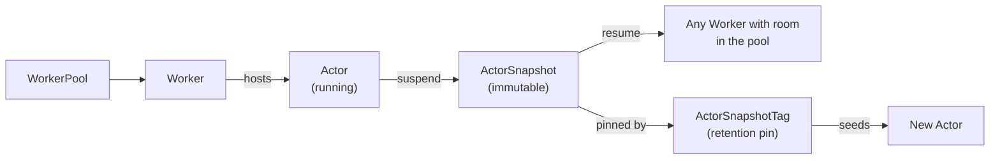

# Agent Substrate architecture

The [kagent architecture](https://kagent.dev/docs/kagent/1.x/about/architecture/kagent/) page established that every Session runs on an Actor. This page explains what an Actor is built from and what it runs on. It covers the ActorTemplate that it is created from, the compute that hosts it, the atespace that identifies it, the sandbox that isolates it, and the snapshot cycle that lets it suspend when idle and resume on demand.

## ActorTemplate

An **ActorTemplate** is the definition that Agent Substrate creates an Actor from. It states the agent's container image, the command that starts the agent, the agent's environment, the sandbox class to isolate it with, and the WorkerPool to schedule it onto. The kagent controller compiles an Agent and the resources that it names into an ActorTemplate.

Agent Substrate rejects any change to an ActorTemplate's spec after it is created, so a running Session stays on a fixed definition. The controller creates a new ActorTemplate for every compiled revision instead of editing an existing one, and it reclaims an old ActorTemplate once nothing references its revision. An Agent references one for as long as the revision is its desired or its latest successful one, and a Session references one for as long as it runs on that revision.

## Workers and WorkerPools

Each Actor runs on a **Worker**, a pod that Agent Substrate starts in advance. A Session that needs an Actor gets one on a Worker that is already running, so no Actor waits for a new pod. The sandbox boundary sits around the Actor, not around the Worker pod that hosts it.

### WorkerPools

Workers come from a **WorkerPool**, a Kubernetes custom resource that an operator provisions before any Agent can compile. A WorkerPool declares how many Workers to keep running and which sandbox technology those Workers use.

An operator never creates a Worker directly. Agent Substrate manages them and keeps enough ready in each WorkerPool for an Actor to start or resume immediately.

A WorkerPool exposes a Kubernetes scale subresource, so a HorizontalPodAutoscaler can size a pool from a metric instead of a fixed replica count. Agent Substrate publishes how many Workers in each pool have no free Actor slot. An autoscaler that watches this number adds Workers before the pool fills, instead of after placements fail.

### Worker capacity

One Worker hosts many Actors at the same time. Each Worker reports its maximum Actor capacity when it starts. A Worker at that capacity refuses further Actors, and Agent Substrate places them on another Worker in the pool. The Worker's Actor capacity is a property of the Worker build, not a setting on the pool. The gVisor and micro-VM Workers that Agent Substrate ships both report a capacity of 1000 Actors.

### Actor placement

Agent Substrate checks two things before it places an Actor on a Worker:

- Whether the Worker has a free Actor slot. This check always runs.
- Whether the Worker has enough spare CPU and memory. This check runs only when the ActorTemplate states how much CPU and memory one Actor needs.

Every ActorTemplate that the kagent controller compiles states a CPU and memory limit for one Actor, so both checks run for a Session's Actor. The `config.runtimeDefaults.cpu` and `config.runtimeDefaults.memory` Helm values set this limit for every agent, and default to `1` CPU and `1Gi` of memory.

The CPU and memory check compares that limit against the capacity that the Worker reports. A WorkerPool sets no resource limits on its Workers by default, and a Worker with no limits reports its whole node as its own capacity. The check then ignores every other pod on the node, so node pressure surfaces as eviction rather than as a placement failure. To make the check reflect the Worker, [set resource limits on Workers](https://kagent.dev/docs/kagent/1.x/operations/tune-agent-substrate#set-resource-requests-on-workers).

Agent Substrate first narrows the pool to the Workers that can take the Actor. It then picks two of those Workers at random and places the Actor on the less loaded of the two. A Worker's load is the higher of two shares: the share of its Actor slots that are filled, and the share of its CPU and memory that is committed. Sampling two Workers keeps the decision cheap, and it avoids the pile-up that follows when every placement aims at the Worker that looks emptiest.

## Atespaces

An **atespace** is the isolation boundary that an Actor belongs to, and the first half of its identity. Agent Substrate addresses an Actor by its atespace and its name together, so the same Actor name can exist in two atespaces without colliding.

An atespace resembles a Kubernetes namespace, but it is not one. Agent Substrate defines it as its own cluster-wide resource. No namespace contains it, a namespace's RBAC does not reach it, and deleting a Kubernetes namespace does not delete the atespace that kagent named after it.

Actors and Workers sit differently against this boundary. An Actor belongs to exactly one atespace for its entire life, whereas a Worker belongs to none. A Worker hosts whichever Actors Agent Substrate places on it, and those Actors can come from different atespaces.

kagent names each atespace after the Kubernetes namespace of the Agent that owns the Actor, and creates the atespace the first time a Session in that namespace needs an Actor. The Actor's own name is `session-` followed by the Session's identifier. A Session on an Agent in the `kagent` namespace therefore runs on an Actor in the `kagent` atespace. Both halves of this identity appear in the address that traffic uses to reach the Actor, which [Sandboxing](https://kagent.dev/docs/kagent/1.x/about/substrate-runtime/sandboxing#how-traffic-reaches-a-sandboxed-actor) covers.

## Sandboxing

Because an Actor often runs a model-directed agent that calls tools and executes commands, Agent Substrate runs each Actor in an isolated sandbox rather than a plain container. A WorkerPool's `sandboxClass` field selects the sandbox technology for its Workers: [gVisor](https://gvisor.dev), or a micro-VM that runs the workload under [Cloud Hypervisor](https://www.cloudhypervisor.org) with a [Kata Containers](https://katacontainers.io) kernel and root image. Both technologies isolate an Actor from its Worker's host kernel, and both support suspend and resume operations.

kagent compiles each ActorTemplate to the sandbox class of the WorkerPool that hosts it, so a default installation runs kagent agents in a gVisor sandbox, and a pool on the `microvm` class runs them under the micro-VM. A WorkerPool that backs kagent Harnesses must run the Worker build that matches its class. For what each class isolates, see [Sandboxing](https://kagent.dev/docs/kagent/1.x/about/substrate-runtime/sandboxing/).

## Suspend, snapshot, and resume

An Actor spends most of its time idle, waiting on a person or a large language model (LLM) to respond. Agent Substrate suspends an idle Actor, reclaims the capacity that it held, and resumes the Actor when traffic arrives. A WorkerPool can therefore run far more Actors than it has room for at any one moment.

The following diagram traces an Actor through one suspend-and-resume cycle, and shows the second path that opens up once the resulting snapshot is tagged.



A **WorkerPool** keeps **Workers** running and ready, and a Worker hosts the **Actor** alongside other Actors while its Session is active. Suspending this Actor writes its durable data to an immutable **ActorSnapshot** and releases the capacity that it held on its Worker.

The diagram forks at this snapshot, because a snapshot serves two purposes.

- **Resume** restores the same Actor onto **any Worker in the pool with room**, which is not necessarily the Worker that it ran on before. Agent Substrate starts new containers for the Actor and restores the durable data from the snapshot. The conversation continues from where it left off. Every idle agent takes this path.
- A **Tag** pins this snapshot so that Agent Substrate does not collect it. To fork a Session from a checkpoint, kagent seeds a **New Actor** from that tag. Resuming an existing Actor never goes through a tag.

A tag gives a snapshot a stable name, so callers do not track Agent Substrate's internal snapshot identity. The tag names one snapshot permanently, and only its visibility scope can change afterward. A tag is also a retention pin, so Agent Substrate does not delete a snapshot while a tag still names it.

For example, an agent partway through a long incident investigation reaches a state worth keeping. Creating a [checkpoint](https://kagent.dev/docs/kagent/1.x/about/substrate-runtime/suspend-and-resume#checkpoints) tags the snapshot that the agent most recently suspended to, which holds that one snapshot in place while the agent carries on and writes newer ones. Without the tag, Agent Substrate collects this snapshot once a newer one supersedes it.

## Tune Agent Substrate

kagent runs every agent on [Agent Substrate](https://kagent.dev/docs/kagent/1.x/about/architecture/agent-substrate/). A default installation creates one WorkerPool named `kagent-default`, holding a single Worker on the `gvisor` sandbox class, and it writes snapshots to the object store that the Agent Substrate chart bundles.

This single Worker reports capacity for 1000 Actors, so a default pool serves many concurrent Sessions before it runs out of slots. Three settings still need tuning before the installation takes real traffic: how many Workers to run, where snapshots are stored durably, and what resource requests the Worker pods set. This page covers each setting, and the steps for moving a pool to the `microvm` sandbox class.

## Before you begin

1. [Install kagent](https://kagent.dev/docs/kagent/1.x/setup/installation/), and confirm that your installation sets `config.server.grpcReflection=true`. Reflection lets a gRPC client discover the controller's methods without a local copy of kagent's protocol buffer definitions.
2. Confirm that you have administrative access to the cluster, because this guide scales WorkerPools and reads cluster-scoped resources.
3. Install [grpcurl](https://github.com/fullstorydev/grpcurl). No kubectl or kagent command covers `GetSubstrateStatus`. Calling it directly is the only way to see the full runtime state.

## Inspect the runtime

Read the current state of the runtime before you change it. The rest of this guide uses three values from this section: the pool name and its `READY` count, the snapshot path that Actors are writing to, and the Worker image that the pool runs.

1. Check the WorkerPool's Worker counts. These counts show whether the pool is producing the Workers that you asked for.

   ```bash
   kubectl get workerpools -n kagent
   ```

   Example output:

   ```console
   NAME             DESIRED   REPLICAS   READY   AGE
   kagent-default   8         8          8       3h
   ```

   `DESIRED` is the replica count that you asked for, `REPLICAS` counts the Worker pods that exist, and `READY` counts the pods that are serving. A gap between `DESIRED` and `REPLICAS` means the controller is not creating pods. A gap between `REPLICAS` and `READY` means the pods exist but are not starting. Raising the replica count helps only when all three counts agree.
2. Port-forward the controller, and leave the command running in a second terminal.

   ```bash
   kubectl port-forward -n kagent svc/kagent-controller 8083:8083
   ```
3. Call `GetSubstrateStatus`, which joins the WorkerPools, ActorTemplates, Actors, and Workers that kagent knows about into one response.

   ```bash
   grpcurl -plaintext -d '{"namespace":"kagent"}' \
     localhost:8083 kagent.api.v1.SystemService/GetSubstrateStatus
   ```

   Example output, abbreviated to one Worker and one Actor:

   ```json
   {
     "enabled": true,
     "workerPools": [
       {
         "namespace": "kagent",
         "name": "kagent-default",
         "replicas": 8,
         "ateomImage": "ghcr.io/kagent-dev/substrate/ateom-gvisor:v0.6.0-alpha3"
       }
     ],
     "actors": [
       {
         "actorId": "792f8f90-72a9-49e8-b720-cb3b96fd9a8b",
         "atespace": "ate-golden",
         "status": "Suspended",
         "actorTemplateName": "assistant-kagent-2a786e2db23a",
         "latestSnapshot": "s3://ate-snapshots/kagent/atespaces/ate-golden/actors/2d921676-80ad-48d3-8c2a-4059ef74da33/snapshots/503a07e3-ec49-433c-abdf-b2bb3cb36d5d"
       }
     ],
     "workers": [
       {
         "workerNamespace": "kagent",
         "workerPool": "kagent-default",
         "workerPod": "kagent-default-787547df77-4kvqf",
         "ip": "10.244.0.104"
       }
     ]
   }
   ```

A Worker entry gains an `actorId` only while an Actor occupies it, so the Workers list also shows which capacity is busy.

## Size a WorkerPool

The replica count is the only capacity dial on a pool, and setting it well depends on knowing what actually consumes a Worker.

A Worker hosts many Actors at the same time, and it holds each one only while a turn is running. kagent suspends an Actor at every turn boundary and frees the Actor's share of its Worker, as described in [Suspend and resume](https://kagent.dev/docs/kagent/1.x/about/substrate-runtime/suspend-and-resume/). An idle Session therefore occupies no Worker capacity at all.

Each Worker reports an Actor capacity when it starts, fixed by the Worker build rather than by a field on the WorkerPool. The gVisor and micro-VM Workers that Agent Substrate ships both report a capacity of 1000 Actors, and no setting raises or lowers it.

Agent Substrate checks this capacity on every placement. It weighs a Worker's spare CPU and memory only when the ActorTemplate states how much CPU and memory one Actor needs. An ActorTemplate that the kagent controller compiles does not state per-Actor CPU or memory, so a pool places a Session's Actor on a Worker's available slots alone, regardless of how loaded the Worker's node already is. Worker resource limits still matter, because they govern how Kubernetes packs Workers onto nodes.

Size the pool for the number of turns that run at the same time, not for the number of Agents or Sessions that you have created. A cluster with hundreds of Sessions that are each used occasionally needs far fewer Workers than the session count suggests.

Scale a pool in place with the standard Kubernetes scale command, because the WorkerPool exposes a scale subresource. Use the pool name that you read in [Inspect the runtime](#inspect-the-runtime).

```bash
kubectl scale workerpool kagent-default -n kagent --replicas=8
```

To change these settings in your Helm values instead, run an upgrade of your kagent installation with the following settings:

```yaml
substrateWorkerPool:
  replicas: 8
```

### Recognize an undersized pool

Agent Substrate reports pool capacity through its metrics rather than through an error that reaches the caller. Each Worker publishes a state of `idle`, `partial`, `at_capacity`, or `unschedulable`, which together show how much of a pool is in use. A placement that does not find a suitable Worker records a `no_capacity` outcome. Agent Substrate treats this outcome as a normal result rather than a failure. It does not set an error type, and it does not raise an alert on its own. Watch the share of Workers at `at_capacity` and the rate of `no_capacity` placements to tell a pool that is merely busy from one that is too small.

None of those signals reach the caller. A turn that cannot get a Worker waits for one, and a turn that waits too long fails with a generic timeout that names neither capacity nor the pool.

```console
ERROR:
  Code: Internal
  Message: actor "ai-01a087c0-1d72-775a-9a32-566acac7b685" request timed out
```

Because short turns release their capacity quickly, a pool under mild pressure absorbs the load and only sheds the requests that wait past the deadline. The result is intermittent timeouts under concurrency rather than a clean failure. Neither the kagent controller log nor the Agent Substrate API log records a capacity message when this happens, so confirm the diagnosis from the `at_capacity` and `no_capacity` signals and from the pool's `READY` count. If the pool is under pressure, raise the replica count.

### Set resource requests on Workers

Generated Worker pods do not set resource requests or limits unless you supply them, and the effect on scheduling is easy to miss.

A Worker with no limits reports its node's entire allocatable capacity as its own. Every Worker on that node reports the same figures, so Agent Substrate cannot use resource capacity to place Actors, and Kubernetes cannot stop you from packing more Workers onto a node than it can carry. Set requests and limits on any pool that carries production traffic.

```yaml
substrateWorkerPool:
  template:
    resources:
      requests:
        cpu: 500m
        memory: 1Gi
      limits:
        cpu: "2"
        memory: 4Gi
```

The same `template` block also accepts `nodeSelector`, `tolerations`, `priorityClassName`, and `nodeAffinity`, so you can keep Workers on nodes that you set aside for them.

### Give Workers their own ServiceAccount

Worker pods run as a ServiceAccount that the chart creates, named after the pool. On a default install that name is `kagent-default`. The chart binds no Role or ClusterRole to the account. Its purpose is to keep Workers off the namespace's `default` ServiceAccount, and to give you a Worker identity that you can attach your own policy to, such as an IAM role or an admission rule.

To run Workers as an account that you manage outside the chart, stop the chart from creating one and name your own account instead. That account must already exist in the release namespace, because neither the chart nor Kubernetes creates it on demand.

```yaml
substrateWorkerPool:
  serviceAccount:
    create: false
    name: my-worker-sa
```

| Field | Description |
| --- | --- |
| `substrateWorkerPool.serviceAccount.create` | Whether the chart creates the Worker ServiceAccount. Defaults to `true`. Set it to `false` to use an account that you manage yourself. |
| `substrateWorkerPool.serviceAccount.name` | The ServiceAccount that Worker pods run as. Omit it to use the pool name. |

The chart writes `serviceAccountName` into the pool's pod template. A `serviceAccountName` that you set under `substrateWorkerPool.template` is overwritten rather than merged. Set the account through `substrateWorkerPool.serviceAccount.name`.

### Keep placement scoped to the pool's namespace

kagent selects a WorkerPool by name and namespace when it compiles an ActorTemplate, and the generated ActorTemplate matches Workers on the `kagent.dev/worker-pool-name` and `kagent.dev/worker-pool-namespace` labels. Agent Substrate matches those labels across every pool rather than checking the WorkerPool's namespace. A pool that sets only the name label can therefore be selected from another namespace.

The chart sets both labels from the pool's name and namespace, and applies them after `substrateWorkerPool.labels`. An extra label that reuses either key is overwritten rather than honored.

```yaml
substrateWorkerPool:
  name: kagent-default
  labels:
    environment: production
```

kagent does not label a pool that you manage outside the chart. Set both keys yourself, and match each value to the pool's name and namespace.

```yaml
apiVersion: ate.dev/v1alpha1
kind: WorkerPool
metadata:
  name: external-pool
  namespace: team-a
  labels:
    kagent.dev/worker-pool-name: external-pool
    kagent.dev/worker-pool-namespace: team-a
spec:
  replicas: 2
  workerImage: "ghcr.io/kagent-dev/substrate/ateom-gvisor:v0.6.0-alpha3"
```

Earlier releases placed Actors with a single `kagent.dev/worker-pool` label, and the chart no longer sets it. A Session or Sandbox that is pinned to a revision from one of those releases still selects that key. Keep the old label on the pool until you recreate them.

```yaml
substrateWorkerPool:
  labels:
    kagent.dev/worker-pool: kagent-default
```

## Configure snapshot storage

Agent Substrate writes every suspended Actor to an object store, so the bucket stores the Session state that a resume restores. Two places decide where a snapshot lands:

- In the Agent Substrate Helm values, `atelet.storageBackend` selects the storage client and `rustfs.enabled` decides whether the chart supplies credentials for it. These two values cover both the components that write snapshots and the ones that manage them.
- In each Harness, `spec.substrate.snapshotPolicy.location`, names the bucket and prefix that its Actors write under. The field is required, and it must point into a bucket that the selected client can reach.

### The bundled object store

Because `rustfs.enabled` defaults to `true`, the Agent Substrate chart installs an in-cluster object store and points the `atelet` DaemonSet and the `ate-api-server` Deployment at it. The store claims a 1Gi PersistentVolumeClaim, and it accepts an access key and secret key that the chart sets to published defaults.

> [!IMPORTANT]
> The bundled store is not durable. Its credentials are shared defaults that every installation receives. Snapshots store agent Session state, so [move a production installation to your own bucket](#move-snapshots-to-an-external-bucket) before it carries real traffic.

### Move snapshots to an external bucket

1. Turn the bundled store off and select the backend in your Agent Substrate Helm values. Setting `atelet.storageBackend` to `s3` selects the S3 client, and setting it to `gcs` selects Google Cloud Storage. Agent Substrate matches only the `s3` value. Every other value, an empty one included, selects Google Cloud Storage.

   ```yaml
   rustfs:
     enabled: false
   atelet:
     storageBackend: s3
   ```
2. Supply the credentials that your backend needs. Setting `rustfs.enabled` to `false` stops the chart from setting the `AWS_*` variables, so neither component receives an endpoint or a key from Helm. Each storage client reads its credentials from the pod's own environment instead.

   - For Google Cloud Storage, the client uses application default credentials. Bind the components' ServiceAccounts through [Workload Identity Federation for GKE](https://docs.cloud.google.com/kubernetes-engine/docs/concepts/workload-identity). The chart does not render a Helm value for Google credentials. Set nothing further.
   - For Amazon S3, the client reads the standard AWS environment and uses a role that the pod assumes. No static key is needed.
   - For an S3-compatible store, pass two variables and the static credentials through `objectStorePlugin.extraEnv`. `AWS_ENDPOINT_URL` names the store's API endpoint, which the client otherwise resolves to Amazon S3. `AWS_S3_USE_PATH_STYLE` puts the bucket name in the request path instead of the hostname, which most S3-compatible stores require. The chart applies this list to the storage client in both the `atelet` and `ate-api-server` pods.

   ```yaml
   objectStorePlugin:
     extraEnv:
       - name: AWS_ENDPOINT_URL
         value: https://objects.example.com
       - name: AWS_S3_USE_PATH_STYLE
         value: "true"
   ```

   Do not set these variables through `atelet.extraEnv`. That list reaches the `atelet` container, which no longer reads storage settings.
3. Point each Harness at the new bucket.

   ```yaml
   spec:
     substrate:
       workerPoolRef:
         name: kagent-default
       snapshotPolicy:
         location: s3://ate-snapshots/kagent/
   ```
4. Run a turn on an agent, suspend its Actor, and compare the `latestSnapshot` path [in the response](#inspect-the-runtime) against the `location` that you set. Because the backend and the location are configured separately, a mismatch between them breaks resuming an Actor from its snapshot later.

### How the chart reaches the components

The `atelet` DaemonSet writes a snapshot, and the `ate-api-server` Deployment manages the snapshot. Each pod reaches the bucket through an `objectstore-plugin` sidecar container, and only that container reads the storage variables. The chart renders `atelet.storageBackend` as the `ATE_STORAGE_BACKEND` variable on both sidecars, so one Helm value keeps the two in agreement. The `atelet` and `ate-api-server` containers fail to start when `ATE_STORAGE_BACKEND` is set on them directly.

Reading these variables off the `objectstore-plugin` container helps when a snapshot fails to write. Edit the Helm values rather than the pod environment because the next Helm upgrade overwrites a direct edit.

| Variable | Purpose |
| --- | --- |
| `ATE_STORAGE_BACKEND` | `s3` selects the S3 client. Any other value, including unset, selects Google Cloud Storage. |
| `AWS_REGION` | Region for the S3 client. |
| `AWS_ENDPOINT_URL` | Endpoint for an S3-compatible store that is not Amazon S3. |
| `AWS_S3_USE_PATH_STYLE` | `true` selects path-style addressing, which most S3-compatible stores need. |
| `AWS_ACCESS_KEY_ID`, `AWS_SECRET_ACCESS_KEY` | Static credentials for the S3 client. |

### Snapshot layout in the bucket

Agent Substrate builds a path per Actor under the Harness prefix, so one bucket serves many Harnesses without collision. The `<actor-uid>` segment is the Actor's `metadata.uid`, not the `actorId` that `GetSubstrateStatus` reports. Both values are UUIDs. Read `latestSnapshot` off the Actor rather than matching a path to an Actor by eye.

```console
s3://ate-snapshots/kagent/atespaces/<atespace>/actors/<actor-uid>/snapshots/<snapshot-uid>
```

A checkpoint uses a different path. kagent creates an Agent Substrate Tag for each checkpoint, and tagging copies the Actor's snapshot into the Tag's own prefix. A Tag names exactly one snapshot, so its objects sit directly under `tags/` with no `snapshots/` segment. The `<tag-uid>` segment is the Tag's `metadata.uid`, so nothing in the path records the `checkpoint-<id>` name that kagent gave the Tag.

```console
s3://ate-snapshots/kagent/atespaces/<atespace>/tags/<tag-uid>
```

A backup or lifecycle policy must cover both prefixes, because one scoped to `actors/` omits every checkpoint and understates how much the bucket stores.

## Keep pools on the sandbox class they serve

kagent configures the sandbox class for you. A default installation runs the `gvisor` class, and every ActorTemplate that kagent generates inherits the class of the pool that hosts it. Edit this setting only to move a pool to the `microvm` class or to change a pool's Worker build. For what each class isolates, see [Sandboxing](https://kagent.dev/docs/kagent/1.x/about/substrate-runtime/sandboxing#sandbox-classes).

One rule governs the change. A pool's class, its Worker image, and the cluster's SandboxConfig must all name the same sandbox class, and Agent Substrate rejects the Actor rather than falling back when they disagree.

### Set a pool's sandbox class

1. Set the class and the matching Worker build in your kagent Helm values.

   You can choose from the following options.

   **Option: gvisor**

   ```yaml
   substrateWorkerPool:
     sandboxClass: gvisor
     workerImage: "ghcr.io/kagent-dev/substrate/ateom-gvisor:v0.6.0-alpha3"
   ```

   **Option: microvm**

   ```yaml
   substrateWorkerPool:
     sandboxClass: microvm
     workerImage: "ghcr.io/kagent-dev/substrate/ateom-microvm:v0.6.0-alpha3"
   ```

   | Field | Description |
| --- | --- |
| `sandboxClass` | The sandbox runtime family for this pool's Workers, and for every ActorTemplate that kagent generates for the pool. Omitting the field selects `gvisor`. |
| `workerImage` | The Worker build that provides the runtime. `ateom-gvisor` serves the `gvisor` class and `ateom-microvm` serves `microvm`. A build that does not match its pool's class never registers a Worker. |
2. Confirm that the cluster has a SandboxConfig for this class. kagent names the configuration directly rather than resolving a default, so a `gvisor` pool needs a config named `gvisor-default` and a `microvm` pool needs a config named `microvm`.

   ```bash
   kubectl get sandboxconfigs
   ```

   Example output:

   ```console
   NAME             CLASS    AGE
   gvisor-default   gvisor   26h
   microvm          microvm  26h
   ```

   A default installation creates only the `gvisor` class, because the Agent Substrate chart applies `sandboxconfig-gvisor.yaml` and kagent installs nothing for `microvm`. The `microvm` configuration and its runtime assets are staged out of band by the Agent Substrate installer, such as through `hack/install-microvm-deps.sh --install`.
3. Verify that the pool's Workers came up on the build that you set. The `ateomImage` field in the [runtime response](#inspect-the-runtime) reports the image that each Worker is running, which the WorkerPool resource calls `workerImage`. Compare the two, and confirm in the output that the pool reports its full replica count as ready.

   ```bash
   kubectl get workerpools -n kagent
   ```

### Diagnose a class mismatch

Each of the three settings fails differently when it disagrees with the others.

- A Worker whose pool class does not match an ActorTemplate's class reports `RevisionInvalid` with `unsupported sandbox class "<value>"`, and placement of this Actor fails with `WorkerPoolNotFound`.
- A missing SandboxConfig fails template preparation with `SandboxConfig "<name>" not found`.
- A Worker image built for another class never registers, so the pool reports fewer ready Workers than its replica count.

### Considerations before changing a running pool

Two constraints apply to a pool that already serves traffic.

- **Snapshots do not move between sandbox classes.** An Actor cannot resume from a snapshot that a different class produced, so changing the class of a pool that holds live Actors strands their state.
- **Nodes fetch sandbox runtime assets from a public Google Cloud Storage URL**, named in the SandboxConfig, independently of the storage backend that you configured for snapshots. A cluster with restricted egress needs a path to this URL, or a SandboxConfig that points at a copy you host.

Replacing `workerImage` rolls the Worker pods through the generated Deployment. The pods take a one-hour termination grace period, so an in-flight turn finishes rather than being cut off, and a rollout of a busy pool takes as long as its longest running turn.
