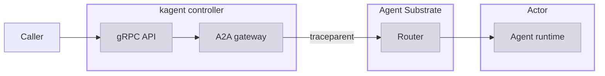

# Telemetry

## Metrics

kagent and Agent Substrate report metrics in two different ways. The kagent controller serves a Prometheus `/metrics` endpoint that Prometheus scrapes. Agent runtimes and Agent Substrate push metrics over the OpenTelemetry Protocol (OTLP) to a collector, which serves them for Prometheus to scrape. Both collection paths are off by default. The [OTel stack](https://kagent.dev/docs/kagent/1.x/observability/otel-stack/) and [Lightweight OTel stack](https://kagent.dev/docs/kagent/1.x/observability/lightweight-otel-stack/) guides turn on both collection paths and set up Prometheus to collect them.

## kagent controller metrics

### Enable the metrics endpoint

The controller serves its metrics over HTTPS, and accepts a scrape only from a ServiceAccount that holds the `<fullname>-metrics-reader` ClusterRole. Enabling the endpoint creates a dedicated metrics Service and that ClusterRole.

```yaml
controller:
  metrics:
    enabled: true
config:
  metrics:
    bindAddress: ":8443"
    secure: true
```

These two sections divide the listener from its Kubernetes packaging. `config.metrics` sets the address that the controller binds and whether it serves over HTTPS. `controller.metrics` creates the Service, the ClusterRoles, and the optional ServiceMonitor. Setting `controller.metrics.enabled` to `false` overrides `config.metrics.bindAddress` with `0`, which disables the listener as well. Change the port through `config.metrics.bindAddress`, because the chart derives the Service `targetPort` and the pod `containerPort` from it at template time.

Grant your Prometheus instance access in one of the following ways.

- **With the Prometheus Operator**: Set `controller.metrics.serviceMonitor.enabled` to `true`. The chart creates a ServiceMonitor for the metrics Service. Also set `controller.metrics.serviceMonitor.prometheusServiceAccount.name` and `.namespace` to the ServiceAccount that Prometheus runs as, and the chart binds the metrics reader ClusterRole to it. The chart renders the ServiceMonitor only when the cluster serves the `monitoring.coreos.com/v1` API. For an example, see [OTel stack](https://kagent.dev/docs/kagent/1.x/observability/otel-stack#send-kagent-telemetry-to-the-collector).
- **Without the Prometheus Operator**: Bind the `<fullname>-metrics-reader` ClusterRole to the Prometheus ServiceAccount yourself, and add a scrape job for the `<fullname>-controller-metrics` Service on port `8443`. The job must use HTTPS, send the ServiceAccount token, and skip verification of the controller's self-signed certificate. For an example, see [Lightweight OTel stack](https://kagent.dev/docs/kagent/1.x/observability/lightweight-otel-stack#install-prometheus).

### Metric reference

Besides the standard Go runtime and process metrics, the controller reports the following metrics.

| Metric | Type | Measures |
| --- | --- | --- |
| `kagent_grpc_server_requests_total` | Counter | Requests to the controller's gRPC API, by `method`, `code`, and `rpc_type`. The `method` label names the full gRPC method, such as `/kagent.api.v1alpha1.SessionService/CreateSession`. |
| `kagent_grpc_server_request_duration_seconds` | Histogram | Latency of requests to the controller's gRPC API, with the same labels. |
| `controller_runtime_reconcile_total`, `controller_runtime_reconcile_errors_total`, `controller_runtime_reconcile_time_seconds` | Counter, counter, histogram | Reconciliations of kagent resources, by controller, and how long each one takes. A rising error count means that the controller cannot bring a resource to its desired state. |
| `workqueue_depth`, `workqueue_queue_duration_seconds`, `workqueue_retries_total` | Gauge, histogram, counter | Work waiting for a reconciler, how long it waits, and how often it is retried. |
| `leader_election_master_status` | Gauge | `1` on the controller replica that holds the leader lease. With several replicas, exactly one reports `1`. |
| `rest_client_requests_total` | Counter | Requests from the controller to the Kubernetes API server, by status code. |
| `kagent_runtime_revision_gc_pending` | Gauge | Runtime revisions that the last successful discovery found eligible for cleanup. The controller reports a cached count, so a scrape does not make a database or network call. The metric is absent until a discovery succeeds, and `0` reports a discovery that matched nothing. A failed discovery holds the previous value rather than clearing it. |
| `kagent_runtime_revision_gc_duration_seconds` | Histogram | Time that one revision cleanup attempt takes, by the `kagent_gc_stage` label: `discovery` or `collection`. A `collection` attempt covers the database claim, the Agent Substrate read and deletion, and the database finalization. A failed attempt carries an `error_type` label holding a gRPC status code name, or `_OTHER` for every other failure, so the series that carry the label give both the failure rate and the reason. |

The Agent Substrate `atecontroller` component reports the same `controller_runtime_*` and `workqueue_*` metrics for its own reconcilers. To keep the two apart in a query, filter by the scrape job, such as `job="kagent-controller-metrics"` in the OTel stack.

## Agent runtime metrics

When the kagent Helm release sets an endpoint in `config.runtimeDefaults.telemetry.metrics`, agent runtimes export metrics over OTLP. A runtime reports the histogram in this section only when kagent's own A2A wrapper opens the `invoke_agent` span for it. For the runtimes that open that span themselves, both stack guides derive the metric from the spans instead. The stack guides convert these OpenTelemetry metrics to Prometheus names in the collector.

| Metric | Type | Measures |
| --- | --- | --- |
| `gen_ai_invoke_agent_duration_seconds` | Histogram | Time that one `invoke_agent` execution segment takes. The `claude`, `codex`, `langgraph`, `crewai`, and `byo` runtimes record it themselves, because kagent's wrapper opens their `invoke_agent` span and measures it. The `kagent`, `adk-python`, and `openai-agents` runtimes open that span in their own instrumentation, so the wrapper stays a transport span and records no duration. Both stack guides add a `signal_to_metrics` connector that derives the metric from those spans before any sampling in the collector. Between the two paths, every runtime reports the metric, except a `byo` image that is not built on `kagent-core` and opens no `invoke_agent` span of its own. |

The metric carries labels for the Agent name, model, and error type when those values exist. When the collector copies resource attributes to labels, the metric also carries labels such as `service_name`, `service_namespace`, `service_version`, `kagent_runtime`, and `gen_ai_main_agent_id`.

## Agent Substrate metrics

### Export the metrics

Agent Substrate exports metrics over OTLP when its Helm release has an OTLP endpoint. The same setting also turns on Agent Substrate traces and logs.

```bash
helm upgrade substrate \
  oci://ghcr.io/kagent-dev/substrate/helm/substrate \
  --version 0.4.0-alpha1 \
  --namespace ate-system \
  --reuse-values \
  --set otel.endpoint=http://otel-collector.telemetry.svc.cluster.local:4317
```

To send metrics somewhere other than traces and logs, set `otel.metrics.endpoint` instead. To stop exporting metrics while keeping the other signals, leave `otel.endpoint` empty, and set `otel.traces.endpoint` and `otel.logs.endpoint` instead. Setting `otel.metrics.enabled` to `false` is not enough in version 0.5.0-alpha2, because only the router's agentgateway reads it, and the other Agent Substrate components keep exporting. Agent Substrate exports a batch of metrics every 60 seconds, so a new installation shows its first values about a minute after you set the endpoint.

### Metric reference

The collector's Prometheus exporter converts each OpenTelemetry metric name to a Prometheus name. The exporter replaces dots with underscores, and adds a unit suffix, such as `_seconds` or `_bytes`, and a `_total` suffix for counters. The following table lists the Prometheus names. Every metric also carries a `service_name` label for the Agent Substrate component that reported it, when the collector copies resource attributes to labels, as both stack guides configure.

| Metric | Reported by | Type | Measures |
| --- | --- | --- | --- |
| `ate_workerpool_desired_workers` | `atecontroller` | Gauge | Worker pods that a WorkerPool requests, from its `spec.replicas`. |
| `ate_workerpool_ready_workers` | `atecontroller` | Gauge | Worker pods that are ready in a WorkerPool. A value below `ate_workerpool_desired_workers` means that the pool cannot run as many Actors as it should. |
| `ate_workerpool_workers` | `ateapi` | Gauge | Live Workers per pool, split by the `ate_worker_state` label into `idle` and `assigned`. Few idle Workers means that new and resumed Actors are about to wait for capacity. |
| `ate_scheduler_assignment_duration_seconds` | `ateapi` | Histogram | Time to assign an Actor to a Worker, by the `ate_scheduler_outcome` label: `assigned`, `no_free_worker`, or `error`. |
| `ate_scheduler_eligible_workers` | `ateapi` | Histogram | Unassigned Workers that could take an Actor at scheduling time. |
| `ate_actor_lifecycle_operation_duration_seconds` | `ateapi` | Histogram | Time that each Actor operation takes, by the `ate_actor_operation_name` label, such as `create`, `resume`, and `suspend`. A failed operation carries an `error_type` label. |
| `ate_actor_restore_duration_seconds` | `atelet` | Histogram | Time for each phase of restoring an Actor from a snapshot on its Worker's node, by the `ate_snapshot_phase` label, such as `download`, `oci_unpack`, and `ateom_restore`. This is where most of the time to resume an Actor goes. |
| `ate_actor_checkpoint_duration_seconds` | `atelet` | Histogram | Time for each phase of writing a snapshot when an Actor suspends. |
| `atelet_snapshot_size_bytes` | `atelet` | Histogram | Uncompressed size of each snapshot. |
| `ate_imagecache_requests_total` | `atelet` | Counter | Lookups in the node-local image cache, by the `ate_imagecache_outcome` label. A cache miss pays for pulling and unpacking the image, so a low hit ratio predicts slow resumes. |
| `ate_actor_stats_cpu_time_seconds_total` | `atelet` | Counter | CPU time of the Actors that run on a node, by template. Use `rate()` to find the templates that use a node's CPU. |
| `ate_actor_stats_memory_usage_bytes` | `atelet` | Gauge | Memory of the Actors that run on a node, by template, including page cache that the node can reclaim. |
| `ate_actor_stats_memory_working_set_bytes` | `atelet` | Gauge | Working set memory of the Actors that run on a node, by template, without reclaimable page cache. Compare this value with a memory limit. |
| `ate_actor_stats_sampled_actors` | `atelet` | Gauge | Actors on a node that have a current resource measurement. Divide the other `ate_actor_stats_*` metrics by this value to get a per-Actor average for a template. |
| `ate_actor_crashes_total` | `ateapi` | Counter | Actors that moved to the terminal crashed state, by failure reason. The metric appears only after the first crash. |
| `rpc_server_call_duration_seconds`, `rpc_client_call_duration_seconds` | `ateapi`, `atelet` | Histogram | Latency, rate, and errors of the gRPC calls between Agent Substrate components. |

## Example queries

Run the following queries in Prometheus or Grafana.

- Ready Workers compared with desired Workers, per WorkerPool.

  ```text
  ate_workerpool_ready_workers / ate_workerpool_desired_workers
  ```
- The 95th percentile time to resume an Actor, per phase.

  ```text
  histogram_quantile(0.95, sum by (le, ate_snapshot_phase) (rate(ate_actor_restore_duration_seconds_bucket[5m])))
  ```
- The rate of requests to the kagent gRPC API, by method.

  ```text
  sum by (method) (rate(kagent_grpc_server_requests_total[5m]))
  ```
- The rate of failed reconciliations in the kagent controller, by reconciler. The query uses the job name from the OTel stack. In the lightweight stack, the job is `kagent-controller`.

  ```text
  sum by (controller) (rate(controller_runtime_reconcile_errors_total{job="kagent-controller-metrics"}[5m]))
  ```
- The 95th percentile agent invocation duration, per Agent. Because both stack guides configure the collector to derive the metric, the query covers every runtime that opens an `invoke_agent` span.

  ```text
  histogram_quantile(0.95, sum by (le, gen_ai_agent_name) (rate(gen_ai_invoke_agent_duration_seconds_bucket[5m])))
  ```

## Next steps

[OTel stack](https://kagent.dev/docs/kagent/1.x/observability/otel-stack/)

Collect traces, logs, and metrics in Grafana.

[Tune Agent Substrate](https://kagent.dev/docs/kagent/1.x/operations/tune-agent-substrate/)

Size WorkerPools and adjust the runtime settings that these metrics measure.

## Tracing

A trace records one agent request as a tree of timed spans, so you can see where a slow or failed request spent its time and which model and tool calls it made along the way. In kagent 1.0 a single request crosses the controller, the Agent Substrate router, and the Actor that runs the agent, and one trace ties all three together.

## About trace coverage

A trace follows a W3C Trace Context header that the controller passes along with each request. The following diagram shows the path of one request, from the caller to the agent runtime.



A caller reaches the gRPC API on the kagent controller, which starts the trace. The controller hands the request to its A2A gateway, which opens an A2A (Agent-to-Agent) connection to the Session's Actor and injects a `traceparent` header into that call. The Agent Substrate router forwards the call to the Worker that runs the Actor, and adds its own spans to the trace. The agent runtime inside the Actor reads the header and continues the same trace, so the model and tool spans it produces hang off the controller's spans rather than starting a trace of their own.

Each hop sends its spans under a separate OpenTelemetry (OTel) service name. A tracing backend groups the spans by those names.

- **The controller** reports as `kagent-controller` in the `kagent` service namespace. Its spans also carry the pod, node, and namespace that the controller runs on.
- **The Agent Substrate router** runs the agentgateway proxy, and reports as `agentgateway`.
- **Each agent runtime** reports as its own service, named for the Agent it was compiled from. The `my-first-agent` Agent reports as `my-first-agent`. In kagent 0.x, every agent reported under a single `kagent` service. A backend that you filter by service now lists one entry for each Agent, so the list grows as you add Agents.

### Harness coverage

The controller passes its tracing configuration to every harness, and adds the collector to the Actor's egress allowlist. Which spans a harness then sends depends on its own instrumentation. For the available harnesses, see [Choose a harness](https://kagent.dev/docs/kagent/1.x/agents/agent-harness#choose-a-harness). For how the allowlist is built, see [Egress control](https://kagent.dev/docs/kagent/1.x/about/substrate-runtime/networking-and-egress#policy-generation).

| Harness | What the trace shows |
| --- | --- |
| `kagent` | The runtime's spans. The span names on this page describe this runtime. |
| `codex` and `claude` | The runtime's spans, from their own instrumentation. The span names differ from the ones on this page. |
| `byo` | Spans only if the image implements OTel and reads the standard exporter variables. An image without OTel instrumentation leaves its half of the trace missing. A Harness `spec.env` entry overrides the controller's value for a variable of the same name, but an endpoint that you set this way is not added to the egress allowlist, so the image cannot reach it. |

### Spans

The `kagent` runtime creates the same spans for every agent, and most span names describe the operation rather than the agent. The `invoke_agent` span is the exception, because its name carries the name of the agent that ran. To narrow a search to one agent, filter by service name rather than by span name. The following table lists the spans in nesting order, starting with the span that accepts the request.

| Span | When it is created |
| --- | --- |
| `lf.a2a.v1.A2AService/SendMessage` | Once per request, as the root of the runtime's half of the trace. The runtime creates it when it accepts the A2A call from the controller. The controller reports spans of the same name for its own side of the call. |
| `a2a.request` | Once per request. Records the A2A method and the final state of the task in the `a2a.method` and `a2a.task.state` attributes. |
| `invoke_agent <agent>` | Once per request, named for the Agent that serves it, with each hyphen replaced by an underscore. The Agent `my-first-agent` produces `invoke_agent my_first_agent`, while its service name keeps the hyphens, so the two spellings differ. |
| `generate_content <model>` | Once per model call, named for the model that was called. |
| `execute_tool <tool>` | Once per tool call, named for the tool that was called. Records the call's arguments and the tool's reply in the `gcp.vertex.agent.tool_call_args` and `gcp.vertex.agent.tool_response` attributes. |
| `execute_tool (merged)` | Once per model turn that calls more than one tool, as the parent of that turn's `execute_tool` spans. A turn that calls a single tool does not create a merged span. |

### Correlation attributes

Use attributes, not span names, to identify a request in a trace. The runtime copies the request attributes to every descendant span. The runtime identity and main Agent identity are resource attributes, so use them to filter all spans from the same runtime process.

| Attribute | Where | Value |
| --- | --- | --- |
| `a2a.task.id` | Span | The A2A task ID, which identifies one turn of a conversation. |
| `gen_ai.conversation.id` | Span | The A2A context ID, which identifies the conversation and is stable across its turns. |
| `gen_ai.agent.id` | Span | The Agent, as `<namespace>/<name>`. The shorter `gen_ai.agent.name` carries the name alone. |
| `enduser.id` | Span | The authenticated caller, such as `admin@kagent.dev`. |
| `gen_ai.main_agent.id` | Resource | The main Agent that the runtime process was compiled for, as `<namespace>/<name>`. This resource attribute replaces the resource-level `gen_ai.agent.id` name. |
| `kagent.runtime` | Resource | The runtime that served the request, such as `adk-go`. |

The runtime also adds each scalar value in the A2A message's metadata as an `a2a.message.metadata.<key>` attribute, so a client can tag a request and search for it later. These tags stay on the `a2a.request` span alone, unlike the correlation attributes. A search on one therefore returns that span rather than the whole subtree.

> [!WARNING]
> When the `config.runtimeDefaults.telemetry.captureContent` Helm setting is `true`, prompts and replies reach your tracing backend. On the `kagent` runtime, the `generate_content` span of each model call then carries the conversation as the `gen_ai.input.messages` and `gen_ai.output.messages` attributes, and the Agent's system prompt as `gen_ai.system_instructions`. The setting defaults to `false`, which omits all three.
>
> The setting does not govern tool content. An `execute_tool` span carries the call's arguments and the tool's reply in `gcp.vertex.agent.tool_call_args` and `gcp.vertex.agent.tool_response` whether the setting is `true` or `false`, so a tool that returns sensitive data sends it to your tracing backend on the default settings. Turn tracing off for an agent whose tools return data that must not leave the cluster. For how to use this content as an audit record, see [Audit prompts](https://kagent.dev/docs/kagent/1.x/observability/audit-prompts/).

## Before you begin

1. [Install kagent](https://kagent.dev/docs/kagent/1.x/setup/installation/).
2. [Create your first agent](https://kagent.dev/docs/kagent/1.x/get-started/your-first-agent/), so that you have an Agent to send a request to. That guide also installs the kagent CLI. The steps on this page need the 1.0.0-alpha14 CLI, because the CLIs of other releases, newer ones included, do not have the Session commands that these steps use. To check your version, run `kagent version`.
3. Set up a tracing backend.

   The [OTel stack](https://kagent.dev/docs/kagent/1.x/observability/otel-stack/) sends traces to Tempo, and the [Lightweight OTel stack](https://kagent.dev/docs/kagent/1.x/observability/lightweight-otel-stack/) sends traces to Jaeger. Both guides turn on tracing, so you can skip to [Review a trace](#review-a-trace).

## Enable tracing

Tracing is off by default. Turning it on is a Helm change, because the controller reads its tracing configuration from the environment and passes that configuration to the agent runtimes that the controller starts. The following steps send traces over OTLP to the collector that both stack guides install. To send traces to another OTLP backend, change the endpoint.

1. Save the current revision of your Agent. A later step uses it to tell when kagent recompiles the Agent with the new settings. The command first waits for any recompile that is still in progress, such as one from an earlier Helm upgrade, so that it saves a finished revision.

   ```bash
   for i in $(seq 1 60); do
     REVISIONS=$(kubectl get agent my-first-agent -n kagent \
       -o jsonpath='{.status.desiredRevision} {.status.latestSuccessfulRevision}')
     [ "${REVISIONS% *}" = "${REVISIONS#* }" ] && break
     sleep 5
   done
   export OLD_REVISION=${REVISIONS#* }
   echo "Current revision: $OLD_REVISION"
   ```
2. Get your current Helm values for kagent.

   ```shell
   helm get values kagent -n kagent -o yaml > values.yaml
   ```
3. Add the tracing settings to the values file.

   ```yaml
   config:
     telemetry:
       traces:
         endpoint: http://otel-collector.telemetry.svc.cluster.local:4317
         protocol: grpc
         timeout: 15s
     runtimeDefaults:
       telemetry:
         traces:
           endpoint: http://otel-collector.telemetry.svc.cluster.local:4317
           protocol: grpc
           timeout: 15s
   ```

   Review the following table to understand this configuration.

   | Field | Description |
| --- | --- |
| `config.telemetry.traces` | The traces of the kagent controller itself. |
| `config.runtimeDefaults.telemetry.traces` | The traces of every agent runtime that the controller compiles. The controller's own settings do not propagate to a runtime, so set both blocks to trace the whole path of a request. |
| `traces.endpoint` | Where the traces go, as an `http://` or `https://` URL. An `http://` endpoint sends plaintext. On the `http/protobuf` protocol, include the signal path, as in `http://otel-collector.telemetry.svc.cluster.local:4318/v1/traces`. |
| `traces.protocol` | `grpc` or `http/protobuf`. Defaults to `grpc`, which matches the port `4317` in the example endpoint. Point `http/protobuf` at port `4318` instead. |
| `traces.timeout` | The export timeout, as a duration in seconds with an `s` suffix. Defaults to `10s`. |

   A signal does not have a separate switch. When you set a signal's endpoint, the controller exports the signal. When you omit a signal's endpoint, the controller compiles an explicit off state for the signal. Omit the endpoint key rather than leaving it empty, because an empty endpoint fails validation. An endpoint must be an absolute `http://` or `https://` URL. The controller rejects one that includes credentials, a query, or a fragment. Check the controller's logs after you change these values.
4. Upgrade the kagent Helm release.

   ```bash
   helm upgrade kagent \
     oci://ghcr.io/kagent-dev/kagent/helm/kagent \
     --version 1.0.0-alpha14 \
     --namespace kagent \
     --values values.yaml
   ```
5. Wait for kagent to recompile the Agent. The controller rebuilds each Agent after the controller restarts. A Session that you create before the rebuild finishes starts from the previous revision, without the new settings. The following command prints `Recompiled` when the new revision is ready.

   ```bash
   for i in $(seq 1 60); do
     [ "$(kubectl get agent my-first-agent -n kagent \
       -o jsonpath='{.status.latestSuccessfulRevision}')" != "$OLD_REVISION" ] \
       && echo "Recompiled" && break
     sleep 5
   done
   ```

   If the command finishes without printing `Recompiled`, the upgrade did not change the settings that kagent compiles into the Agent. Either the settings were already in place, or the chart did not recognize the `config` keys. Helm accepts a key that a chart does not define without an error, so check that you upgraded to version 1.0.0-alpha14 of the chart, which uses the keys on this page.
6. Create a new Session, so that its Actor starts from a runtime that has the tracing configuration.

   ```bash
   kagent agent session create --agent my-first-agent
   ```
7. Confirm that the Session runs the Agent's current revision. The command waits until kagent finishes compiling the Agent, then compares that revision with the one that the Session started from. If the command prints `Outdated`, the Session was created from an earlier revision, and exports without the new settings. Create another Session, and run the command again.

   ```bash
   for i in $(seq 1 60); do
     REVISIONS=$(kubectl get agent my-first-agent -n kagent \
       -o jsonpath='{.status.desiredRevision} {.status.latestSuccessfulRevision}')
     [ "${REVISIONS% *}" = "${REVISIONS#* }" ] && break
     sleep 5
   done
   SESSION_REVISION=$(kagent agent session get $SESSION_ID -o json | jq -r '.session.preparedRevision')
   [ "$SESSION_REVISION" = "${REVISIONS#* }" ] && echo "Current" || echo "Outdated"
   ```

## Review a trace

Send a request to a new Session, then find its trace in the backend that you set up.

1. Send a request to a new Session to produce a trace.

   ```bash
   export SESSION_ID=$(kagent agent session create --agent my-first-agent -o json | jq -r '.session.id')
   kagent agent invoke --session $SESSION_ID --task "What is 2+2?"
   ```
2. Open the trace in your tracing backend.

   You can choose from the following options.

   **Option: Grafana with Tempo**

   1. Forward the Grafana port, and leave the command running.

      ```bash
      kubectl port-forward -n telemetry svc/kube-prometheus-stack-grafana 3000:80
      ```
   2. In your browser, open Grafana at [http://localhost:3000](http://localhost:3000), and log in. For the password, see [Explore the telemetry in Grafana](https://kagent.dev/docs/kagent/1.x/observability/otel-stack#explore-the-telemetry-in-grafana).
   3. Open **Explore**, select the **Tempo** data source, and select the **Search** query type.
   4. From the **Service Name** list, select `my-first-agent`, and run the query. Selecting `kagent-controller` instead returns the same traces from the controller's side.
   5. Click a trace to open it.

   **Option: Jaeger**

   1. Forward the Jaeger query port, and leave the command running.

      ```bash
      kubectl port-forward -n telemetry svc/jaeger 16686:16686
      ```
   2. In your browser, open Jaeger at [http://localhost:16686](http://localhost:16686).
   3. From the **Service** list, select `my-first-agent`. Selecting `kagent-controller` instead returns the same traces from the controller's side.
   4. Leave **Operation** on `all`, or select `invoke_agent <agent>` to start from the agent's own work rather than from the A2A call that carries it, and click **Find Traces**.
   5. Click a trace to open it.
3. Review the span tree. The trace starts with the controller's spans, continues through the Agent Substrate router, and ends with the agent runtime's spans. The following example shows the spans of one request, with the service that reported each span.

   ```console
   lf.a2a.v1.A2AService/SendMessage                         kagent-controller
     lf.a2a.v1.A2AService/SendMessage                       kagent-controller
       POST /*                                              agentgateway
         POST                                               agentgateway
           lf.a2a.v1.A2AService/SendMessage                 my-first-agent
             a2a.request                                    my-first-agent
               invoke_agent my_first_agent                   my-first-agent
                 generate_content gpt-4.1-mini              my-first-agent
                   HTTP POST                                my-first-agent
   ```
4. Use a span attribute, such as `gen_ai.conversation.id=<context-id>`, to narrow a search to one conversation. Use a resource attribute, such as `gen_ai.main_agent.id=<namespace>/<agent>`, to narrow a search to one runtime process.

## Agent Substrate traces

Agent Substrate records traces for its own work, such as scheduling an Actor onto a Worker and restoring it from a snapshot. These traces are separate from the agent request trace, and do not share its ID. The router's `agentgateway` spans are the exception, and join the request trace. The `POST /*` span covers the whole request at the router, including any wait for the Actor to resume, but does not show which step of the resume took the time. To investigate a slow start, look up the Agent Substrate traces from the same time window, or read the Actor's [suspend and resume records](https://kagent.dev/docs/kagent/1.x/observability/substrate-telemetry#suspend-and-resume-records), which carry the trace ID of each operation.

| Service | Reports |
| --- | --- |
| `ateapi` | Actor lifecycle operations, such as create, resume, and suspend, and the scheduling of Actors onto Workers. |
| `atelet` | Work on a Worker's node, such as restoring an Actor from a snapshot. |
| `ateom-gvisor` | Work inside the sandbox that runs the Actor. |
| `atecontroller` | Reconciliation of Agent Substrate resources, such as WorkerPools. |

Agent Substrate exports traces only when its Helm release sets `otel.endpoint`, and it keeps 1% of its traces by default. To keep more, raise `otel.traces.samplingRatio`.

For the steps, see [Send Agent Substrate telemetry to the collector](https://kagent.dev/docs/kagent/1.x/observability/otel-stack#send-agent-substrate-telemetry-to-the-collector).

## Traces from a suspended Actor

Agent Substrate checkpoints an Actor as soon as the response body closes, which is sooner than a batching span exporter normally sends its buffer. Spans still in the buffer at that moment freeze inside the snapshot and reach the backend only when the session next resumes, or never at all for a conversation's last message.

To avoid losing them, the `kagent`, `codex`, and `claude` runtimes flush their span buffer after each A2A handler returns, before the response completes. The flush is unconditional and waits up to three seconds, and no setting changes either. An agent on the `byo` harness flushes only if its own image does, so a conversation's last turn can lose its spans there.

The flush lets a kagent trace arrive promptly rather than on the exporter's own schedule. To understand what suspension does to an Actor, see [Suspend and resume](https://kagent.dev/docs/kagent/1.x/about/substrate-runtime/suspend-and-resume/).

## Turn tracing off

Turn off the trace exporter, then create a new Session so that the change takes effect. The controller sets the trace exporter to `none` in each runtime, so an agent does not fall back to the OpenTelemetry SDK's default of exporting to `localhost`.

1. Remove the telemetry settings from the kagent Helm release. Remove the whole `telemetry` block rather than one signal inside it. The controller rejects a null value anywhere in its configuration and fails to start, so a values file that sets a single signal to `null` breaks the installation. A `--set` flag removes the key instead of nulling it.

   ```bash
   helm upgrade kagent \
     oci://ghcr.io/kagent-dev/kagent/helm/kagent \
     --version 1.0.0-alpha14 \
     --namespace kagent --reuse-values \
     --set config.telemetry=null \
     --set config.runtimeDefaults.telemetry=null
   ```
2. Create a new Session to pick up the change, because an existing Actor keeps the configuration it started with.
3. To remove the tracing backend, follow the cleanup steps in the [OTel stack](https://kagent.dev/docs/kagent/1.x/observability/otel-stack#clean-up) or [Lightweight OTel stack](https://kagent.dev/docs/kagent/1.x/observability/lightweight-otel-stack#clean-up) guide.

## Next steps

[Audit prompts](https://kagent.dev/docs/kagent/1.x/observability/audit-prompts/)

Export every prompt and reply as a log event for security and compliance review.

[Metrics](https://kagent.dev/docs/kagent/1.x/observability/metrics/)

Review the metrics that kagent and Agent Substrate report.

[Suspend and resume](https://kagent.dev/docs/kagent/1.x/about/substrate-runtime/suspend-and-resume/)

Learn what happens to an Actor between the turns of a conversation.

## Agent Substrate telemetry

Every kagent agent runs as an Actor on Agent Substrate. An Actor suspends after each turn, and can resume on a different Worker pod the next time, so telemetry that is keyed to a pod loses track of an agent between turns. To keep one agent's telemetry together, Agent Substrate labels its telemetry with the identity of the Actor rather than the pod that ran it.

## What Agent Substrate reports

Agent Substrate reports telemetry from its own components, separately from the telemetry that kagent reports for each agent request.

| Signal | Where it goes | Details |
| --- | --- | --- |
| Actor logs | The stdout of the Worker pod that runs the Actor | The Actor's own output, and records for each suspend and resume. See [Read an Actor's logs](#read-an-actors-logs). |
| Actor events | Over OTLP when an OTLP endpoint is set. Otherwise, the stdout of the component that records them. | An event for every Actor state change, and samples of each Actor's CPU and memory use. See [Actor state changes](#actor-state-changes) and [Actor usage samples](#actor-usage-samples). |
| Component logs | The stdout of each component | Logs from the Agent Substrate components, including an access log entry for every request that the router receives. The router also exports its access log over OTLP when an OTLP endpoint is set. |
| Traces | Over OTLP, when an OTLP endpoint is set | Scheduling, resume, and suspend work, in traces that are separate from the agent request trace. The router's `agentgateway` spans are the exception, and join the agent request trace. See [Agent Substrate traces](https://kagent.dev/docs/kagent/1.x/observability/tracing#agent-substrate-traces). |
| Metrics | Over OTLP, when an OTLP endpoint is set | Worker capacity, scheduling, and snapshot timing. See [Agent Substrate metrics](https://kagent.dev/docs/kagent/1.x/observability/metrics#agent-substrate-metrics). |

The Agent Substrate Helm chart sets one OTLP endpoint for traces, metrics, and logs through `otel.endpoint`, and samples traces at a ratio of `0.01` by default through `otel.traces.samplingRatio`. The [OTel stack](https://kagent.dev/docs/kagent/1.x/observability/otel-stack#send-agent-substrate-telemetry-to-the-collector) and [Lightweight OTel stack](https://kagent.dev/docs/kagent/1.x/observability/lightweight-otel-stack/) guides set both.

The router access log and the Actor events are the Agent Substrate logs over OTLP, and the `otel.logs` settings control them together. To send them to a different backend than traces and metrics, set `otel.logs.endpoint`. To stop exporting them, set `otel.logs.enabled` to `false`. The chart has no setting for the access log alone.

When the Agent Substrate release sets an OTLP endpoint, the component that records an Actor event exports the event and does not write it to stdout. Read the events from your logging backend.

## Actor identity

Agent Substrate adds the following labels to Actor logs and to its component logs about an Actor. Each label maps to a kagent object, so you can find an agent's telemetry from the Session or the Agent that you already know.

| Label | Value for a kagent agent |
| --- | --- |
| `ate.actor.name` | `session-<session-id>`, one Actor for each Session. |
| `ate.actor.uid` | A unique ID for the lifetime of the Actor. A deleted and recreated Actor gets a new one. |
| `ate.atespace` | The atespace of the Actor, which is the namespace of the Agent, such as `kagent`. The Actors that build an Agent's first snapshot run in `ate-golden` instead. |
| `ate.template.name` | The Agent name and the short form of the revision, joined by a hyphen, such as `my-first-agent-a995d20d30a7`. Every Session of one Agent at one revision shares this value. |
| `ate.template.atespace` | Where the template lives, which matches `ate.atespace` for a kagent agent. |
| `ate.actor.container.name` | The container that wrote the line, such as `kagent`. Records for a suspend or resume omit this label, because the Actor writes them rather than a container. |

Agent Substrate metrics carry template and WorkerPool labels rather than the Actor identity, so that the number of time series does not grow with the number of conversations. To look into one agent, use its logs.

## Before you begin

1. [Install kagent](https://kagent.dev/docs/kagent/1.x/setup/installation/), including the `kubectl-ate` plugin that the installation guide describes.
2. [Create your first agent](https://kagent.dev/docs/kagent/1.x/get-started/your-first-agent/) and send it at least one message. This setup gives the `my-first-agent` Agent an Actor with logs to read. The guide also installs the kagent CLI.
3. Install [`jq`](https://jqlang.org/download/), to read the Session ID and filter the JSON log records.

## Read an Actor's logs

An Actor writes to the stdout of whichever Worker pod runs it, and a suspended Actor is assigned to no Worker at all. Find the Actor by its Session ID, then read the Worker pods of its WorkerPool and filter by the Actor's name.

1. Save the ID of the Session that you want to follow. Use an existing Session ID in place of this command when you already have one.

   ```bash
   export SESSION_ID=$(kagent agent session create --agent my-first-agent -o json | jq -r '.session.id')
   echo $SESSION_ID
   ```

   A value of `null` means that the Session was not created. The CLI lists only the Sessions that you created, so confirm that you are using the identity that created the agent.
2. Confirm that the Actor exists, and check its state. The Actor name is `session-` followed by the Session ID.

   ```bash
   kubectl ate get actors session-$SESSION_ID --atespace kagent
   ```

   Example output:

   ```console
   ATESPACE   NAME                                      TEMPLATE                                              STATE                   WORKER POD   WORKER IPS   VERSION   AGE
   kagent     session-01a0d409-d249-728e-865c-ee58b55dff04   kagent/my-first-agent-a995d20d30a7   ACTOR_STATE_SUSPENDED   <none>                   5         32m
   ```

   `ACTOR_STATE_SUSPENDED` with a `WORKER POD` of `<none>` is the resting state between turns. Because a suspended Actor names no Worker, the remaining steps read every Worker in the pool rather than one pod.
3. Find the WorkerPool that the Harness runs on.

   ```bash
   export WORKER_POOL=$(kubectl get harness my-first-harness -n kagent \
     -o jsonpath='{.spec.substrate.workerPoolRef.name}')
   echo $WORKER_POOL
   ```

   Example output:

   ```console
   kagent-default
   ```
4. Read the Actor's lines from the Workers in the pool. A Worker writes the output of every Actor that it runs, so the filter selects a single Actor by name. Worker output mixes JSON records with plain text, so the filter also drops any line that is not a JSON object.

   ```bash
   kubectl logs -n kagent -l ate.dev/worker-pool=$WORKER_POOL --tail=-1 \
     | jq -cR --arg actor "session-$SESSION_ID" \
       'fromjson? | objects | select(.labels["ate.actor.name"] == $actor)'
   ```

   Example output:

   ```console
   {"labels":{"ate.actor.name":"session-01a0d409-d249-728e-865c-ee58b55dff04","ate.actor.uid":"c91579a8-675c-474c-9437-4482ac628774","ate.atespace":"kagent","ate.template.atespace":"kagent","ate.template.name":"my-first-agent-a995d20d30a7"},"message":"Actor restoring","span_id":"d81bb304af04c945","time":"2026-09-24T16:02:52.008842377Z","trace_flags":"00","trace_id":"3b8987f98057610937b38639136d32b5"}
   {"labels":{"ate.actor.name":"session-01a0d409-d249-728e-865c-ee58b55dff04","ate.actor.uid":"c91579a8-675c-474c-9437-4482ac628774","ate.atespace":"kagent","ate.template.atespace":"kagent","ate.template.name":"my-first-agent-a995d20d30a7"},"message":"Actor checkpointed","span_id":"4914db77fcc2f59b","time":"2026-09-24T15:30:09.671009219Z","trace_flags":"01","trace_id":"c4971ca2e614428819443f64fe70f81c"}
   ```

   The filter returns the Actor's lines from every Worker that currently runs in the pool, including the lines from before the Actor last suspended.

`kubectl logs` reads only the Worker pods that exist now. When a Worker pod is replaced, the output that it held is gone. To keep an Actor's history across Worker replacements, collect the stdout of the Worker pods with a log agent that stores structured JSON, and query it by the same labels. The OTel stack and Lightweight OTel stack guides configure their collectors with only the OTLP receiver. Neither collector reads pod stdout.

Agent Substrate can also stream a single Actor's output directly, without the pool-wide filter.

```bash
kubectl ate logs actor session-$SESSION_ID --atespace kagent
```

The command reads the Worker that the Actor runs on, so it works only while the Actor is running. A kagent agent runs only during a turn, and the command returns an error the rest of the time.

```console
Error: actor kagent/session-01a0d409-d249-728e-865c-ee58b55dff04 is not currently running on any worker pod
```

## Suspend and resume records

The records that Agent Substrate writes for an Actor mark each step of a suspend and resume cycle. Each record carries the Actor labels and a `message` field, and no container label. To list only these records for an Actor, filter out the lines that have a container label.

```bash
kubectl logs -n kagent -l ate.dev/worker-pool=$WORKER_POOL --tail=-1 \
  | jq -cR --arg actor "session-$SESSION_ID" \
    'fromjson? | objects | select(.labels["ate.actor.name"] == $actor and .labels["ate.actor.container.name"] == null) | {time, message}'
```

Example output:

```console
{"time":"2026-09-24T15:30:08.965994177Z","message":"Actor restoring"}
{"time":"2026-09-24T15:30:09.04801126Z","message":"Actor restored"}
{"time":"2026-09-24T15:30:09.582808844Z","message":"Actor checkpointing"}
{"time":"2026-09-24T15:30:09.671009219Z","message":"Actor checkpointed"}
{"time":"2026-09-24T16:02:52.008842377Z","message":"Actor restoring"}
{"time":"2026-09-24T16:02:52.093494544Z","message":"Actor restored"}
{"time":"2026-09-24T16:02:52.481758336Z","message":"Actor checkpointing"}
{"time":"2026-09-24T16:02:52.588873294Z","message":"Actor checkpointed"}
```

| `message` | Written when |
| --- | --- |
| `Actor restoring` | A Worker begins to restore the Actor from a snapshot. A Session's Actor restores even for its first turn, from the snapshot that kagent built for the Agent, so `Actor restoring` is the first record for every Session. |
| `Actor restored` | The restore finishes and the Actor can serve the request. |
| `Actor checkpointing` | The Actor begins to suspend, and Agent Substrate begins to write its snapshot. |
| `Actor checkpointed` | The snapshot is written. The Actor is suspended, and the Worker is free for another Actor. |

Each turn produces one cycle of the four records. The time between `Actor restoring` and `Actor restored` is how long the agent took to wake up for the turn.

The Actor that builds a pair's first snapshot, in the `ate-golden` atespace, writes `Actor starting` and `Actor started` instead of the restore records, because it has no snapshot to restore from.

Each record also carries `trace_id`, `span_id`, and `trace_flags`, which join the record to the Agent Substrate trace for the same operation. A `trace_flags` value of `01` means that Agent Substrate sampled the trace and exported it. A value of `00` means that the trace was not sampled, which is the case for most requests at the default ratio of `0.01`. A sampled trace reaches your tracing backend only if your collector keeps the Agent Substrate spans.

## Actor state changes

The Agent Substrate API server, `ateapi`, writes an `Actor state changed` event each time an Actor moves to a new state. The event includes the Actor identity labels, the operation that caused the change in `ate.actor.operation.name`, and the new state in `ate.actor.state`. The last event for an Actor tells you its state, and when the Actor entered it.

| `ate.actor.state` | Meaning |
| --- | --- |
| `resuming` | A turn woke the Actor, and a Worker is restoring it. |
| `running` | The Actor is on a Worker and can serve the turn. |
| `suspending` | The turn ended, and the Actor is writing its snapshot. |
| `suspended` | The snapshot is written, and the Actor does not hold a Worker. |
| `deleting`, `deleted` | The Session was deleted. `deleted` is the last event that an Actor gets. |

Where the events go depends on whether the Agent Substrate release sets an OTLP endpoint. When the release sets an endpoint, `ateapi` exports each event as an OTLP log with the same attributes. A logging backend then receives the state changes of every Actor without reading pod output. Do not sample this stream. A dropped event leaves the last known state wrong, with nothing to show that an event is missing. In your logging backend, select the records with the body `Actor state changed`, and filter them by the `ate.actor.name` attribute.

### Read state changes from stdout

When the Agent Substrate release does not set an OTLP endpoint, `ateapi` writes each event to stdout. `ateapi` runs more than one replica, and each replica writes only the changes that it handles. Read the logs of every replica.

```bash
for pod in $(kubectl get pods -n ate-system -o name | grep ate-api-server); do
  kubectl logs -n ate-system "$pod"
done | grep '"msg":"Actor state changed"' | grep "session-${SESSION_ID}"
```

Example output:

```console
{"time":"2026-09-24T17:00:43.007925845Z","level":"INFO","msg":"Actor state changed","ate.atespace":"kagent","ate.actor.name":"session-01a0d45b-c729-7d67-85c6-daa053202bff","ate.actor.uid":"831c62c5-b5ac-411f-b15e-7addfef97d73","ate.template.atespace":"kagent","ate.template.name":"my-first-agent-699a5ed2f709","ate.actor.operation.name":"resume","ate.actor.state":"resuming","trace_id":"402701838ffd50932dc0aec8e43a1604","span_id":"1f8f032ff37422c7","trace_flags":"00"}
{"time":"2026-09-24T17:00:43.194765137Z","level":"INFO","msg":"Actor state changed","ate.atespace":"kagent","ate.actor.name":"session-01a0d45b-c729-7d67-85c6-daa053202bff","ate.actor.uid":"831c62c5-b5ac-411f-b15e-7addfef97d73","ate.template.atespace":"kagent","ate.template.name":"my-first-agent-699a5ed2f709","ate.actor.operation.name":"resume","ate.actor.state":"running","trace_id":"402701838ffd50932dc0aec8e43a1604","span_id":"f92aecd47d89ad68","trace_flags":"00"}
```

## Actor usage samples

The Worker records an `Actor usage sampled` event each time an Actor starts running and again when it stops. Each event includes the Actor identity labels, the WorkerPool, the Actor's CPU time, and its memory use, peak memory, and working set. The `ate.stats.kind` attribute is `initial` for the first sample of a run and `final` for the last.

## Learn more

The Agent Substrate project documents its telemetry in full, including the complete metric registry, in [Actor observability](https://github.com/agent-substrate/substrate/blob/main/docs/observability.md). That page describes the newest Agent Substrate, which can be ahead of version 0.5.0-alpha2 that this guide uses. Records that it describes might not exist in your version.

You can also check out the following resources in this documentation set.

[Tracing](https://kagent.dev/docs/kagent/1.x/observability/tracing/)

Read the spans of an agent request, and the separate Agent Substrate traces.

[Suspend and resume](https://kagent.dev/docs/kagent/1.x/about/substrate-runtime/suspend-and-resume/)

Understand what happens to an Actor between turns.

## Audit prompts

Audit the prompts (inputs) and replies (outputs) that pass between your agents and their models. Security and compliance teams use these records to review how people use your kagent environment. For example, you can confirm that no request sends personally identifiable information (PII) to a model. You can also reconstruct the instructions that an agent received in an earlier conversation.

## About prompt auditing

kagent records prompts and replies in traces. When you turn on content capture, the spans for each model call carry the request that the agent sent and the reply that it received. You then find the records in your tracing backend, by agent, by conversation, or by the text that they contain.

The `kagent` runtime does not write prompts or replies to log records, so a logging backend on its own cannot hold a prompt audit trail. Capture is off by default, because the content can include sensitive user and model data.

### Content capture by harness

Each harness records the content on its own instrumentation, so where the content lands differs by harness. The settings in the last column are the fields in the `config.runtimeDefaults.telemetry` Helm block. For the available harnesses, see [Choose a harness](https://kagent.dev/docs/kagent/1.x/agents/agent-harness#choose-a-harness).

| Harness | Where the content goes | Settings |
| --- | --- | --- |
| `kagent` | The `generate_content` span of each model call, in three attributes. See [What a record holds](#what-a-record-holds). | `captureContent` |
| `codex` | The runtime's own spans. | `captureContent` |
| `claude` | Prompts and tool details on spans, and assistant replies in the runtime's own log records. With `captureRawApiBodies`, the log records also carry the complete provider request and response bodies, which is a fuller record than the spans give you. | `captureContent`, `captureRawApiBodies` |
| `byo` | Wherever the image's own instrumentation records it. The controller sets `OTEL_INSTRUMENTATION_GENAI_CAPTURE_MESSAGE_CONTENT` on this harness, but an image that does not read the variable records nothing. | `captureContent` |

For each setting, see the agent harness [telemetry content settings](https://kagent.dev/docs/kagent/1.x/agents/agent-harness#telemetry-content-settings).

### What a record holds

On the `kagent` runtime, each `generate_content` span carries the following three attributes, as JSON.

| Attribute | What it holds |
| --- | --- |
| `gen_ai.system_instructions` | The `systemPrompt` field of your AgentTemplate, followed by the instructions that the runtime appends. |
| `gen_ai.input.messages` | The chat history sent to the model, as a list of messages with a `role` and typed `parts`. |
| `gen_ai.output.messages` | The model's reply, with its `finish_reason`. On a turn that calls a tool, the reply holds the tool call and its arguments instead of text. |

The record holds more than the prompts that your team wrote.

The system instruction holds the instructions that the runtime appends as well as the prompt your team wrote, and the message history holds the person's messages, the agent's earlier turns, and the model's tool calls.

A tool's own arguments and reply are recorded separately, on the `execute_tool` span of each tool call, in the `gcp.vertex.agent.tool_call_args` and `gcp.vertex.agent.tool_response` attributes. `config.runtimeDefaults.telemetry.captureContent` does not govern those two attributes. The runtime records them whenever tracing is on. Treat them as part of the audit record, and as a disclosure to account for on an agent whose tools return sensitive data.

Each model call carries the full history again, so a long conversation repeats its earlier messages in every span. Account for that volume when you set a retention period.

The `kagent` runtime does not shorten these attributes. The `claude` and `codex` runtimes bound each captured prompt and reply to the `config.runtimeDefaults.telemetry.maxCaptureBytes` budget, which defaults to 16384 bytes, and report a shortened capture with the `kagent.capture.input_truncated` and `kagent.capture.output_truncated` attributes. Your tracing backend might also limit the size of an attribute, so check its limits before you rely on it for long conversations.

### Delivery

Agent Substrate suspends an Actor as soon as a response completes. The controller therefore sets the `kagent` and `codex` runtimes to flush their spans before each response completes, so that the records of a turn reach your backend before the Actor suspends. The `claude` runtime does not perform that flush, so the records of a conversation's last turn can be lost. For more information, see [Traces from a suspended Actor](https://kagent.dev/docs/kagent/1.x/observability/tracing#traces-from-a-suspended-actor).

> [!IMPORTANT]
> Traces are a best-effort record. An exporter drops spans without an error when the collector is unreachable or its queue is full, and nothing in the trace shows that a record is missing. Treat captured spans as a review aid, not as a complete or tamper-proof compliance log.

## Before you begin

1. [Install kagent](https://kagent.dev/docs/kagent/1.x/setup/installation/).
2. [Create your first agent](https://kagent.dev/docs/kagent/1.x/get-started/your-first-agent/), so that you have an Agent to send requests to. That guide also installs the kagent CLI. The steps on this page need the 1.0.0-alpha14 CLI, because the CLIs of other releases, newer ones included, do not have the Session commands that these steps use. To check your version, run `kagent version`.
3. Install [`jq`](https://jqlang.org/download/), to read the Session ID and revision out of the CLI's JSON output.
4. Set up a tracing backend, and turn on tracing. The [OTel stack](https://kagent.dev/docs/kagent/1.x/observability/otel-stack/) sends traces to Tempo, and the [Lightweight OTel stack](https://kagent.dev/docs/kagent/1.x/observability/lightweight-otel-stack/) sends traces to Jaeger. Both guides turn on tracing.

## Turn on content capture

Turn on content capture in the kagent Helm release, then create a Session that picks up the new setting.

1. Save the current revision of your Agent. A later step uses it to tell when kagent rebuilds the Agent with the new setting. The command first waits for any rebuild that is still in progress, such as one from an earlier Helm upgrade, so that it saves a finished revision.

   ```bash
   for i in $(seq 1 60); do
     REVISIONS=$(kubectl get agent my-first-agent -n kagent \
       -o jsonpath='{.status.desiredRevision} {.status.latestSuccessfulRevision}')
     [ "${REVISIONS% *}" = "${REVISIONS#* }" ] && break
     sleep 5
   done
   export OLD_REVISION=${REVISIONS#* }
   echo "Current revision: $OLD_REVISION"
   ```
2. Upgrade the kagent Helm release. The `--reuse-values` flag keeps the tracing settings that you already set.

   ```bash
   helm upgrade kagent \
     oci://ghcr.io/kagent-dev/kagent/helm/kagent \
     --version 1.0.0-alpha14 \
     --namespace kagent \
     --reuse-values \
     --set config.runtimeDefaults.telemetry.captureContent=true
   ```

   For an agent on the `claude` runtime, also set `config.runtimeDefaults.telemetry.logs.endpoint` to the address of your collector, and send the logs to a backend that stores them. Loki in the [OTel stack](https://kagent.dev/docs/kagent/1.x/observability/otel-stack/) is one such backend. Without log export, the replies of a `claude` agent are not recorded.
3. Wait for the controller to roll out.

   ```bash
   kubectl rollout status deployment/kagent-controller -n kagent --timeout=300s
   ```
4. Wait for kagent to rebuild the Agent. The controller rebuilds each Agent after the controller restarts. A Session that you create before the rebuild finishes starts from the previous revision, without the new setting. The following command prints `Recompiled` when the new revision is ready.

   ```bash
   for i in $(seq 1 60); do
     [ "$(kubectl get agent my-first-agent -n kagent \
       -o jsonpath='{.status.latestSuccessfulRevision}')" != "$OLD_REVISION" ] \
       && echo "Recompiled" && break
     sleep 5
   done
   ```

   If the command finishes without printing `Recompiled`, the upgrade did not change the settings that kagent compiles into the Agent. Either the setting was already in place, or the chart did not recognize the key. Helm accepts a key that a chart does not define without an error, so check that you upgraded to version 1.0.0-alpha14 of the chart, which uses the key on this page.
5. Create a new Session. A Session keeps the runtime configuration that it was created with, so only a new Session captures content.

   ```bash
   kagent agent session create --agent my-first-agent
   ```
6. Confirm that the Session runs the Agent's current revision. If the command prints `Outdated`, the Session was created from an earlier revision, and does not capture content. Create another Session, and run the command again.

   ```bash
   for i in $(seq 1 60); do
     REVISIONS=$(kubectl get agent my-first-agent -n kagent \
       -o jsonpath='{.status.desiredRevision} {.status.latestSuccessfulRevision}')
     [ "${REVISIONS% *}" = "${REVISIONS#* }" ] && break
     sleep 5
   done
   SESSION_REVISION=$(kagent agent session get $SESSION_ID -o json | jq -r '.session.preparedRevision')
   [ "$SESSION_REVISION" = "${REVISIONS#* }" ] && echo "Current" || echo "Outdated"
   ```

## Verify the setup

Send a request that contains a distinctive phrase, then find that phrase in the captured request.

1. Send a request to the new Session.

   ```bash
   export SESSION_ID=$(kagent agent session create --agent my-first-agent -o json | jq -r '.session.id')
   kagent agent invoke --session $SESSION_ID --task "Audit check: what is 2+2?"
   ```
2. Find the captured request in your tracing backend.

   You can choose from the following options.

   **Option: Grafana with Tempo**

   1. Forward the Grafana port, and leave the command running.

      ```bash
      kubectl port-forward -n telemetry svc/kube-prometheus-stack-grafana 3000:80
      ```
   2. In your browser, open Grafana at [http://localhost:3000](http://localhost:3000), and log in. For the password, see [Explore the telemetry in Grafana](https://kagent.dev/docs/kagent/1.x/observability/otel-stack#explore-the-telemetry-in-grafana).
   3. Open **Explore**, select the **Tempo** data source, and select the **TraceQL** query type.
   4. Run the following query, which returns the model calls whose request contains the phrase.

      ```text
      { span.gen_ai.input.messages =~ ".*Audit check.*" }
      ```
   5. Open a trace, and select its `generate_content` span. The **Span Attributes** section shows the three attributes that [What a record holds](#what-a-record-holds) describes.

   **Option: Jaeger**

   1. Forward the Jaeger query port, and leave the command running.

      ```bash
      kubectl port-forward -n telemetry svc/jaeger 16686:16686
      ```
   2. In your browser, open Jaeger at [http://localhost:16686](http://localhost:16686).
   3. From the **Service** list, select `my-first-agent`. From the **Operation** list, select the `generate_content` operation for your model, such as `generate_content gpt-4.1-mini`, and click **Find Traces**.
   4. Open the most recent trace, and expand the `generate_content` span. The **Tags** section shows the three attributes that [What a record holds](#what-a-record-holds) describes.

   If both attributes read `{}`, the Session started without content capture. Check that the previous section printed `Current`, and create a new Session if it did not.
3. To collect every model call of one conversation, search by its conversation ID. Every span of the conversation carries the ID in the `gen_ai.conversation.id` attribute. For the other attributes that you can search by, see [Correlation attributes](https://kagent.dev/docs/kagent/1.x/observability/tracing#correlation-attributes).

> [!CAUTION]
> Anyone who can read your tracing or logging backend can now read the prompts and replies of every agent. Restrict access to the backend, and set a retention period that meets your compliance requirements.

## Turn off content capture

Turn off content capture, then create a new Session so that the change takes effect.

1. Turn off content capture in the kagent Helm release. Tracing stays on.

   ```bash
   helm upgrade kagent \
     oci://ghcr.io/kagent-dev/kagent/helm/kagent \
     --version 1.0.0-alpha14 \
     --namespace kagent --reuse-values \
     --set config.runtimeDefaults.telemetry.captureContent=false
   ```
2. Create a new Session, because an existing Actor keeps the configuration that it started with. The spans of a Session that still captures content keep carrying it until you delete the Session.
3. Delete the captured content from your backend when your retention policy requires it. Turning off capture does not remove the spans that your backend already stores.

## Next steps

[Tracing](https://kagent.dev/docs/kagent/1.x/observability/tracing/)

Read the spans and attributes of an agent request.

[Telemetry content settings](https://kagent.dev/docs/kagent/1.x/agents/agent-harness#telemetry-content-settings)

Review how each content setting applies to each harness.
