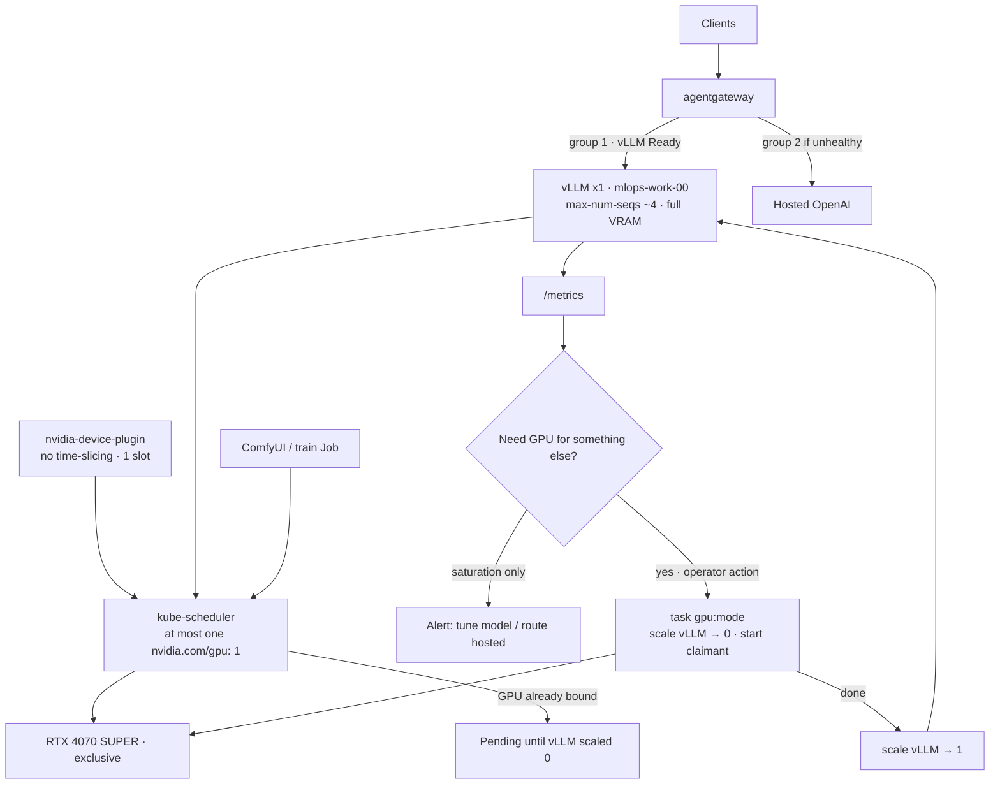
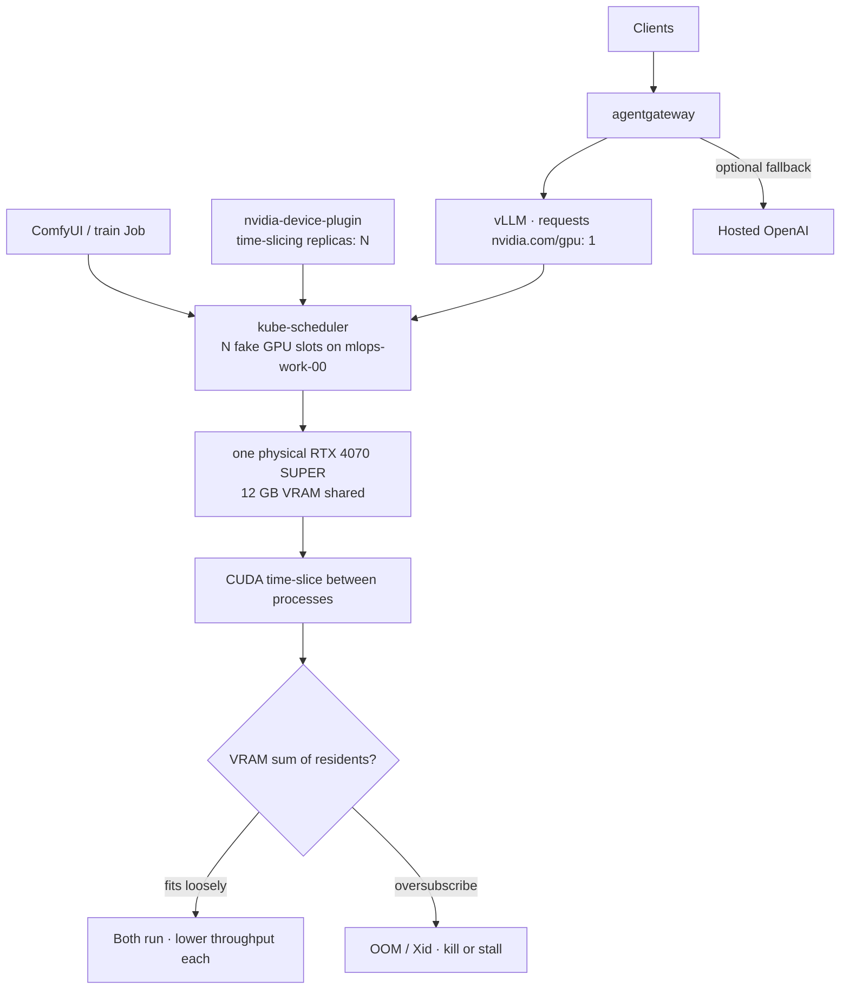
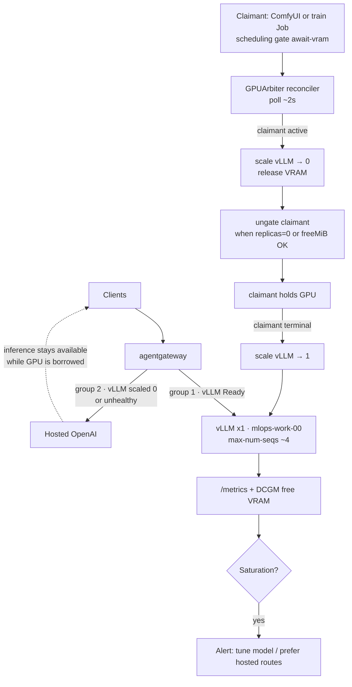

# Platform AI Hardware

`nvidia-device-plugin` is used for connecting the node to the GPU device and resource allocation for kubernetes workloads. Talos has nvidia extensions used to establish base requirements for the gpu's to work on a bare immutable image.

1. [Nvidia 4070 Super RTX Ti 12GB]()
2. [Nvidia 5090 Super RTX Ti 32GB]()

Until the second GPU lands, capacity is one card on `mlops-work-00`. Replica/node
autoscaling still does not apply. What changes with a [GPU arbiter operator](https://github.com/shrinedogg/gpu-arbiter-operator)
(adapted for this lab: vLLM vs ComfyUI / training Jobs instead of gaming sessions)
is **who steals and returns the GPU** — a reconciler instead of `task gpu:mode`.

### Approaches

**Static**

No time-slicing. Device plugin advertises `nvidia.com/gpu: 1`, so the scheduler
allows only one GPU consumer at a time; that pod owns the full 12 GB. Mode
changes are manual (`task gpu:mode` or kubectl scale) — no reconciler.

**Dynamic**

With device-plugin [time-slicing](https://github.com/NVIDIA/k8s-device-plugin#shared-access-to-gpus-with-cuda-time-slicing)
enabled (`replicas: N` on one physical card). The scheduler sees multiple
`nvidia.com/gpu` slots; CUDA still shares one 12 GB pool. No exclusive handoff —
vLLM, ComfyUI, and train Jobs can land together and contend for VRAM.

Not recommended on the 4070 while vLLM holds `--gpu-memory-utilization 0.90`.
Prefer **Static** or **Reconcile**.

**Reconcile**

Considering a custom operator to manage vram allocation like [GPU arbiter](https://github.com/shrinedogg/gpu-arbiter-operator) for inspiration. Exclusive handoff (scheduling + scale), not CUDA VRAM budgets. Default holder is vLLM; transient claimants borrow the whole card, then return it.

