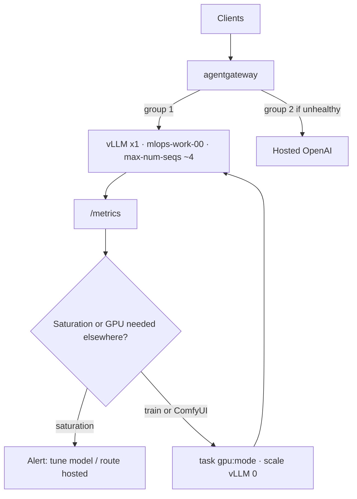

# AI Platform

1. [Platform AI Clients](#platform-clients)
  1. Claude Code / Cursor
  2. OpenWebUI
2. [Platform AI Infrastructure](#platform-infrastructure)
3. [Platform AI Hardware](#platform-hardware)

## Where it runs

Everything below runs on the `mlops` cluster in namespace `ai`. It is deployed by
`task platform:ai:deploy` (`platform/ai/Taskfile.yml`), which runs only when `CLUSTER=mlops` and applies
`kustomize build platform/ai/kubernetes`. The CRDs come first through the task's `install-crds` step.

| Component | Cluster | Namespace | Deployed from |
|-----------|---------|-----------|---------------|
| agentgateway controller (chart v2.2.1) | `mlops` | `ai` | `platform/ai/kubernetes/kustomization.yaml` |
| `ai-gateway` Gateway (`agentgateway` class, LB `192.168.2.203`) | `mlops` | `ai` | `platform/ai/kubernetes/aigateway/` |
| kagent (chart 1.0.0-alpha10, `api.kagent.dev/v1alpha3`), Agent Substrate (subchart), kmcp | `mlops` | `ai` | `platform/ai/kubernetes/overlays/mlops/kustomization.yaml` (ADR-0009) |
| Harnesses (`kagent`, `claude`), AgentTemplates, Agents | `mlops` | `ai` | `platform/ai/kubernetes/harness/`, `platform/ai/kubernetes/agents/` |
| LLM providers: OpenAI, Anthropic, self-hosted vLLM | `mlops` | `ai` | `platform/ai/kubernetes/llm-providers/` |
| MCP servers (GitHub, Firecrawl, Context7, memory) and `/mcp` route | `mlops` | `ai` | `platform/ai/kubernetes/mcp/`, `mcp-backend.yaml`, `mcp-route.yaml` |
| Open WebUI, openedai-speech | `mlops` | `ai` | `platform/ai/kubernetes/integrations/` |
| kagent UI route (`ai.homelab.internal`) | `mlops` | `ai` | `platform/ai/kubernetes/ui-http-route.yaml`, attached to `homelab-internal-gateway` |
| vLLM GPU workload | `mlops-work-00` | `ai` | `platform/ai/kubernetes/llm-providers/selfhosted/` |

```
                                   ┌─────────────────────── FRONT DOORS ───────────────────────┐
                                   │  OpenWebUI (chat)   n8n (events/cron/glue)   Claude Code    │
                                   │        │                   │                  /Cursor       │
                                   └────────┼───────────────────┼───────────────────┼───────────┘
                                            │                   │                   │ (kagent /mcp:
                                            ▼                   ▼                   │  list+invoke_agent)
                          ┌───────────────────────────────────────────────────────────────────┐
                          │                    agentgateway  (ai namespace)                     │
                          │   /  → kagent UI        /mcp → mcp-backend (tool fabric + authz)     │
                          └───────────────┬───────────────────────────────┬───────────────────┘
                                          │                               │
                          ┌───────────────▼──────────────┐   ┌────────────▼─────────────────────┐
                          │      AGENT RUNTIME (kagent)    │   │        MCP TOOL FABRIC         │
                          │  supervisor (A2A parent, opt.) │   │  github · knowledge-search     │
                          │   ├─ k8s-ops agent             │   │  firecrawl · crawl4ai(scrape)   │
                          │   ├─ knowledge/research agent  │──▶│  kagent-tools/querydoc/controller│
                          │   ├─ browser agent             │   │  comfyui · devbot-computer(defer)│
                          │   └─ (Hermes harness, deferred)│   └────────────────┬─────────────────┘
                          │  memory · HITL · skills(OCI/git)│                   │
                          └───────────────┬────────────────┘                    │
                                          │ ModelConfig                         │ tools call out
                    ┌─────────────────────▼─────────────────┐      ┌────────────▼───────────────┐
                    │            MODEL LAYER                  │    │      KNOWLEDGE LAYER        │
                    │ local: vLLM (AWQ 7-8B) · NIM · ollama   │    │ knowledge-indexer (FastAPI) │
                    │ hosted: Claude · GPT · Bedrock (teacher)│    │  /ingest  +  /mcp search    │
                    │ training: Unsloth QLoRA Job (scale-0)   │    │ Qdrant (knowledge_*) ·      │
                    └─────────────────────────────────────────┘    │ ollama nomic-embed 768d     │
                                          ▲                         └─────────────────────────────┘
                                          │ ONE GPU (RTX 4070 SUPER, 12 GB) — one heavy workload at a time
                                          └── embeddings on CPU · crawl4ai off-GPU · train via scale-to-zero
```

## Platform Clients

1. Claude Code
2. OpenWebUI

## Platform Infrastructure

1. **AI Gateway**

The AI Gateway provides a unified interface for multiple LLM providers, enabling:

- Request routing and load balancing
- Cost tracking and monitoring
- Authentication and rate limiting

### Platform Providers

| Provider | Description | Source |
|----------|-------------|--------|
| `Anthropic` | Claude models for advanced reasoning | `llm-providers/anthropic` |
| `OpenAI` | GPT models for general-purpose AI | `llm-providers/openai` |
| `vLLM` | Self-hosted open-source LLM on the RTX 4070 Super | `llm-providers/selfhosted` |

Only the providers listed in `platform/ai/kubernetes/llm-providers/kustomization.yaml` are deployed.

2. **Agents**

3. **MCP**

## Use Cases

1. [RAG (Retrieval Augmented Generation)](./rag.md)
2. AI Software Factory: **planned**, see "Build Software Factory" in `.ai/ROADMAP.md`


## Platform Hardware

`nvidia-device-plugin` is used for connecting the node to the GPU device and resource allocation for kubernetes workloads. Talos has nvidia extensions used to establish base requirements for the gpu's to work on a bare immutable image.

1. [Nvidia 4070 Super RTX Ti 12GB]()
2. [Nvidia 5090 Super RTX Ti 32GB]()


