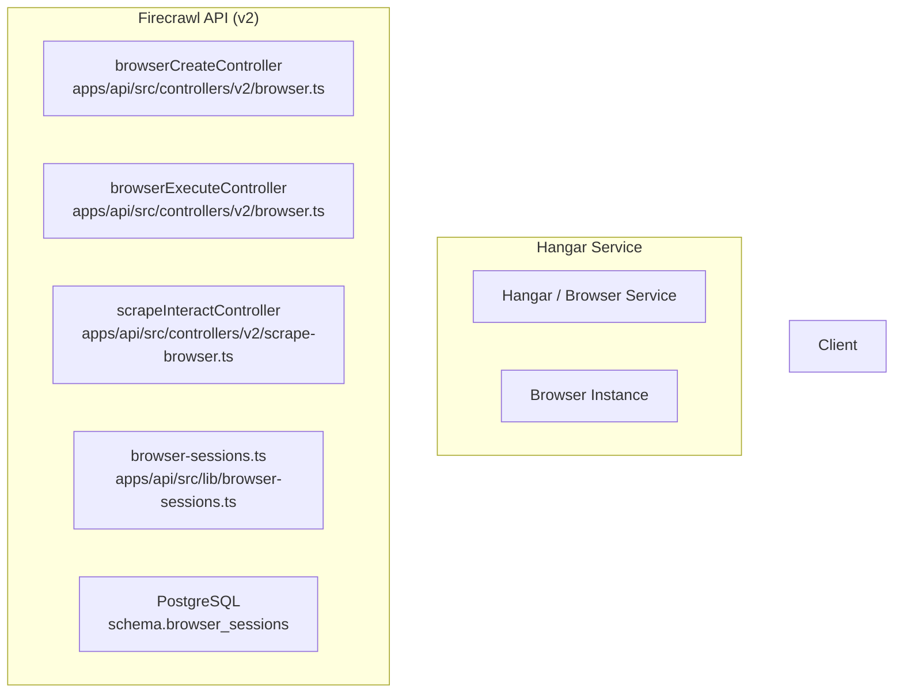

# Browser Session Endpoints

> **Relevant source files**
> * [apps/api/requests/v2/browser.requests.http](https://github.com/firecrawl/firecrawl/blob/f84845c8/apps/api/requests/v2/browser.requests.http)
> * [apps/api/src/__tests__/snips/v2/browser-profiles.test.ts](https://github.com/firecrawl/firecrawl/blob/f84845c8/apps/api/src/__tests__/snips/v2/browser-profiles.test.ts)
> * [apps/api/src/__tests__/snips/v2/browser-replay.test.ts](https://github.com/firecrawl/firecrawl/blob/f84845c8/apps/api/src/__tests__/snips/v2/browser-replay.test.ts)
> * [apps/api/src/controllers/v2/browser.ts](https://github.com/firecrawl/firecrawl/blob/f84845c8/apps/api/src/controllers/v2/browser.ts)
> * [apps/api/src/controllers/v2/scrape-browser.ts](https://github.com/firecrawl/firecrawl/blob/f84845c8/apps/api/src/controllers/v2/scrape-browser.ts)
> * [apps/api/src/db/schema/public.ts](https://github.com/firecrawl/firecrawl/blob/f84845c8/apps/api/src/db/schema/public.ts)
> * [apps/api/src/lib/browser-profiles.test.ts](https://github.com/firecrawl/firecrawl/blob/f84845c8/apps/api/src/lib/browser-profiles.test.ts)
> * [apps/api/src/lib/browser-profiles.ts](https://github.com/firecrawl/firecrawl/blob/f84845c8/apps/api/src/lib/browser-profiles.ts)
> * [apps/api/src/lib/browser-sessions.ts](https://github.com/firecrawl/firecrawl/blob/f84845c8/apps/api/src/lib/browser-sessions.ts)

## Purpose and Scope

This document describes the Browser Session API endpoints (v2) that provide remote browser automation capabilities via Chrome DevTools Protocol (CDP). Browser sessions allow users to execute code (Python, Node.js, Bash) in a managed browser environment, access live view streams, and automate web interactions programmatically.

For detailed information about the underlying Browser Service integration and session management infrastructure, see [Browser Session System](/firecrawl/firecrawl/10-browser-session-system). For code execution implementation details across different language runtimes, see [Code Execution Modes](/firecrawl/firecrawl/10.2-code-execution-modes).

---

## System Overview

The Browser Session endpoints expose a managed browser automation service where each session represents a remote browser instance accessible via CDP WebSocket URLs. Sessions are created on-demand, execute user code in isolated environments, and are automatically destroyed based on TTL (time-to-live) policies or manual deletion.

**Diagram: Browser Session Components and Code Entities**



**Sources:** [apps/api/src/controllers/v2/browser.ts L1-L211](https://github.com/firecrawl/firecrawl/blob/f84845c8/apps/api/src/controllers/v2/browser.ts#L1-L211)

 [apps/api/src/controllers/v2/scrape-browser.ts L1-L124](https://github.com/firecrawl/firecrawl/blob/f84845c8/apps/api/src/controllers/v2/scrape-browser.ts#L1-L124)

 [apps/api/src/lib/browser-sessions.ts L1-L198](https://github.com/firecrawl/firecrawl/blob/f84845c8/apps/api/src/lib/browser-sessions.ts#L1-L198)

---

## Endpoint Reference

### POST /v2/browser - Create Browser Session

Creates a new remote browser session with configurable TTL, activity timeout, and optional browser profile persistence.

**Request Schema (`browserCreateRequestSchema`):**

```javascript
export const browserCreateRequestSchema = z.object({  ttl: z.number().int().min(30).max(3600).default(600),  activityTtl: z.number().int().min(10).max(3600).default(300),  streamWebView: z.boolean().default(true),  recordSession: z.boolean().default(false),  zeroDataRetention: z.boolean().optional(),  integration: integrationSchema.optional().transform(value => value || null),  blockAds: z.boolean().default(true),  profile: z    .object({      name: browserProfileNameSchema,      saveChanges: z.boolean().default(true),    })    .optional(),  location: z    .strictObject({      country: z.string().refine(...).transform(...),    })    .optional(),  __agentInterop: z    .object({      auth: z.string(),      requestId: z.string().uuid(),      shouldBill: z.boolean(),    })    .optional(),});
```

[apps/api/src/controllers/v2/browser.ts L41-L73](https://github.com/firecrawl/firecrawl/blob/f84845c8/apps/api/src/controllers/v2/browser.ts#L41-L73)

**Key Implementation Details:**

* Safe mode validation checks `getSafeMode(req.acuc?.flags)` to reject browser operations if restricted [apps/api/src/controllers/v2/browser.ts L120-L124](https://github.com/firecrawl/firecrawl/blob/f84845c8/apps/api/src/controllers/v2/browser.ts#L120-L124)
* Keyless free tier exhaustion handling intercepts `BrowserSessionError` with status `429` and `KEYLESS_FREE_TIER_LIMIT_MESSAGE` to provide a signup URL [apps/api/src/controllers/v2/browser.ts L93-L106](https://github.com/firecrawl/firecrawl/blob/f84845c8/apps/api/src/controllers/v2/browser.ts#L93-L106)

**Sources:** [apps/api/src/controllers/v2/browser.ts L41-L150](https://github.com/firecrawl/firecrawl/blob/f84845c8/apps/api/src/controllers/v2/browser.ts#L41-L150)

---

### POST /v2/scrape/:jobId/interact - Scrape Interaction

Enables interaction with an existing scrape job by either creating a new browser session that replays scrape actions or executing prompts/code against an active scrape session.

**Request Schema (`browserExecuteRequestSchema`):**

```javascript
const browserExecuteRequestSchema = z  .object({    code: z.string().min(1).refine(value => Buffer.byteLength(value, "utf8") <= 100_000, "Code must not exceed 100,000 UTF-8 bytes.").optional(),    prompt: z.string().min(1).max(10_000).optional(),    language: z.enum(["python", "node", "bash"]).default("node"),    timeout: z.number().min(1).max(300).default(30),    origin: z.string().optional(),    integration: integrationSchema.optional().transform(val => val || null),    existingSessionId: z.string().optional(),    zeroDataRetention: z.boolean().optional(),    url: z.url().optional(),  })  .refine(data => data.code || data.prompt, {    message: "Either 'code' or 'prompt' must be provided.",  });
```

[apps/api/src/controllers/v2/scrape-browser.ts L61-L83](https://github.com/firecrawl/firecrawl/blob/f84845c8/apps/api/src/controllers/v2/scrape-browser.ts#L61-L83)

**Key Logic:**

* Validates database authentication configuration and scrape job access via `getScrapeJobAccess` and `readScrapeJobState` [apps/api/src/controllers/v2/scrape-browser.ts L173-L198](https://github.com/firecrawl/firecrawl/blob/f84845c8/apps/api/src/controllers/v2/scrape-browser.ts#L173-L198)
* Supports execution via `executePromptViaBrowserAgent` or code execution via `executeCodeViaBrowserSession` [apps/api/src/controllers/v2/scrape-browser.ts L32-L36](https://github.com/firecrawl/firecrawl/blob/f84845c8/apps/api/src/controllers/v2/scrape-browser.ts#L32-L36)

**Sources:** [apps/api/src/controllers/v2/scrape-browser.ts L61-L210](https://github.com/firecrawl/firecrawl/blob/f84845c8/apps/api/src/controllers/v2/scrape-browser.ts#L61-L210)

---

### POST /v2/browser/:sessionId/execute - Execute Code

Executes code within an active browser session.

**Request Schema (`browserExecuteRequestSchema`):**

```javascript
const browserExecuteRequestSchema = z.object({  code: z    .string()    .min(1)    .refine(      value => Buffer.byteLength(value, "utf8") <= 100_000,      "Code must not exceed 100,000 UTF-8 bytes.",    ),  language: z.enum(["python", "node", "bash"]).default("node"),  timeout: z.number().int().min(1).max(300).default(30),  origin: z.string().optional(),});
```

[apps/api/src/controllers/v2/browser.ts L75-L86](https://github.com/firecrawl/firecrawl/blob/f84845c8/apps/api/src/controllers/v2/browser.ts#L75-L86)

**Controller Implementation (`browserExecuteController`):**

* Validates session existence and status (`destroyed` sessions return status `410`) [apps/api/src/controllers/v2/browser.ts L182-L185](https://github.com/firecrawl/firecrawl/blob/f84845c8/apps/api/src/controllers/v2/browser.ts#L182-L185)
* Executes code via `executeHangarBrowser` and logs session activity using `enqueueBrowserSessionActivity` [apps/api/src/controllers/v2/browser.ts L190-L199](https://github.com/firecrawl/firecrawl/blob/f84845c8/apps/api/src/controllers/v2/browser.ts#L190-L199)

**Sources:** [apps/api/src/controllers/v2/browser.ts L170-L211](https://github.com/firecrawl/firecrawl/blob/f84845c8/apps/api/src/controllers/v2/browser.ts#L170-L211)

---

### Database Schema for Browser Sessions

Browser sessions and activities are tracked in PostgreSQL via Drizzle schema definitions.

**Table: `browser_sessions`**

* `id`: `uuid` (Primary Key)
* `zero_data_retention`: `boolean`
* `team_id`: `text`
* `browser_id`: `text` (Hangar browser id)
* `cdp_url`, `cdp_path`, `cdp_interactive_path`: `text`
* `status`: `text` (`active`, `destroyed`, `error`)
* `ttl_total`, `ttl_without_activity`: `integer`
* `credits_used`: `integer`
* `profile_name`: `text`

**Table: `browser_session_activities`**

* `id`: `bigint`
* `team_id`, `session_id`: `text`
* `language`: `text`
* `timeout`, `exit_code`: `integer`
* `killed`: `boolean`

**Sources:** [apps/api/src/db/schema/public.ts L102-L140](https://github.com/firecrawl/firecrawl/blob/f84845c8/apps/api/src/db/schema/public.ts#L102-L140)

---

## SDK Integration and HTTP Requests

Browser session endpoints can be invoked directly using HTTP or via client SDKs as defined in request catalogs.

**HTTP Request Example (`browser.requests.http`):**

```
POST {{baseUrl}}/v2/browser HTTP/1.1Authorization: Bearer {{$dotenv TEST_API_KEY}}content-type: application/json {  "ttl": 600,  "activityTtl": 120,  "streamWebView": false}
```

[apps/api/requests/v2/browser.requests.http L12-L21](https://github.com/firecrawl/firecrawl/blob/f84845c8/apps/api/requests/v2/browser.requests.http#L12-L21)

**Sources:** [apps/api/requests/v2/browser.requests.http L1-L114](https://github.com/firecrawl/firecrawl/blob/f84845c8/apps/api/requests/v2/browser.requests.http#L1-L114)
