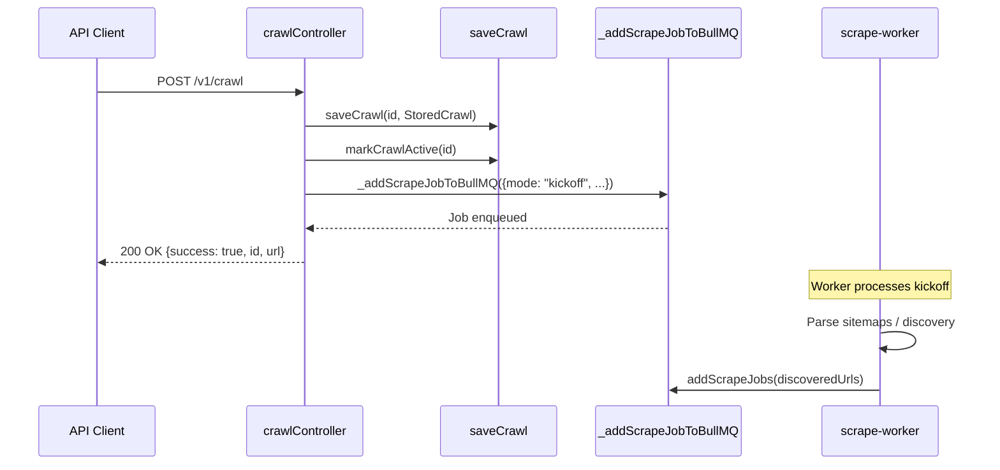

# Crawl Endpoints

> **Relevant source files**
> * [apps/api/src/__tests__/snips/v2/crawl.test.ts](https://github.com/firecrawl/firecrawl/blob/f84845c8/apps/api/src/__tests__/snips/v2/crawl.test.ts)
> * [apps/api/src/controllers/v0/crawl-status.ts](https://github.com/firecrawl/firecrawl/blob/f84845c8/apps/api/src/controllers/v0/crawl-status.ts)
> * [apps/api/src/controllers/v0/crawl.ts](https://github.com/firecrawl/firecrawl/blob/f84845c8/apps/api/src/controllers/v0/crawl.ts)
> * [apps/api/src/controllers/v1/batch-scrape.ts](https://github.com/firecrawl/firecrawl/blob/f84845c8/apps/api/src/controllers/v1/batch-scrape.ts)
> * [apps/api/src/controllers/v1/crawl-status-ws.ts](https://github.com/firecrawl/firecrawl/blob/f84845c8/apps/api/src/controllers/v1/crawl-status-ws.ts)
> * [apps/api/src/controllers/v1/crawl-status.ts](https://github.com/firecrawl/firecrawl/blob/f84845c8/apps/api/src/controllers/v1/crawl-status.ts)
> * [apps/api/src/controllers/v1/crawl.ts](https://github.com/firecrawl/firecrawl/blob/f84845c8/apps/api/src/controllers/v1/crawl.ts)
> * [apps/api/src/controllers/v2/batch-scrape.ts](https://github.com/firecrawl/firecrawl/blob/f84845c8/apps/api/src/controllers/v2/batch-scrape.ts)
> * [apps/api/src/controllers/v2/crawl-status.ts](https://github.com/firecrawl/firecrawl/blob/f84845c8/apps/api/src/controllers/v2/crawl-status.ts)
> * [apps/api/src/controllers/v2/crawl.ts](https://github.com/firecrawl/firecrawl/blob/f84845c8/apps/api/src/controllers/v2/crawl.ts)
> * [apps/api/src/index.ts](https://github.com/firecrawl/firecrawl/blob/f84845c8/apps/api/src/index.ts)
> * [apps/api/src/lib/concurrency-limit.ts](https://github.com/firecrawl/firecrawl/blob/f84845c8/apps/api/src/lib/concurrency-limit.ts)
> * [apps/api/src/lib/crawl-redis.ts](https://github.com/firecrawl/firecrawl/blob/f84845c8/apps/api/src/lib/crawl-redis.ts)
> * [apps/api/src/scraper/WebScraper/crawler.ts](https://github.com/firecrawl/firecrawl/blob/f84845c8/apps/api/src/scraper/WebScraper/crawler.ts)
> * [apps/api/src/scraper/WebScraper/sitemap.ts](https://github.com/firecrawl/firecrawl/blob/f84845c8/apps/api/src/scraper/WebScraper/sitemap.ts)
> * [apps/api/src/services/queue-jobs.ts](https://github.com/firecrawl/firecrawl/blob/f84845c8/apps/api/src/services/queue-jobs.ts)
> * [apps/api/src/services/queue-service.ts](https://github.com/firecrawl/firecrawl/blob/f84845c8/apps/api/src/services/queue-service.ts)
> * [apps/api/src/services/queue-worker.ts](https://github.com/firecrawl/firecrawl/blob/f84845c8/apps/api/src/services/queue-worker.ts)
> * [apps/api/src/services/worker/crawl-logic.test.ts](https://github.com/firecrawl/firecrawl/blob/f84845c8/apps/api/src/services/worker/crawl-logic.test.ts)
> * [apps/api/src/services/worker/crawl-logic.ts](https://github.com/firecrawl/firecrawl/blob/f84845c8/apps/api/src/services/worker/crawl-logic.ts)
> * [apps/api/src/services/worker/scrape-worker.ts](https://github.com/firecrawl/firecrawl/blob/f84845c8/apps/api/src/services/worker/scrape-worker.ts)

## Purpose and Scope

This page documents the technical implementation, request handling, data flow, state management, and status monitoring for the `/crawl` and `/batch/scrape` API endpoints. It covers request validation via `crawlRequestSchema` and `batchScrapeRequestSchema`, job kickoff workflows through `crawlController` [apps/api/src/controllers/v1/crawl.ts L43](https://github.com/firecrawl/firecrawl/blob/f84845c8/apps/api/src/controllers/v1/crawl.ts#L43-L43)

 and `batchScrapeController` [apps/api/src/controllers/v2/batch-scrape.ts L64](https://github.com/firecrawl/firecrawl/blob/f84845c8/apps/api/src/controllers/v2/batch-scrape.ts#L64-L64)

 Redis-based crawl state persistence (`StoredCrawl`), concurrency controls, and status polling mechanisms (`crawlStatusController`) [apps/api/src/controllers/v1/crawl-status.ts L148](https://github.com/firecrawl/firecrawl/blob/f84845c8/apps/api/src/controllers/v1/crawl-status.ts#L148-L148)

Sources: [apps/api/src/controllers/v1/crawl.ts L43-L107](https://github.com/firecrawl/firecrawl/blob/f84845c8/apps/api/src/controllers/v1/crawl.ts#L43-L107)

 [apps/api/src/controllers/v2/batch-scrape.ts L64-L110](https://github.com/firecrawl/firecrawl/blob/f84845c8/apps/api/src/controllers/v2/batch-scrape.ts#L64-L110)

 [apps/api/src/controllers/v1/crawl-status.ts L148-L169](https://github.com/firecrawl/firecrawl/blob/f84845c8/apps/api/src/controllers/v1/crawl-status.ts#L148-L169)

 [apps/api/src/lib/crawl-redis.ts L18-L43](https://github.com/firecrawl/firecrawl/blob/f84845c8/apps/api/src/lib/crawl-redis.ts#L18-L43)

## Endpoint Architecture and Controller Mapping

Firecrawl exposes multi-page crawling and batch scraping through distinct API controllers across versions v0, v1, and v2. The system translates high-level client intent into discrete queue jobs and Redis-backed state records.


Sources: [apps/api/src/controllers/v1/crawl.ts L43-L200](https://github.com/firecrawl/firecrawl/blob/f84845c8/apps/api/src/controllers/v1/crawl.ts#L43-L200)

 [apps/api/src/controllers/v2/batch-scrape.ts L64-L150](https://github.com/firecrawl/firecrawl/blob/f84845c8/apps/api/src/controllers/v2/batch-scrape.ts#L64-L150)

 [apps/api/src/lib/crawl-redis.ts L45-L79](https://github.com/firecrawl/firecrawl/blob/f84845c8/apps/api/src/lib/crawl-redis.ts#L45-L79)

 [apps/api/src/services/queue-jobs.ts L154-L187](https://github.com/firecrawl/firecrawl/blob/f84845c8/apps/api/src/services/queue-jobs.ts#L154-L187)

## Request Validation, Security, and Permissions

When a crawl or batch scrape request arrives, it passes through security checks before any tasks are enqueued:

1. **Safe Mode Enforcement:** `resolveSafeMode` inspects account flags and request headers to enforce isolation or lockdown constraints [apps/api/src/controllers/v1/crawl.ts L51-L62](https://github.com/firecrawl/firecrawl/blob/f84845c8/apps/api/src/controllers/v1/crawl.ts#L51-L62)  [apps/api/src/controllers/v2/batch-scrape.ts L77-L84](https://github.com/firecrawl/firecrawl/blob/f84845c8/apps/api/src/controllers/v2/batch-scrape.ts#L77-L84)
2. **Zero Data Retention (ZDR):** Computed via `getScrapeZDR` or forced by plan flags and lockdown states [apps/api/src/controllers/v1/crawl.ts L65-L68](https://github.com/firecrawl/firecrawl/blob/f84845c8/apps/api/src/controllers/v1/crawl.ts#L65-L68)  [apps/api/src/controllers/v2/batch-scrape.ts L125-L130](https://github.com/firecrawl/firecrawl/blob/f84845c8/apps/api/src/controllers/v2/batch-scrape.ts#L125-L130)
3. **Threat Protection:** `resolveThreatProtection` and `checkUrl` validate seed URLs against blocklists and threat intelligence feeds [apps/api/src/controllers/v1/crawl.ts L70-L76](https://github.com/firecrawl/firecrawl/blob/f84845c8/apps/api/src/controllers/v1/crawl.ts#L70-L76)  [apps/api/src/controllers/v1/crawl.ts L110-L114](https://github.com/firecrawl/firecrawl/blob/f84845c8/apps/api/src/controllers/v1/crawl.ts#L110-L114)  Seed rejections trigger immediate billing of scan credits via `billTeam` [apps/api/src/controllers/v1/crawl.ts L119-L134](https://github.com/firecrawl/firecrawl/blob/f84845c8/apps/api/src/controllers/v1/crawl.ts#L119-L134)
4. **Permissions Check:** `checkPermissions` evaluates team limits, format restrictions, and requested crawler options [apps/api/src/controllers/v1/crawl.ts L88-L100](https://github.com/firecrawl/firecrawl/blob/f84845c8/apps/api/src/controllers/v1/crawl.ts#L88-L100)  [apps/api/src/controllers/v2/batch-scrape.ts L100-L103](https://github.com/firecrawl/firecrawl/blob/f84845c8/apps/api/src/controllers/v2/batch-scrape.ts#L100-L103)
5. **Key Format Restrictions:** `checkKeyFormatRestriction` ensures the API key has privileges for requested actions and output formats [apps/api/src/controllers/v1/crawl.ts L158-L169](https://github.com/firecrawl/firecrawl/blob/f84845c8/apps/api/src/controllers/v1/crawl.ts#L158-L169)  [apps/api/src/controllers/v2/batch-scrape.ts L112-L123](https://github.com/firecrawl/firecrawl/blob/f84845c8/apps/api/src/controllers/v2/batch-scrape.ts#L112-L123)

Sources: [apps/api/src/controllers/v1/crawl.ts L47-L169](https://github.com/firecrawl/firecrawl/blob/f84845c8/apps/api/src/controllers/v1/crawl.ts#L47-L169)

 [apps/api/src/controllers/v2/batch-scrape.ts L68-L123](https://github.com/firecrawl/firecrawl/blob/f84845c8/apps/api/src/controllers/v2/batch-scrape.ts#L68-L123)

## Job Submission and Kickoff Flow

Once validated, `crawlController` initializes crawl state in Redis and dispatches a kickoff job to the queue system.



The crawl kickoff is handled by background worker routines (`scrape-worker.ts`), which utilize `WebCrawler` [apps/api/src/scraper/WebScraper/crawler.ts L62](https://github.com/firecrawl/firecrawl/blob/f84845c8/apps/api/src/scraper/WebScraper/crawler.ts#L62-L62)

 and `getLinksFromSitemap` [apps/api/src/scraper/WebScraper/sitemap.ts L24](https://github.com/firecrawl/firecrawl/blob/f84845c8/apps/api/src/scraper/WebScraper/sitemap.ts#L24-L24)

 to discover URLs and populate the job queue.

Sources: [apps/api/src/controllers/v1/crawl.ts L171-L250](https://github.com/firecrawl/firecrawl/blob/f84845c8/apps/api/src/controllers/v1/crawl.ts#L171-L250)

 [apps/api/src/lib/crawl-redis.ts L45-L79](https://github.com/firecrawl/firecrawl/blob/f84845c8/apps/api/src/lib/crawl-redis.ts#L45-L79)

 [apps/api/src/services/queue-jobs.ts L154-L187](https://github.com/firecrawl/firecrawl/blob/f84845c8/apps/api/src/services/queue-jobs.ts#L154-L187)

 [apps/api/src/services/worker/scrape-worker.ts L14-L31](https://github.com/firecrawl/firecrawl/blob/f84845c8/apps/api/src/services/worker/scrape-worker.ts#L14-L31)

## Crawl State Management (StoredCrawl)

Crawl metadata, progress tracking, and configuration are stored in Redis using the `StoredCrawl` data structure defined in `crawl-redis.ts`:

```typescript
export type StoredCrawl = {  originUrl?: string;  crawlerOptions: any;  scrapeOptions: Omit<ScrapeOptions, "timeout">;  internalOptions: InternalOptions;  team_id: string;  robots?: string;  cancelled?: boolean;  createdAt: number;  maxConcurrency?: number;  zeroDataRetention?: boolean;  queueBackend?: "pg" | "fdb";  v1?: boolean;  webhook?: WebhookConfig;  requestId?: string;  origin?: string;};
```

Key state management helper functions include:

* `saveCrawl`: Persists the crawl object to Redis with a 24-hour expiration TTL [apps/api/src/lib/crawl-redis.ts L45-L70](https://github.com/firecrawl/firecrawl/blob/f84845c8/apps/api/src/lib/crawl-redis.ts#L45-L70)
* `getCrawl`: Retrieves and renews the TTL for an active crawl record [apps/api/src/lib/crawl-redis.ts L131-L155](https://github.com/firecrawl/firecrawl/blob/f84845c8/apps/api/src/lib/crawl-redis.ts#L131-L155)
* `addCrawlJob`: Associates job identifiers with a crawl group in Redis sets [apps/api/src/lib/crawl-redis.ts L166-L193](https://github.com/firecrawl/firecrawl/blob/f84845c8/apps/api/src/lib/crawl-redis.ts#L166-L193)
* `recordRobotsBlocked` and `recordThreatBlocked`: Track non-fatal URL exclusions and deduplicate scan billing per crawl [apps/api/src/lib/crawl-redis.ts L81-L125](https://github.com/firecrawl/firecrawl/blob/f84845c8/apps/api/src/lib/crawl-redis.ts#L81-L125)

Sources: [apps/api/src/lib/crawl-redis.ts L18-L125](https://github.com/firecrawl/firecrawl/blob/f84845c8/apps/api/src/lib/crawl-redis.ts#L18-L125)

 [apps/api/src/lib/crawl-redis.ts L131-L193](https://github.com/firecrawl/firecrawl/blob/f84845c8/apps/api/src/lib/crawl-redis.ts#L131-L193)

## Concurrency Control and Rate Limiting

To prevent resource exhaustion across large crawls, the system enforces per-team and per-crawl concurrency limits:

* `_addScrapeJobToBullMQPg` registers active jobs against concurrency tracking structures in Redis [apps/api/src/services/queue-jobs.ts L189-L224](https://github.com/firecrawl/firecrawl/blob/f84845c8/apps/api/src/services/queue-jobs.ts#L189-L224)
* `pushCrawlConcurrencyLimitActiveJob` tracks active executions scoped specifically to a crawl identifier [apps/api/src/lib/concurrency-limit.ts L196-L207](https://github.com/firecrawl/firecrawl/blob/f84845c8/apps/api/src/lib/concurrency-limit.ts#L196-L207)
* `getNextConcurrentJob` pulls queued items respecting team concurrency limits and backlogs [apps/api/src/lib/concurrency-limit.ts L224-L229](https://github.com/firecrawl/firecrawl/blob/f84845c8/apps/api/src/lib/concurrency-limit.ts#L224-L229)

Sources: [apps/api/src/services/queue-jobs.ts L189-L224](https://github.com/firecrawl/firecrawl/blob/f84845c8/apps/api/src/services/queue-jobs.ts#L189-L224)

 [apps/api/src/lib/concurrency-limit.ts L196-L229](https://github.com/firecrawl/firecrawl/blob/f84845c8/apps/api/src/lib/concurrency-limit.ts#L196-L229)

## Status Polling, Monitoring, and Cancellation

Clients poll crawl execution progress via the `crawlStatusController` endpoint [apps/api/src/controllers/v1/crawl-status.ts L148](https://github.com/firecrawl/firecrawl/blob/f84845c8/apps/api/src/controllers/v1/crawl-status.ts#L148-L148)

```mermaid
flowchart TD

mermaid-1rglb8yh5ix-flowchart-PollingClient["Client GET /v1/crawl/:id"]
mermaid-1rglb8yh5ix-flowchart-crawlStatusController["crawlStatusController"]
mermaid-1rglb8yh5ix-flowchart-crawlGroup["crawlGroup.getGroup"]
mermaid-1rglb8yh5ix-flowchart-getCrawl["getCrawl"]
mermaid-1rglb8yh5ix-flowchart-getGroupNumericStats["scrapeQueue.getGroupNumericStats"]
mermaid-1rglb8yh5ix-flowchart-readRequestCredits["readRequestCredits"]
mermaid-1rglb8yh5ix-flowchart-Response["CrawlStatusResponse"]
```



The status controller queries `crawlGroup` status, retrieves numeric statistics from the NuQ queue (`getGroupNumericStats`), inspects Bigtable or analytics storage for billed credits (`readRequestCredits`), and checks for kickoff errors (`getCrawlError`) [apps/api/src/controllers/v1/crawl-status.ts L160-L196](https://github.com/firecrawl/firecrawl/blob/f84845c8/apps/api/src/controllers/v1/crawl-status.ts#L160-L196)

 Cancellations are marked via `crawl-redis.ts` flags (`cancelled: true`), which workers inspect before executing further child jobs [apps/api/src/lib/crawl-redis.ts L25](https://github.com/firecrawl/firecrawl/blob/f84845c8/apps/api/src/lib/crawl-redis.ts#L25-L25)

Sources: [apps/api/src/controllers/v1/crawl-status.ts L148-L225](https://github.com/firecrawl/firecrawl/blob/f84845c8/apps/api/src/controllers/v1/crawl-status.ts#L148-L225)

 [apps/api/src/lib/crawl-redis.ts L25](https://github.com/firecrawl/firecrawl/blob/f84845c8/apps/api/src/lib/crawl-redis.ts#L25-L25)
