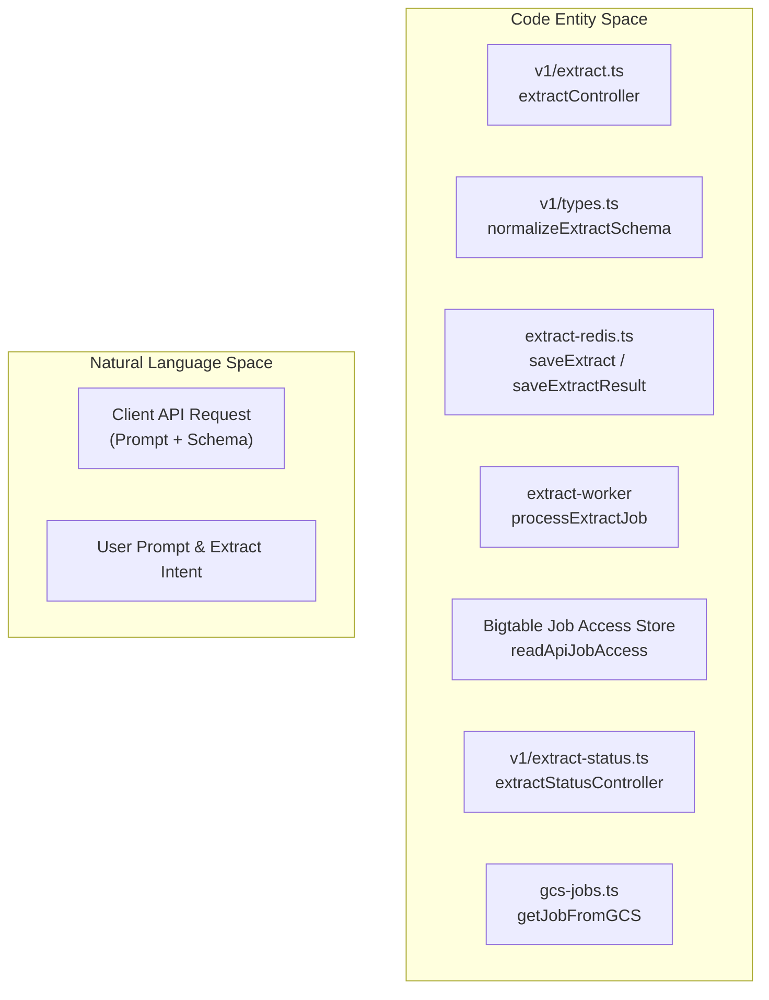
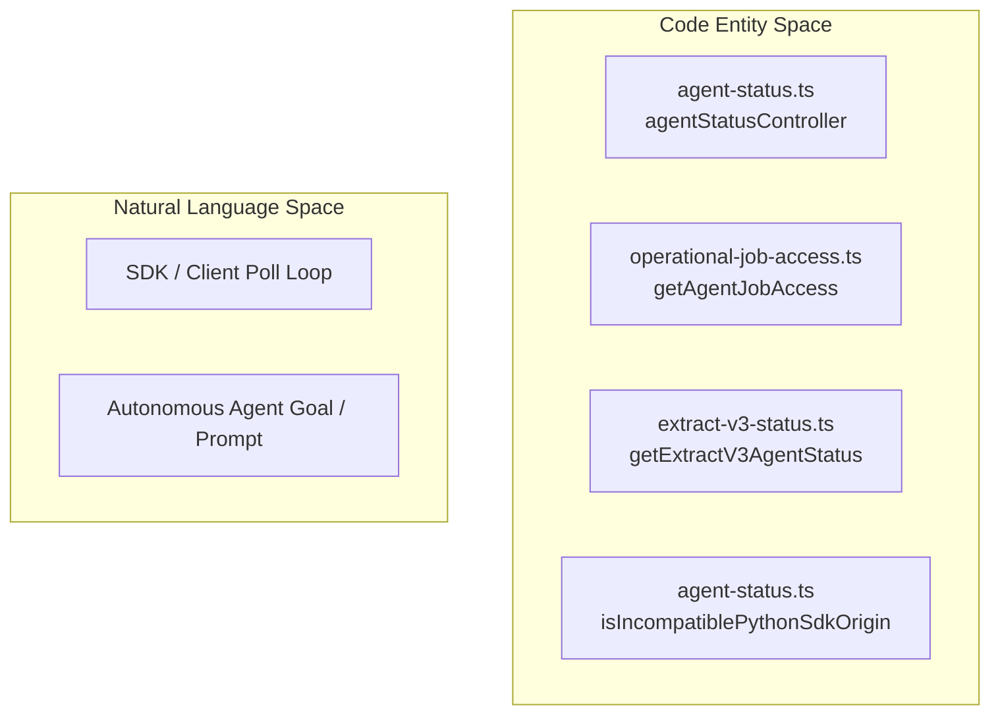
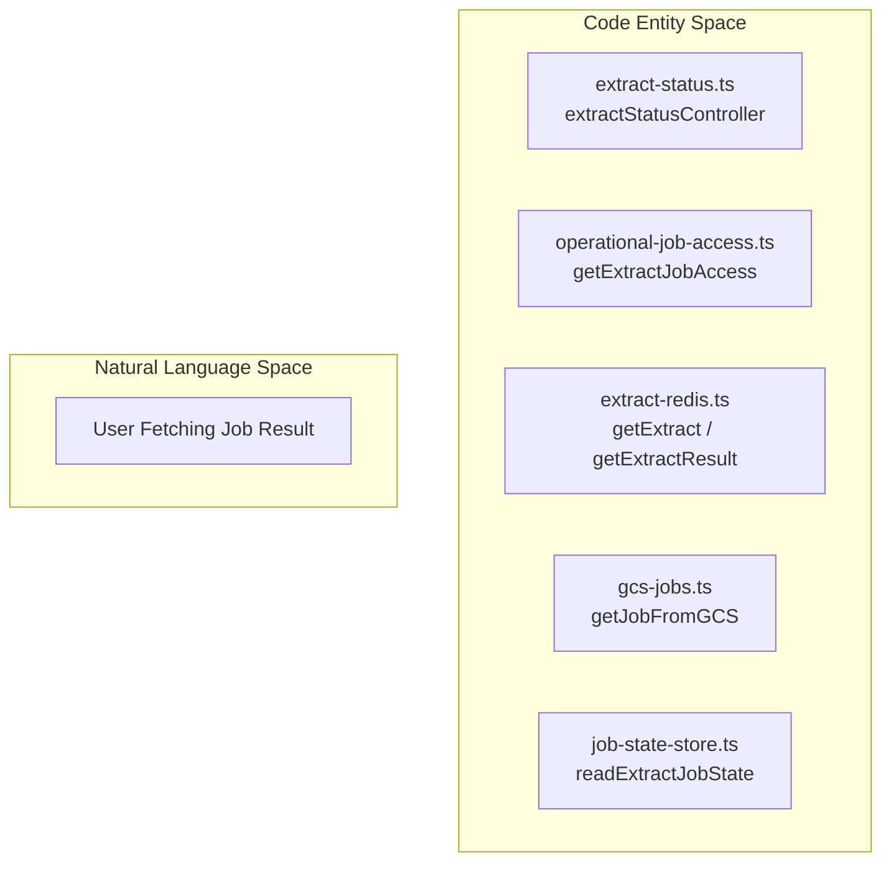

# Extract and Agent Endpoints

> **Relevant source files**
> * [CONTRIBUTING.md](https://github.com/firecrawl/firecrawl/blob/f84845c8/CONTRIBUTING.md?plain=1)
> * [README.md](https://github.com/firecrawl/firecrawl/blob/f84845c8/README.md?plain=1)
> * [SELF_HOST.md](https://github.com/firecrawl/firecrawl/blob/f84845c8/SELF_HOST.md?plain=1)
> * [apps/api/src/__tests__/nuq-postgres.test.ts](https://github.com/firecrawl/firecrawl/blob/f84845c8/apps/api/src/__tests__/nuq-postgres.test.ts)
> * [apps/api/src/__tests__/snips/v2/agent-effort.test.ts](https://github.com/firecrawl/firecrawl/blob/f84845c8/apps/api/src/__tests__/snips/v2/agent-effort.test.ts)
> * [apps/api/src/__tests__/snips/v2/agent-thread.test.ts](https://github.com/firecrawl/firecrawl/blob/f84845c8/apps/api/src/__tests__/snips/v2/agent-thread.test.ts)
> * [apps/api/src/controllers/v1/__tests__/activity.test.ts](https://github.com/firecrawl/firecrawl/blob/f84845c8/apps/api/src/controllers/v1/__tests__/activity.test.ts)
> * [apps/api/src/controllers/v1/activity.ts](https://github.com/firecrawl/firecrawl/blob/f84845c8/apps/api/src/controllers/v1/activity.ts)
> * [apps/api/src/controllers/v1/extract-status.ts](https://github.com/firecrawl/firecrawl/blob/f84845c8/apps/api/src/controllers/v1/extract-status.ts)
> * [apps/api/src/controllers/v2/__tests__/agent-cancel.test.ts](https://github.com/firecrawl/firecrawl/blob/f84845c8/apps/api/src/controllers/v2/__tests__/agent-cancel.test.ts)
> * [apps/api/src/controllers/v2/__tests__/agent-list.test.ts](https://github.com/firecrawl/firecrawl/blob/f84845c8/apps/api/src/controllers/v2/__tests__/agent-list.test.ts)
> * [apps/api/src/controllers/v2/__tests__/agent-status.test.ts](https://github.com/firecrawl/firecrawl/blob/f84845c8/apps/api/src/controllers/v2/__tests__/agent-status.test.ts)
> * [apps/api/src/controllers/v2/agent-cancel.ts](https://github.com/firecrawl/firecrawl/blob/f84845c8/apps/api/src/controllers/v2/agent-cancel.ts)
> * [apps/api/src/controllers/v2/agent-list.ts](https://github.com/firecrawl/firecrawl/blob/f84845c8/apps/api/src/controllers/v2/agent-list.ts)
> * [apps/api/src/controllers/v2/agent-status.ts](https://github.com/firecrawl/firecrawl/blob/f84845c8/apps/api/src/controllers/v2/agent-status.ts)
> * [apps/api/src/controllers/v2/agent-thread.ts](https://github.com/firecrawl/firecrawl/blob/f84845c8/apps/api/src/controllers/v2/agent-thread.ts)
> * [apps/api/src/controllers/v2/extract-status.ts](https://github.com/firecrawl/firecrawl/blob/f84845c8/apps/api/src/controllers/v2/extract-status.ts)
> * [apps/api/src/controllers/v2/feedback/feedback-store.ts](https://github.com/firecrawl/firecrawl/blob/f84845c8/apps/api/src/controllers/v2/feedback/feedback-store.ts)
> * [apps/api/src/controllers/v2/scrape-alexandria.test.ts](https://github.com/firecrawl/firecrawl/blob/f84845c8/apps/api/src/controllers/v2/scrape-alexandria.test.ts)
> * [apps/api/src/lib/bigtable-row-key.ts](https://github.com/firecrawl/firecrawl/blob/f84845c8/apps/api/src/lib/bigtable-row-key.ts)
> * [apps/api/src/lib/change-tracking-store.ts](https://github.com/firecrawl/firecrawl/blob/f84845c8/apps/api/src/lib/change-tracking-store.ts)
> * [apps/api/src/lib/extract-v3-status.ts](https://github.com/firecrawl/firecrawl/blob/f84845c8/apps/api/src/lib/extract-v3-status.ts)
> * [apps/api/src/lib/extract/extract-redis.ts](https://github.com/firecrawl/firecrawl/blob/f84845c8/apps/api/src/lib/extract/extract-redis.ts)
> * [apps/api/src/lib/operational-job-access.test.ts](https://github.com/firecrawl/firecrawl/blob/f84845c8/apps/api/src/lib/operational-job-access.test.ts)
> * [apps/api/src/lib/operational-job-access.ts](https://github.com/firecrawl/firecrawl/blob/f84845c8/apps/api/src/lib/operational-job-access.ts)
> * [apps/api/src/lib/request-credits-analytics.test.ts](https://github.com/firecrawl/firecrawl/blob/f84845c8/apps/api/src/lib/request-credits-analytics.test.ts)
> * [apps/api/src/lib/request-credits-analytics.ts](https://github.com/firecrawl/firecrawl/blob/f84845c8/apps/api/src/lib/request-credits-analytics.ts)
> * [apps/js-sdk/firecrawl/src/__tests__/unit/v2/agent-effort-trace.unit.test.ts](https://github.com/firecrawl/firecrawl/blob/f84845c8/apps/js-sdk/firecrawl/src/__tests__/unit/v2/agent-effort-trace.unit.test.ts)
> * [apps/js-sdk/firecrawl/src/__tests__/unit/v2/agent-thread.unit.test.ts](https://github.com/firecrawl/firecrawl/blob/f84845c8/apps/js-sdk/firecrawl/src/__tests__/unit/v2/agent-thread.unit.test.ts)
> * [apps/python-sdk/firecrawl/__tests__/unit/v2/methods/test_agent_thread.py](https://github.com/firecrawl/firecrawl/blob/f84845c8/apps/python-sdk/firecrawl/__tests__/unit/v2/methods/test_agent_thread.py)
> * [apps/python-sdk/tests/test_agent_partial_types.py](https://github.com/firecrawl/firecrawl/blob/f84845c8/apps/python-sdk/tests/test_agent_partial_types.py)
> * [docker-compose.yaml](https://github.com/firecrawl/firecrawl/blob/f84845c8/docker-compose.yaml)

This document details the implementation, request routing, data flows, and persistence layers for Firecrawl's LLM-powered `/extract` and `/agent` endpoints. These endpoints enable structured data extraction using JSON schemas and prompt instructions, as well as autonomous multi-step research and agent workflows (including agent listing, thread management, status tracking, and cancellation).

---

## 1. Overview and Endpoint Matrix

Firecrawl exposes two primary high-level intelligence endpoints, alongside operational sub-endpoints for managing asynchronous execution, job access verification, and thread/agent histories.

| Endpoint | Method | Purpose | Code Entity / Controller |
| --- | --- | --- | --- |
| `/v1/extract` | `POST` | Structured data extraction from specific URLs or auto-discovered web sources | `apps/api/src/controllers/v1/extract.ts` |
| `/v1/extract/:jobId` | `GET` | Polling/retrieving asynchronous extract job status and results | `apps/api/src/controllers/v1/extract-status.ts` |
| `/v2/agent` | `POST` | Autonomous research and agentic data gathering | `apps/api/src/controllers/v2/agent.ts` |
| `/v2/agent/:jobId/status` | `GET` | Polling agent job execution status, partial schemas, and stop reasons | `apps/api/src/controllers/v2/agent-status.ts` |
| `/v2/agent/:jobId/cancel` | `POST` | Cancels an ongoing autonomous agent run | `apps/api/src/controllers/v2/agent-cancel.ts` |
| `/v2/agent/list` | `GET` | Paginated listing of recent agent sessions for a team via ClickHouse | `apps/api/src/controllers/v2/agent-list.ts` |

Sources: [apps/api/src/controllers/v1/extract-status.ts L32-L129](https://github.com/firecrawl/firecrawl/blob/f84845c8/apps/api/src/controllers/v1/extract-status.ts#L32-L129)

 [apps/api/src/controllers/v2/agent-status.ts L59-L123](https://github.com/firecrawl/firecrawl/blob/f84845c8/apps/api/src/controllers/v2/agent-status.ts#L59-L123)

 [apps/api/src/controllers/v2/agent-list.ts L64-L195](https://github.com/firecrawl/firecrawl/blob/f84845c8/apps/api/src/controllers/v2/agent-list.ts#L64-L195)

---

## 2. Extract Endpoint Architecture & Request Flow

The `/extract` endpoint accepts a target set of URLs, an optional user prompt, system instructions, and a target JSON schema. If no URLs are provided, the system falls back to automated search query generation.

### Extract Request Flow Diagram

Sources: [apps/api/src/controllers/v1/extract-status.ts L16-L30](https://github.com/firecrawl/firecrawl/blob/f84845c8/apps/api/src/controllers/v1/extract-status.ts#L16-L30)

 [apps/api/src/lib/extract/extract-redis.ts L51-L74](https://github.com/firecrawl/firecrawl/blob/f84845c8/apps/api/src/lib/extract/extract-redis.ts#L51-L74)

 [apps/api/src/lib/operational-job-access.ts L50-L54](https://github.com/firecrawl/firecrawl/blob/f84845c8/apps/api/src/lib/operational-job-access.ts#L50-L54)

---

## 3. Schema Normalization and Validation

LLM-driven structured extraction relies on rigid JSON schemas. Firecrawl normalizes input schemas to ensure strict compliance with upstream model providers (such as OpenAI and compatible routers).

### Key Normalization Steps

* **Object Properties**: If an object schema defines `type: "object"` alongside `properties`, any extraneous `additionalProperties` key is cleaned up to prevent validation rejection [apps/api/src/controllers/v1/types.ts L113-L119](https://github.com/firecrawl/firecrawl/blob/f84845c8/apps/api/src/controllers/v1/types.ts#L113-L119)
* **Required Fields**: Filters `required` arrays to prune references to fields not explicitly declared in `properties` [apps/api/src/controllers/v1/types.ts L121-L142](https://github.com/firecrawl/firecrawl/blob/f84845c8/apps/api/src/controllers/v1/types.ts#L121-L142)
* **Recursive Definitions**: Preserves `$ref` and `$defs` structures for nested and recursive data extraction schemas [apps/api/src/controllers/v2/types.ts L121-L149](https://github.com/firecrawl/firecrawl/blob/f84845c8/apps/api/src/controllers/v2/types.ts#L121-L149)
* **Schema-less Protection**: Rejects unsupported "schema-less dictionary" definitions where `type: "object"` is specified without `properties` but with `additionalProperties: true` [apps/api/src/controllers/v1/types.ts L188-L190](https://github.com/firecrawl/firecrawl/blob/f84845c8/apps/api/src/controllers/v1/types.ts#L188-L190)

Sources: [apps/api/src/controllers/v1/types.ts L97-L190](https://github.com/firecrawl/firecrawl/blob/f84845c8/apps/api/src/controllers/v1/types.ts#L97-L190)

 [apps/api/src/controllers/v2/types.ts L102-L196](https://github.com/firecrawl/firecrawl/blob/f84845c8/apps/api/src/controllers/v2/types.ts#L102-L196)

---

## 4. Agent Endpoints (/v2/agent, Status, List, Cancel, Thread)

The `/v2/agent` suite orchestrates autonomous research, multi-turn conversational threads (`threadId`, `threadTurn`), status polling, and cancellation.

### Agent Status Controller (agentStatusController)

The `agentStatusController` function ([apps/api/src/controllers/v2/agent-status.ts L59-L123](https://github.com/firecrawl/firecrawl/blob/f84845c8/apps/api/src/controllers/v2/agent-status.ts#L59-L123)

) handles verification of job ownership via Bigtable job access lookups ([apps/api/src/controllers/v2/agent-status.ts L63-L74](https://github.com/firecrawl/firecrawl/blob/f84845c8/apps/api/src/controllers/v2/agent-status.ts#L63-L74)

) and queries the underlying Extract V3 agent status service ([apps/api/src/lib/extract-v3-status.ts L1](https://github.com/firecrawl/firecrawl/blob/f84845c8/apps/api/src/lib/extract-v3-status.ts#L1-L1)

).

#### Python SDK Compatibility Layer

Older Python SDK versions (`< 4.37.1`) utilize strict Pydantic literals for models (`Literal["spark-1-pro", "spark-1-mini"]`) and crash with a `ValidationError` when encountering newer model identifiers like `"spark-2"`. The backend inspects the client origin string and gracefully falls back to reporting `"spark-1-pro"` for legacy client versions [apps/api/src/controllers/v2/agent-status.ts L25-L43](https://github.com/firecrawl/firecrawl/blob/f84845c8/apps/api/src/controllers/v2/agent-status.ts#L25-L43)

Sources: [apps/api/src/controllers/v2/agent-status.ts L25-L123](https://github.com/firecrawl/firecrawl/blob/f84845c8/apps/api/src/controllers/v2/agent-status.ts#L25-L123)

 [apps/api/src/lib/operational-job-access.ts L56-L60](https://github.com/firecrawl/firecrawl/blob/f84845c8/apps/api/src/lib/operational-job-access.ts#L56-L60)

### Agent List Controller (agentListController)

The agent list endpoint provides a paginated history of recent agent executions for a specific team, querying ClickHouse for request metadata and agent session settings [apps/api/src/controllers/v2/agent-list.ts L64-L195](https://github.com/firecrawl/firecrawl/blob/f84845c8/apps/api/src/controllers/v2/agent-list.ts#L64-L195)

* **Cursor Pagination**: Uses keyset pagination ordered by `(created_at DESC, id DESC)` with millisecond precision (`DateTime64(3)`) to prevent skipping records created within the same millisecond [apps/api/src/controllers/v2/agent-list.ts L152-L160](https://github.com/firecrawl/firecrawl/blob/f84845c8/apps/api/src/controllers/v2/agent-list.ts#L152-L160)
* **Option Parsing**: Safely parses JSON-serialized options columns retrieved from ClickHouse rows via `parseAgentOptions` [apps/api/src/controllers/v2/agent-list.ts L25-L35](https://github.com/firecrawl/firecrawl/blob/f84845c8/apps/api/src/controllers/v2/agent-list.ts#L25-L35)

Sources: [apps/api/src/controllers/v2/agent-list.ts L64-L195](https://github.com/firecrawl/firecrawl/blob/f84845c8/apps/api/src/controllers/v2/agent-list.ts#L64-L195)

---

## 5. Job Status, Access Control, and Persistence

Both extract and agent endpoints enforce team isolation and security using cryptographically secure job identifiers (UUIDv7) and Bigtable-backed access control rows [apps/api/src/lib/operational-job-access.ts L24-L42](https://github.com/firecrawl/firecrawl/blob/f84845c8/apps/api/src/lib/operational-job-access.ts#L24-L42)

### Job State and Expiry Resolution

* **Multi-Tier Result Retrieval**: Results are fetched first from Google Cloud Storage (`GCS_BUCKET_NAME`) if configured [apps/api/src/controllers/v1/extract-status.ts L18-L23](https://github.com/firecrawl/firecrawl/blob/f84845c8/apps/api/src/controllers/v1/extract-status.ts#L18-L23)  falling back to Redis result storage (`getExtractResult`) [apps/api/src/controllers/v1/extract-status.ts L25-L28](https://github.com/firecrawl/firecrawl/blob/f84845c8/apps/api/src/controllers/v1/extract-status.ts#L25-L28)  or Bigtable terminal state records [apps/api/src/controllers/v1/extract-status.ts L71-L89](https://github.com/firecrawl/firecrawl/blob/f84845c8/apps/api/src/controllers/v1/extract-status.ts#L71-L89)
* **TTL Management**: Active extract jobs maintain a Redis TTL (reduced to 6 hours for operational efficiency) [apps/api/src/lib/extract/extract-redis.ts L46-L47](https://github.com/firecrawl/firecrawl/blob/f84845c8/apps/api/src/lib/extract/extract-redis.ts#L46-L47)  while terminal results persist for 24 hours [apps/api/src/lib/extract/extract-redis.ts L148](https://github.com/firecrawl/firecrawl/blob/f84845c8/apps/api/src/lib/extract/extract-redis.ts#L148-L148)

Sources: [apps/api/src/controllers/v1/extract-status.ts L16-L129](https://github.com/firecrawl/firecrawl/blob/f84845c8/apps/api/src/controllers/v1/extract-status.ts#L16-L129)

 [apps/api/src/lib/extract/extract-redis.ts L46-L74](https://github.com/firecrawl/firecrawl/blob/f84845c8/apps/api/src/lib/extract/extract-redis.ts#L46-L74)

 [apps/api/src/lib/operational-job-access.ts L24-L60](https://github.com/firecrawl/firecrawl/blob/f84845c8/apps/api/src/lib/operational-job-access.ts#L24-L60)

---

## 6. Usage, Billing, and Zero Data Retention Constraints

* **Credit Billing**: Extract and agent tasks track token consumption and bill credit costs back to the team via unified billing stores [apps/api/src/controllers/v1/extract-status.ts L87](https://github.com/firecrawl/firecrawl/blob/f84845c8/apps/api/src/controllers/v1/extract-status.ts#L87-L87)  Threat scanning operations bill an additional baseline fee per unique URL analyzed [apps/api/src/controllers/v2/agent.ts L73-L98](https://github.com/firecrawl/firecrawl/blob/f84845c8/apps/api/src/controllers/v2/agent.ts#L73-L98)
* **Zero Data Retention (ZDR)**: If a team has forced Zero Data Retention enabled, LLM extraction and agent workflows are strictly prohibited because external LLM provider calls require temporary payload processing that violates ZDR compliance policies.

Sources: [apps/api/src/controllers/v1/extract-status.ts L87](https://github.com/firecrawl/firecrawl/blob/f84845c8/apps/api/src/controllers/v1/extract-status.ts#L87-L87)

 [apps/api/src/lib/extract/extract-redis.ts L43](https://github.com/firecrawl/firecrawl/blob/f84845c8/apps/api/src/lib/extract/extract-redis.ts#L43-L43)
