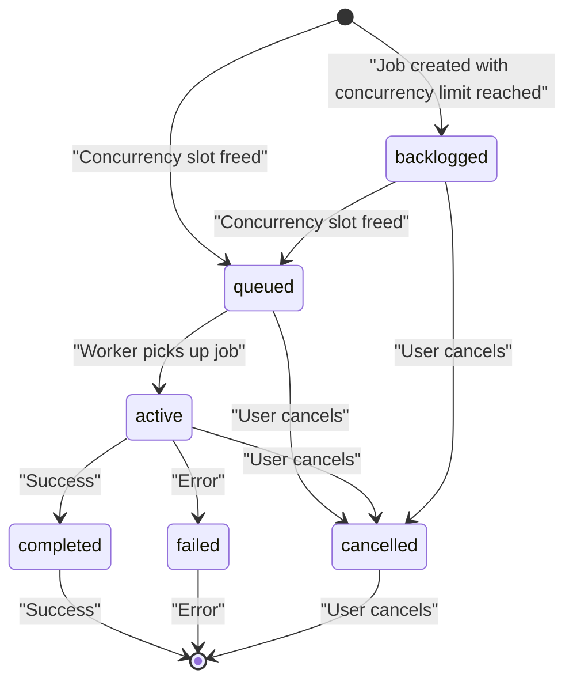
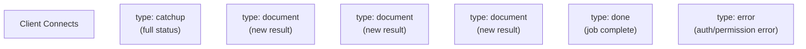
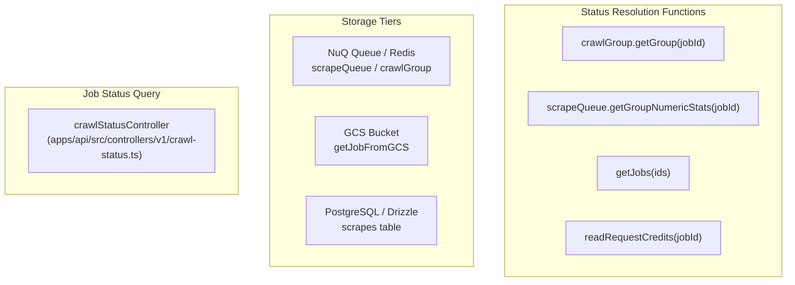
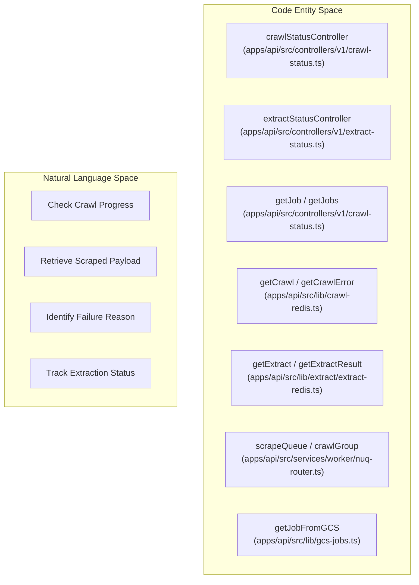

# Job Status and Monitoring

> **Relevant source files**
> * [apps/api/src/__tests__/snips/v2/crawl.test.ts](https://github.com/firecrawl/firecrawl/blob/f84845c8/apps/api/src/__tests__/snips/v2/crawl.test.ts)
> * [apps/api/src/controllers/v0/crawl-status.ts](https://github.com/firecrawl/firecrawl/blob/f84845c8/apps/api/src/controllers/v0/crawl-status.ts)
> * [apps/api/src/controllers/v1/crawl-status-ws.ts](https://github.com/firecrawl/firecrawl/blob/f84845c8/apps/api/src/controllers/v1/crawl-status-ws.ts)
> * [apps/api/src/controllers/v1/crawl-status.ts](https://github.com/firecrawl/firecrawl/blob/f84845c8/apps/api/src/controllers/v1/crawl-status.ts)
> * [apps/api/src/controllers/v1/scrape-status.ts](https://github.com/firecrawl/firecrawl/blob/f84845c8/apps/api/src/controllers/v1/scrape-status.ts)
> * [apps/api/src/controllers/v2/crawl-status.ts](https://github.com/firecrawl/firecrawl/blob/f84845c8/apps/api/src/controllers/v2/crawl-status.ts)
> * [apps/api/src/index.ts](https://github.com/firecrawl/firecrawl/blob/f84845c8/apps/api/src/index.ts)
> * [apps/api/src/lib/concurrency-limit.ts](https://github.com/firecrawl/firecrawl/blob/f84845c8/apps/api/src/lib/concurrency-limit.ts)
> * [apps/api/src/scraper/scrapeURL/transformers/diff.ts](https://github.com/firecrawl/firecrawl/blob/f84845c8/apps/api/src/scraper/scrapeURL/transformers/diff.ts)
> * [apps/api/src/services/queue-jobs.ts](https://github.com/firecrawl/firecrawl/blob/f84845c8/apps/api/src/services/queue-jobs.ts)
> * [apps/api/src/services/queue-service.ts](https://github.com/firecrawl/firecrawl/blob/f84845c8/apps/api/src/services/queue-service.ts)
> * [apps/api/src/services/queue-worker.ts](https://github.com/firecrawl/firecrawl/blob/f84845c8/apps/api/src/services/queue-worker.ts)
> * [apps/api/src/services/worker/crawl-logic.test.ts](https://github.com/firecrawl/firecrawl/blob/f84845c8/apps/api/src/services/worker/crawl-logic.test.ts)
> * [apps/api/src/services/worker/crawl-logic.ts](https://github.com/firecrawl/firecrawl/blob/f84845c8/apps/api/src/services/worker/crawl-logic.ts)

This page documents the implementation and architecture of job status tracking, WebSocket streaming, error handling, and job lifecycle states in Firecrawl. It covers REST status endpoints across API versions, real-time updates via WebSockets, multi-tier status storage (Redis, PostgreSQL, GCS), and job expiry/cleanup mechanics.

For information about creating jobs, see [API Reference](/firecrawl/firecrawl/4-api-reference). For details on queue and worker systems that execute these jobs, see [Queue and Worker System](/firecrawl/firecrawl/3.2-queue-and-worker-system).

---

## Job Lifecycle States

Jobs in Firecrawl progress through a series of states from creation to completion. The state model depends on whether the job is synchronous or asynchronous:

### State Definitions

| State | Description | Applies To |
| --- | --- | --- |
| `active` | Job is currently being processed by a worker | All async jobs |
| `queued` | Job is waiting to be picked up by a worker | All async jobs |
| `backlogged` | Job is in the concurrency limit queue, waiting for capacity | All async jobs |
| `completed` | Job finished successfully | All jobs |
| `failed` | Job encountered an error and stopped | All jobs |
| `cancelled` | Job was cancelled by user or system | All jobs |
| `scraping` | Crawl is in progress (combines active + queued) | Crawls only |

**State Transition Diagram**



**Sources:** [apps/api/src/services/worker/nuq.ts L24-L27](https://github.com/firecrawl/firecrawl/blob/f84845c8/apps/api/src/services/worker/nuq.ts#L24-L27)

 [apps/api/src/controllers/v1/crawl-status.ts L212-L234](https://github.com/firecrawl/firecrawl/blob/f84845c8/apps/api/src/controllers/v1/crawl-status.ts#L212-L234)

 [apps/api/src/services/queue-jobs.ts L82-L98](https://github.com/firecrawl/firecrawl/blob/f84845c8/apps/api/src/services/queue-jobs.ts#L82-L98)

---

## Status Retrieval Methods

Firecrawl provides multiple mechanisms for retrieving job status: REST endpoints for polling across v0, v1, and v2 APIs, and WebSocket connections for real-time streaming updates.

### REST Status Endpoints

**Endpoint Structure by API Version**

| Version | Endpoint Pattern | Job Types |
| --- | --- | --- |
| v0 | `GET /v0/crawl/:jobId` | Crawl |
| v1 | `GET /v1/crawl/:jobId` | Crawl / Batch scrape |
| v1 | `GET /v1/scrape/:jobId` | Single Scrape |
| v1 | `GET /v1/extract/:jobId` | Extract |
| v2 | `GET /v2/crawl/:jobId` | Crawl / Batch scrape |
| v2 | `GET /v2/extract/:jobId` | Extract / Agent |

**Query Parameters**

```markdown
?skip=<number>     # Offset for pagination (default: 0)
?limit=<number>    # Max results per page (default: 10)
```

**Response Schema (v1/v2 Crawl)**

```
{  success: boolean,  status: "scraping" | "completed" | "cancelled" | "failed",  completed: number,      // Count of completed jobs  total: number,          // Total job count  creditsUsed: number,    // Credits billed  expiresAt: string,      // ISO 8601 expiry time  data: Document[],       // Array of scraped documents  next?: string           // URL for next page of results}
```

**Sources:** [apps/api/src/controllers/v1/crawl-status.ts L167-L178](https://github.com/firecrawl/firecrawl/blob/f84845c8/apps/api/src/controllers/v1/crawl-status.ts#L167-L178)

 [apps/api/src/controllers/v2/crawl-status.ts L179-L198](https://github.com/firecrawl/firecrawl/blob/f84845c8/apps/api/src/controllers/v2/crawl-status.ts#L179-L198)

 [apps/api/src/controllers/v1/extract-status.ts L29-L125](https://github.com/firecrawl/firecrawl/blob/f84845c8/apps/api/src/controllers/v1/extract-status.ts#L29-L125)

 [apps/api/src/controllers/v0/crawl-status.ts L151](https://github.com/firecrawl/firecrawl/blob/f84845c8/apps/api/src/controllers/v0/crawl-status.ts#L151-L151)

### WebSocket Status Streaming

WebSocket connections provide real-time updates as jobs progress, eliminating the need for polling loops in clients.

**Connection Endpoint (v1 only)**

```
WS /v1/crawl/:jobId/stream
```

**Message Types Flow**



**Connection Lifecycle & Implementation**
The WebSocket implementation in `crawlStatusWS` ([apps/api/src/controllers/v1/crawl-status-ws.ts L60-L167](https://github.com/firecrawl/firecrawl/blob/f84845c8/apps/api/src/controllers/v1/crawl-status-ws.ts#L60-L167)

) establishes a polling loop that periodically inspects `scrapeQueue` via `getJobsWithStatuses` for newly completed or failed jobs, streaming them immediately to the client as `document` messages. High-level status aggregates are verified using `getCrawlJobs` and team concurrency limit state (`[apps/api/src/controllers/v1/crawl-status-ws.ts:76-111]`).

**Sources:** [apps/api/src/controllers/v1/crawl-status-ws.ts L60-L167](https://github.com/firecrawl/firecrawl/blob/f84845c8/apps/api/src/controllers/v1/crawl-status-ws.ts#L60-L167)

 [apps/api/src/controllers/v1/crawl-status-ws.ts L89-L93](https://github.com/firecrawl/firecrawl/blob/f84845c8/apps/api/src/controllers/v1/crawl-status-ws.ts#L89-L93)

---

## Status Tracking Architecture

Job status is coordinated across multiple backends (Redis, PostgreSQL, and Google Cloud Storage) to decouple hot execution state from long-term persistence.

**Multi-Tier Status Storage**



**Sources:** [apps/api/src/controllers/v1/crawl-status.ts L179-L201](https://github.com/firecrawl/firecrawl/blob/f84845c8/apps/api/src/controllers/v1/crawl-status.ts#L179-L201)

 [apps/api/src/controllers/v2/crawl-status.ts L200-L222](https://github.com/firecrawl/firecrawl/blob/f84845c8/apps/api/src/controllers/v2/crawl-status.ts#L200-L222)

 [apps/api/src/lib/gcs-jobs.ts L20-L25](https://github.com/firecrawl/firecrawl/blob/f84845c8/apps/api/src/lib/gcs-jobs.ts#L20-L25)

### PseudoJob Type

Status endpoints unify data from diverse sources into a standard `PseudoJob` type structure:

```typescript
export type PseudoJob<T> = {  id: string;  status: NuQJobStatus;  returnvalue: T | null;  timestamp: number;  data: {    scrapeOptions: any;    teamId?: string;  };  failedReason?: string;};
```

**PseudoJob Resolution Logic**
The `getJob` function ([apps/api/src/controllers/v1/crawl-status.ts L45-L91](https://github.com/firecrawl/firecrawl/blob/f84845c8/apps/api/src/controllers/v1/crawl-status.ts#L45-L91)

) queries active job queues and fallback storage tiers concurrently:

1. `scrapeQueue.getJob(id)`: Fetches active or recently completed job states from Redis/NuQ.
2. `readScrapeJobState(id)`: Reads persisted scrape status from Bigtable/state storage.
3. `getJobFromGCS(id)`: Retrieves large payload results from Google Cloud Storage if configured.

**Sources:** [apps/api/src/controllers/v1/crawl-status.ts L45-L91](https://github.com/firecrawl/firecrawl/blob/f84845c8/apps/api/src/controllers/v1/crawl-status.ts#L45-L91)

 [apps/api/src/controllers/v2/crawl-status.ts L48-L100](https://github.com/firecrawl/firecrawl/blob/f84845c8/apps/api/src/controllers/v2/crawl-status.ts#L48-L100)

---

## Result Retrieval, Diffing, and Storage

### Data Retention and Zero Data Retention (ZDR)

Firecrawl supports Zero Data Retention (`zeroDataRetention`). When enabled for a team, individual result blobs are not persisted in long-term storage past job finalization. In the legacy `v0` API, ZDR is unsupported and requests fail with a `400` status code ([apps/api/src/controllers/v0/crawl-status.ts L112-L117](https://github.com/firecrawl/firecrawl/blob/f84845c8/apps/api/src/controllers/v0/crawl-status.ts#L112-L117)

).

### Change Tracking and Diffing

URL change detection is powered by the `deriveDiff` transformer ([apps/api/src/scraper/scrapeURL/transformers/diff.ts L73-L207](https://github.com/firecrawl/firecrawl/blob/f84845c8/apps/api/src/scraper/scrapeURL/transformers/diff.ts#L73-L207)

), which queries previous job artifacts via `changeTrackingGetLastScrape` and `getJobFromGCS` to generate `git-diff` textual representations or structured JSON comparisons.

### Extract Job Status

Extract jobs track execution phases (`MAP`, `SCRAPE`, `EXTRACT`) through specialized Redis storage keys and maintain TTLs up to 24 hours ([apps/api/src/lib/extract/extract-redis.ts L5-L14](https://github.com/firecrawl/firecrawl/blob/f84845c8/apps/api/src/lib/extract/extract-redis.ts#L5-L14)

).

**Sources:** [apps/api/src/controllers/v0/crawl-status.ts L112-L117](https://github.com/firecrawl/firecrawl/blob/f84845c8/apps/api/src/controllers/v0/crawl-status.ts#L112-L117)

 [apps/api/src/scraper/scrapeURL/transformers/diff.ts L73-L207](https://github.com/firecrawl/firecrawl/blob/f84845c8/apps/api/src/scraper/scrapeURL/transformers/diff.ts#L73-L207)

 [apps/api/src/lib/extract/extract-redis.ts L5-L14](https://github.com/firecrawl/firecrawl/blob/f84845c8/apps/api/src/lib/extract/extract-redis.ts#L5-L14)

---

## Job Expiry and Cleanup

Completed jobs and associated queue entries expire according to configured retention windows:

* **BullMQ Default TTL:** Completed and failed jobs are retained for ~25 hours (`90000` seconds) ([apps/api/src/services/queue-service.ts L45-L50](https://github.com/firecrawl/firecrawl/blob/f84845c8/apps/api/src/services/queue-service.ts#L45-L50) ).
* **Extract Metadata:** Stored in Redis with a 6-hour TTL ([apps/api/src/lib/extract/extract-redis.ts L47](https://github.com/firecrawl/firecrawl/blob/f84845c8/apps/api/src/lib/extract/extract-redis.ts#L47-L47) ).
* **Billing Queue:** Completed items expire after 1 minute; failed items after 1 hour ([apps/api/src/services/queue-service.ts L83-L88](https://github.com/firecrawl/firecrawl/blob/f84845c8/apps/api/src/services/queue-service.ts#L83-L88) ).

**Sources:** [apps/api/src/services/queue-service.ts L45-L90](https://github.com/firecrawl/firecrawl/blob/f84845c8/apps/api/src/services/queue-service.ts#L45-L90)

 [apps/api/src/lib/extract/extract-redis.ts L47](https://github.com/firecrawl/firecrawl/blob/f84845c8/apps/api/src/lib/extract/extract-redis.ts#L47-L47)

---

## Error Handling and Status Codes

Status APIs return standard HTTP status codes mapped to operational states:

| Code | Condition |
| --- | --- |
| `200` | Job found; status/data returned successfully. |
| `400` | Invalid Job ID format or ZDR policy violation. |
| `403` | Unauthorized access attempt to another team's job. |
| `404` | Job not found in Redis, GCS, or PostgreSQL. |
| `429` | Queue capacity limit exceeded during job ingestion. |

**Failed Kickoff Management**
If a crawl encounters an unrecoverable failure during initialization (such as queue exhaustion), `getCrawlError` captures the reason ([apps/api/src/controllers/v1/crawl-status.ts L195-L224](https://github.com/firecrawl/firecrawl/blob/f84845c8/apps/api/src/controllers/v1/crawl-status.ts#L195-L224)

). If 0 jobs are present and an initialization error exists, the overarching status resolves to `failed`.

**Sources:** [apps/api/src/controllers/v1/crawl-status.ts L195-L224](https://github.com/firecrawl/firecrawl/blob/f84845c8/apps/api/src/controllers/v1/crawl-status.ts#L195-L224)

 [apps/api/src/controllers/v2/crawl-status.ts L219-L227](https://github.com/firecrawl/firecrawl/blob/f84845c8/apps/api/src/controllers/v2/crawl-status.ts#L219-L227)

---

## Code Entity Mapping

The diagram below connects natural language concepts to their concrete code implementations:



**Sources:** [apps/api/src/controllers/v1/crawl-status.ts L1-L165](https://github.com/firecrawl/firecrawl/blob/f84845c8/apps/api/src/controllers/v1/crawl-status.ts#L1-L165)

 [apps/api/src/lib/crawl-redis.ts L8-L17](https://github.com/firecrawl/firecrawl/blob/f84845c8/apps/api/src/lib/crawl-redis.ts#L8-L17)

 [apps/api/src/services/worker/nuq-router.ts L27-L32](https://github.com/firecrawl/firecrawl/blob/f84845c8/apps/api/src/services/worker/nuq-router.ts#L27-L32)

 [apps/api/src/lib/extract/extract-redis.ts L5-L14](https://github.com/firecrawl/firecrawl/blob/f84845c8/apps/api/src/lib/extract/extract-redis.ts#L5-L14)
