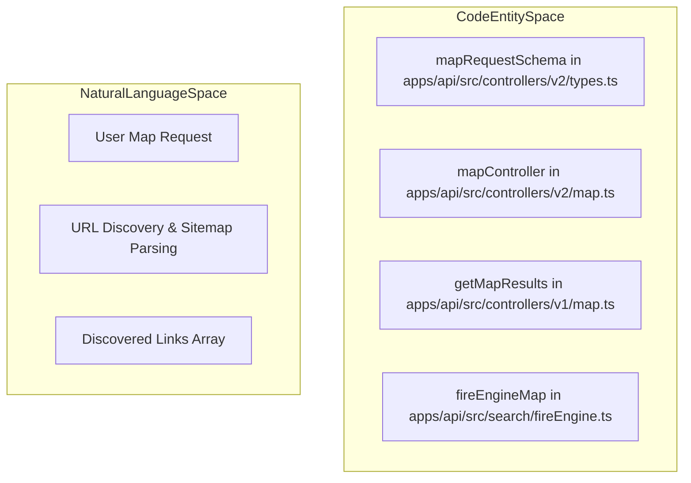
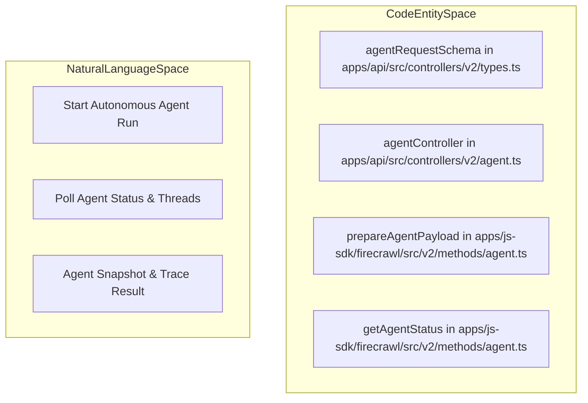

# Request and Response Schemas

> **Relevant source files**
> * [apps/api/src/__tests__/snips/v1/types-validation.test.ts](https://github.com/firecrawl/firecrawl/blob/f84845c8/apps/api/src/__tests__/snips/v1/types-validation.test.ts)
> * [apps/api/src/__tests__/snips/v2/types-validation.test.ts](https://github.com/firecrawl/firecrawl/blob/f84845c8/apps/api/src/__tests__/snips/v2/types-validation.test.ts)
> * [apps/api/src/controllers/v1/extract.ts](https://github.com/firecrawl/firecrawl/blob/f84845c8/apps/api/src/controllers/v1/extract.ts)
> * [apps/api/src/controllers/v1/map.ts](https://github.com/firecrawl/firecrawl/blob/f84845c8/apps/api/src/controllers/v1/map.ts)
> * [apps/api/src/controllers/v1/types.ts](https://github.com/firecrawl/firecrawl/blob/f84845c8/apps/api/src/controllers/v1/types.ts)
> * [apps/api/src/controllers/v2/agent.ts](https://github.com/firecrawl/firecrawl/blob/f84845c8/apps/api/src/controllers/v2/agent.ts)
> * [apps/api/src/controllers/v2/extract.ts](https://github.com/firecrawl/firecrawl/blob/f84845c8/apps/api/src/controllers/v2/extract.ts)
> * [apps/api/src/controllers/v2/map.ts](https://github.com/firecrawl/firecrawl/blob/f84845c8/apps/api/src/controllers/v2/map.ts)
> * [apps/api/src/controllers/v2/types.ts](https://github.com/firecrawl/firecrawl/blob/f84845c8/apps/api/src/controllers/v2/types.ts)
> * [apps/api/src/lib/crawl-regex.ts](https://github.com/firecrawl/firecrawl/blob/f84845c8/apps/api/src/lib/crawl-regex.ts)
> * [apps/api/src/lib/openai-strict-schema.test.ts](https://github.com/firecrawl/firecrawl/blob/f84845c8/apps/api/src/lib/openai-strict-schema.test.ts)
> * [apps/api/src/lib/openai-strict-schema.ts](https://github.com/firecrawl/firecrawl/blob/f84845c8/apps/api/src/lib/openai-strict-schema.ts)
> * [apps/api/src/lib/request-credits-store.test.ts](https://github.com/firecrawl/firecrawl/blob/f84845c8/apps/api/src/lib/request-credits-store.test.ts)
> * [apps/api/src/lib/request-credits-store.ts](https://github.com/firecrawl/firecrawl/blob/f84845c8/apps/api/src/lib/request-credits-store.ts)
> * [apps/api/src/lib/robots-txt.ts](https://github.com/firecrawl/firecrawl/blob/f84845c8/apps/api/src/lib/robots-txt.ts)
> * [apps/api/src/scraper/crawler/sitemap.ts](https://github.com/firecrawl/firecrawl/blob/f84845c8/apps/api/src/scraper/crawler/sitemap.ts)
> * [apps/js-sdk/firecrawl/src/index.ts](https://github.com/firecrawl/firecrawl/blob/f84845c8/apps/js-sdk/firecrawl/src/index.ts)
> * [apps/js-sdk/firecrawl/src/v2/methods/agent.ts](https://github.com/firecrawl/firecrawl/blob/f84845c8/apps/js-sdk/firecrawl/src/v2/methods/agent.ts)
> * [apps/python-sdk/firecrawl/v2/methods/agent.py](https://github.com/firecrawl/firecrawl/blob/f84845c8/apps/python-sdk/firecrawl/v2/methods/agent.py)
> * [apps/python-sdk/firecrawl/v2/methods/aio/agent.py](https://github.com/firecrawl/firecrawl/blob/f84845c8/apps/python-sdk/firecrawl/v2/methods/aio/agent.py)

This page documents the core data types, schemas, and validation logic used throughout the Firecrawl API. These schemas define the structure of requests, responses, and configuration options for all API endpoints.

Firecrawl uses [Zod](https://github.com/firecrawl/firecrawl/blob/f84845c8/Zod)

 for runtime schema validation and type inference. The type system is organized into major API versions (v0, v1, and v2) with distinct schemas and validation rules. Primary schema definitions are in [apps/api/src/controllers/v1/types.ts](https://github.com/firecrawl/firecrawl/blob/f84845c8/apps/api/src/controllers/v1/types.ts)

 and [apps/api/src/controllers/v2/types.ts](https://github.com/firecrawl/firecrawl/blob/f84845c8/apps/api/src/controllers/v2/types.ts)

## Overview

Key characteristics of the schema system:

* **Runtime validation**: All incoming requests are validated against Zod schemas before processing, such as in `extractController` [apps/api/src/controllers/v1/extract.ts L111-L118](https://github.com/firecrawl/firecrawl/blob/f84845c8/apps/api/src/controllers/v1/extract.ts#L111-L118)  and [apps/api/src/controllers/v2/extract.ts L35-L41](https://github.com/firecrawl/firecrawl/blob/f84845c8/apps/api/src/controllers/v2/extract.ts#L35-L41)
* **Type safety**: TypeScript types are automatically inferred from Zod schemas using `z.infer<>`.
* **Schema normalization**: OpenAI-compatible JSON schemas undergo normalization via `normalizeSchemaForOpenAI` to handle strict LLM requirements [apps/api/src/controllers/v2/types.ts L109-L196](https://github.com/firecrawl/firecrawl/blob/f84845c8/apps/api/src/controllers/v2/types.ts#L109-L196)
* **Strict validation**: v2 uses strict validation wrappers to catch unrecognized keys and provide helpful error messages [apps/api/src/controllers/v2/types.ts L95-L107](https://github.com/firecrawl/firecrawl/blob/f84845c8/apps/api/src/controllers/v2/types.ts#L95-L107)
* **Preprocessing**: URLs, formats, and other fields undergo preprocessing (e.g., protocol normalization via `.overwrite()`) before validation [apps/api/src/controllers/v2/types.ts L43-L68](https://github.com/firecrawl/firecrawl/blob/f84845c8/apps/api/src/controllers/v2/types.ts#L43-L68)

Sources: [apps/api/src/controllers/v1/types.ts L48-L97](https://github.com/firecrawl/firecrawl/blob/f84845c8/apps/api/src/controllers/v1/types.ts#L48-L97)

 [apps/api/src/controllers/v2/types.ts L43-L107](https://github.com/firecrawl/firecrawl/blob/f84845c8/apps/api/src/controllers/v2/types.ts#L43-L107)

 [apps/api/src/controllers/v1/extract.ts L111-L118](https://github.com/firecrawl/firecrawl/blob/f84845c8/apps/api/src/controllers/v1/extract.ts#L111-L118)

## Core Document Type

The `Document` type represents the output of any scraping operation. It contains the extracted content in multiple formats along with metadata about the scrape.

### Document Structure

```
Document = {  // Content formats  markdown?: string;  html?: string;  rawHtml?: string;  links?: string[];  images?: string[];  screenshot?: string;  json?: any;     // Structured extraction result  summary?: string;  branding?: BrandingProfile;    // Metadata  metadata: {    title?: string;    description?: string;    language?: string;    url?: string;    sourceURL?: string;    statusCode: number;    error?: string;  };}
```

Sources: [apps/api/src/controllers/v2/types.ts L1-L100](https://github.com/firecrawl/firecrawl/blob/f84845c8/apps/api/src/controllers/v2/types.ts#L1-L100)

## Format System

Formats define what content types to extract from a page.

### v1 Format Strings

In v1, formats are simple strings defined in the `Format` type: `markdown`, `html`, `rawHtml`, `links`, `screenshot`, `screenshot@fullPage`, `extract`, `json`, `summary`, `changeTracking`, `branding`, `product`, `menu` [apps/api/src/controllers/v1/types.ts L32-L46](https://github.com/firecrawl/firecrawl/blob/f84845c8/apps/api/src/controllers/v1/types.ts#L32-L46)

### v2 Format Objects

v2 introduces format objects which allow per-format configuration and preprocessing.

Sources: [apps/api/src/controllers/v1/types.ts L32-L46](https://github.com/firecrawl/firecrawl/blob/f84845c8/apps/api/src/controllers/v1/types.ts#L32-L46)

 [apps/api/src/controllers/v2/types.ts L1-L100](https://github.com/firecrawl/firecrawl/blob/f84845c8/apps/api/src/controllers/v2/types.ts#L1-L100)

## Request and Response Schemas

### Scrape Endpoint

**Request Schema (v2)**:
Validated via `scrapeRequestSchema` [apps/api/src/__tests__/snips/v2/types-validation.test.ts L10](https://github.com/firecrawl/firecrawl/blob/f84845c8/apps/api/src/__tests__/snips/v2/types-validation.test.ts#L10-L10)

 supporting `url`, `formats`, `onlyMainContent`, `timeout`, `waitFor`, `actions`, and `location`.

Sources: [apps/api/src/__tests__/snips/v2/types-validation.test.ts L10-L18](https://github.com/firecrawl/firecrawl/blob/f84845c8/apps/api/src/__tests__/snips/v2/types-validation.test.ts#L10-L18)

### Extract Endpoint

The Extract endpoint performs LLM-based structured data extraction.

**Validation Logic**:

* Validated via `extractRequestSchema` [apps/api/src/__tests__/snips/v2/types-validation.test.ts L13](https://github.com/firecrawl/firecrawl/blob/f84845c8/apps/api/src/__tests__/snips/v2/types-validation.test.ts#L13-L13)
* Handled in controllers such as `extractController` [apps/api/src/controllers/v1/extract.ts L111-L118](https://github.com/firecrawl/firecrawl/blob/f84845c8/apps/api/src/controllers/v1/extract.ts#L111-L118)  and [apps/api/src/controllers/v2/extract.ts L35-L41](https://github.com/firecrawl/firecrawl/blob/f84845c8/apps/api/src/controllers/v2/extract.ts#L35-L41)
* JSON Schema is normalized for OpenAI compatibility via `normalizeSchemaForOpenAI` [apps/api/src/controllers/v2/types.ts L109-L196](https://github.com/firecrawl/firecrawl/blob/f84845c8/apps/api/src/controllers/v2/types.ts#L109-L196)

Sources: [apps/api/src/controllers/v1/extract.ts L111-L118](https://github.com/firecrawl/firecrawl/blob/f84845c8/apps/api/src/controllers/v1/extract.ts#L111-L118)

 [apps/api/src/controllers/v2/extract.ts L35-L41](https://github.com/firecrawl/firecrawl/blob/f84845c8/apps/api/src/controllers/v2/extract.ts#L35-L41)

 [apps/api/src/controllers/v2/types.ts L109-L196](https://github.com/firecrawl/firecrawl/blob/f84845c8/apps/api/src/controllers/v2/types.ts#L109-L196)

### Map Endpoint

Map discovery requests are parsed via `mapRequestSchema` [apps/api/src/controllers/v2/types.ts L3](https://github.com/firecrawl/firecrawl/blob/f84845c8/apps/api/src/controllers/v2/types.ts#L3-L3)

 and processed in `mapController` [apps/api/src/controllers/v2/map.ts L32-L35](https://github.com/firecrawl/firecrawl/blob/f84845c8/apps/api/src/controllers/v2/map.ts#L32-L35)

 and `getMapResults` [apps/api/src/controllers/v1/map.ts L90-L134](https://github.com/firecrawl/firecrawl/blob/f84845c8/apps/api/src/controllers/v1/map.ts#L90-L134)

Diagram: Natural Language Space to Code Entity Space Bridge for Map Discovery



Sources: [apps/api/src/controllers/v2/types.ts L3](https://github.com/firecrawl/firecrawl/blob/f84845c8/apps/api/src/controllers/v2/types.ts#L3-L3)

 [apps/api/src/controllers/v2/map.ts L32-L35](https://github.com/firecrawl/firecrawl/blob/f84845c8/apps/api/src/controllers/v2/map.ts#L32-L35)

 [apps/api/src/controllers/v1/map.ts L90-L134](https://github.com/firecrawl/firecrawl/blob/f84845c8/apps/api/src/controllers/v1/map.ts#L90-L134)

### Agent Endpoint

The Agent endpoint handles autonomous agent execution runs. Requests are validated using `agentRequestSchema` [apps/api/src/controllers/v2/types.ts L8](https://github.com/firecrawl/firecrawl/blob/f84845c8/apps/api/src/controllers/v2/types.ts#L8-L8)

 inside `agentController` [apps/api/src/controllers/v2/agent.ts L26-L29](https://github.com/firecrawl/firecrawl/blob/f84845c8/apps/api/src/controllers/v2/agent.ts#L26-L29)

 Payload preparation for client SDKs is handled by `prepareAgentPayload` [apps/js-sdk/firecrawl/src/v2/methods/agent.ts L7-L24](https://github.com/firecrawl/firecrawl/blob/f84845c8/apps/js-sdk/firecrawl/src/v2/methods/agent.ts#L7-L24)

Diagram: Natural Language Space to Code Entity Space Bridge for Agent System



Sources: [apps/api/src/controllers/v2/types.ts L8](https://github.com/firecrawl/firecrawl/blob/f84845c8/apps/api/src/controllers/v2/types.ts#L8-L8)

 [apps/api/src/controllers/v2/agent.ts L26-L29](https://github.com/firecrawl/firecrawl/blob/f84845c8/apps/api/src/controllers/v2/agent.ts#L26-L29)

 [apps/js-sdk/firecrawl/src/v2/methods/agent.ts L7-L24](https://github.com/firecrawl/firecrawl/blob/f84845c8/apps/js-sdk/firecrawl/src/v2/methods/agent.ts#L7-L24)

## JSON Schema Normalization

OpenAI has strict requirements for JSON schemas used in structured extraction. Firecrawl normalizes schemas to ensure compatibility.

**Normalization Rules**:

1. **Remove `additionalProperties`**: Deleted if `properties` is present [apps/api/src/controllers/v2/types.ts L158-L164](https://github.com/firecrawl/firecrawl/blob/f84845c8/apps/api/src/controllers/v2/types.ts#L158-L164)
2. **Filter `required`**: Ensures required fields actually exist in `properties` [apps/api/src/controllers/v2/types.ts L166-L187](https://github.com/firecrawl/firecrawl/blob/f84845c8/apps/api/src/controllers/v2/types.ts#L166-L187)
3. **Handle `$ref`**: Preserves recursive references for OpenAI compatibility [apps/api/src/controllers/v2/types.ts L128-L130](https://github.com/firecrawl/firecrawl/blob/f84845c8/apps/api/src/controllers/v2/types.ts#L128-L130)
4. **Validation**: Rejects object types with no properties but `additionalProperties: true` [apps/api/src/controllers/v1/types.ts L175-L182](https://github.com/firecrawl/firecrawl/blob/f84845c8/apps/api/src/controllers/v1/types.ts#L175-L182)

Sources: [apps/api/src/controllers/v2/types.ts L109-L196](https://github.com/firecrawl/firecrawl/blob/f84845c8/apps/api/src/controllers/v2/types.ts#L109-L196)

 [apps/api/src/controllers/v1/types.ts L104-L193](https://github.com/firecrawl/firecrawl/blob/f84845c8/apps/api/src/controllers/v1/types.ts#L104-L193)
