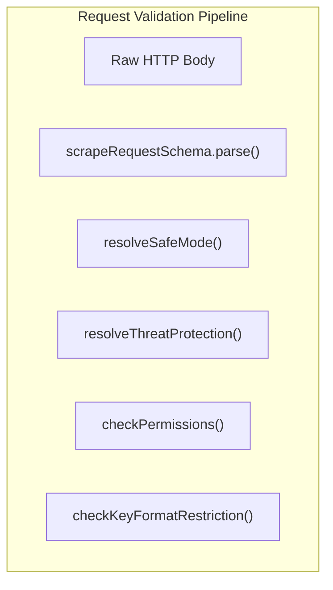

# Scrape Endpoints

> **Relevant source files**
> * [apps/api/requests.http](https://github.com/firecrawl/firecrawl/blob/f84845c8/apps/api/requests.http)
> * [apps/api/src/controllers/v0/scrape.ts](https://github.com/firecrawl/firecrawl/blob/f84845c8/apps/api/src/controllers/v0/scrape.ts)
> * [apps/api/src/controllers/v0/search.ts](https://github.com/firecrawl/firecrawl/blob/f84845c8/apps/api/src/controllers/v0/search.ts)
> * [apps/api/src/controllers/v1/crawl-errors.ts](https://github.com/firecrawl/firecrawl/blob/f84845c8/apps/api/src/controllers/v1/crawl-errors.ts)
> * [apps/api/src/controllers/v1/scrape.ts](https://github.com/firecrawl/firecrawl/blob/f84845c8/apps/api/src/controllers/v1/scrape.ts)
> * [apps/api/src/controllers/v1/search.ts](https://github.com/firecrawl/firecrawl/blob/f84845c8/apps/api/src/controllers/v1/search.ts)
> * [apps/api/src/controllers/v2/parse.ts](https://github.com/firecrawl/firecrawl/blob/f84845c8/apps/api/src/controllers/v2/parse.ts)
> * [apps/api/src/controllers/v2/scrape.ts](https://github.com/firecrawl/firecrawl/blob/f84845c8/apps/api/src/controllers/v2/scrape.ts)
> * [apps/api/src/controllers/v2/search.ts](https://github.com/firecrawl/firecrawl/blob/f84845c8/apps/api/src/controllers/v2/search.ts)
> * [apps/api/src/lib/extract/document-scraper.ts](https://github.com/firecrawl/firecrawl/blob/f84845c8/apps/api/src/lib/extract/document-scraper.ts)
> * [apps/api/src/lib/extract/fire-0/document-scraper-f0.ts](https://github.com/firecrawl/firecrawl/blob/f84845c8/apps/api/src/lib/extract/fire-0/document-scraper-f0.ts)

The scrape endpoints provide single-page web scraping functionality across three API versions (`v0`, `v1`, `v2`). These endpoints accept a URL and options, then return extracted content in various formats including markdown, HTML, screenshots, and LLM-extracted structured data.

**Scope**: This page covers the `/scrape` endpoints and their request/response schemas. For multi-page crawling, see [Crawl Endpoints](/firecrawl/firecrawl/4.3-crawl-endpoints). For URL discovery without scraping, see [Map Endpoints](/firecrawl/firecrawl/4.4-map-endpoints). For batch scraping operations, see [Crawl Endpoints](/firecrawl/firecrawl/4.3-crawl-endpoints) (`batch/scrape`). For LLM extraction workflows, see [Extract and Agent Endpoints](/firecrawl/firecrawl/4.5-extract-and-agent-endpoints).

---

## Endpoint Versions and Routes

The scrape functionality is exposed through three API versions with different behaviors and routing implementations:

| Version | Route | Execution Mode | Schema Location |
| --- | --- | --- | --- |
| `v0` | `POST /v0/scrape` | Asynchronous (queue-based) | `apps/api/src/controllers/v0/scrape.ts` [apps/api/src/controllers/v0/scrape.ts L1-L355](https://github.com/firecrawl/firecrawl/blob/f84845c8/apps/api/src/controllers/v0/scrape.ts#L1-L355) |
| `v1` | `POST /v1/scrape` | Synchronous (in-request via semaphore) | `apps/api/src/controllers/v1/scrape.ts` [apps/api/src/controllers/v1/scrape.ts L1-L545](https://github.com/firecrawl/firecrawl/blob/f84845c8/apps/api/src/controllers/v1/scrape.ts#L1-L545) |
| `v2` | `POST /v2/scrape` | Synchronous (in-request via semaphore) | `apps/api/src/controllers/v2/scrape.ts` [apps/api/src/controllers/v2/scrape.ts L1-L806](https://github.com/firecrawl/firecrawl/blob/f84845c8/apps/api/src/controllers/v2/scrape.ts#L1-L806) |

**Key Differences**:

* **`v0`**: Legacy API using `pageOptions`/`extractorOptions`, queues jobs into `scrapeQueue` and waits for completion with a timeout. It does not support Zero Data Retention (ZDR) [apps/api/src/controllers/v0/scrape.ts L203-L218](https://github.com/firecrawl/firecrawl/blob/f84845c8/apps/api/src/controllers/v0/scrape.ts#L203-L218)
* **`v1`**: Stable API using the `formats` array, executing synchronously using team concurrency semaphores [apps/api/src/controllers/v1/scrape.ts L55-L80](https://github.com/firecrawl/firecrawl/blob/f84845c8/apps/api/src/controllers/v1/scrape.ts#L55-L80)
* **`v2`**: Modern API with enhanced format objects, OpenTelemetry instrumentation (`withSpan`), and advanced features like `parsers`, `minAge`, and Alexandria third-party data options [apps/api/src/controllers/v2/scrape.ts L59-L77](https://github.com/firecrawl/firecrawl/blob/f84845c8/apps/api/src/controllers/v2/scrape.ts#L59-L77)

Sources: [apps/api/src/controllers/v0/scrape.ts L1-L355](https://github.com/firecrawl/firecrawl/blob/f84845c8/apps/api/src/controllers/v0/scrape.ts#L1-L355)

 [apps/api/src/controllers/v1/scrape.ts L1-L545](https://github.com/firecrawl/firecrawl/blob/f84845c8/apps/api/src/controllers/v1/scrape.ts#L1-L545)

 [apps/api/src/controllers/v2/scrape.ts L1-L806](https://github.com/firecrawl/firecrawl/blob/f84845c8/apps/api/src/controllers/v2/scrape.ts#L1-L806)

---

## Request Flow Architecture

```mermaid
flowchart TD

mermaid-jjks7cob5h-flowchart-Client["Client Request<br>(SDK/HTTP)"]
mermaid-jjks7cob5h-flowchart-Auth["Authentication Middleware<br>authenticateUser()"]
mermaid-jjks7cob5h-flowchart-RateLimit["Rate Limiter<br>RateLimiterMode.Scrape"]
mermaid-jjks7cob5h-flowchart-Parse["Schema Validation<br>scrapeRequestSchema.parse()"]
mermaid-jjks7cob5h-flowchart-Perms["Permission & Safe Mode Check<br>resolveSafeMode() & checkPermissions()"]
mermaid-jjks7cob5h-flowchart-LogRequest["logRequest()<br>Background Logging"]
mermaid-jjks7cob5h-flowchart-ModeChoice["API Version?"]
mermaid-jjks7cob5h-flowchart-Semaphore["Team Concurrency Semaphore<br>teamConcurrencySemaphore.withSemaphore()"]
mermaid-jjks7cob5h-flowchart-ProcessJob["processJobInternal()<br>Direct scraping engine execution"]
mermaid-jjks7cob5h-flowchart-AddJob["addScrapeJob()<br>Queue to NuQ / BullMQ"]
mermaid-jjks7cob5h-flowchart-WaitJob["waitForJob()<br>Poll for completion"]
mermaid-jjks7cob5h-flowchart-RemoveJob["scrapeQueue.removeJob()"]
mermaid-jjks7cob5h-flowchart-Response["HTTP Response<br>ScrapeResponse"]

subgraph mermaid-jjks7cob5h-subGraph1 ["v0 Asynchronous Execution"]
    mermaid-jjks7cob5h-flowchart-AddJob
    mermaid-jjks7cob5h-flowchart-WaitJob
    mermaid-jjks7cob5h-flowchart-RemoveJob
end

subgraph mermaid-jjks7cob5h-subGraph0 ["v1/v2 Synchronous Execution"]
    mermaid-jjks7cob5h-flowchart-ModeChoice
    mermaid-jjks7cob5h-flowchart-Semaphore
    mermaid-jjks7cob5h-flowchart-ProcessJob
end
```



**Diagram: Scrape Request Processing Flow**

The `v1` and `v2` controllers use `teamConcurrencySemaphore.withSemaphore()` to enforce team-level concurrency limits, executing scrapes synchronously via `processJobInternal` within the HTTP request lifecycle [apps/api/src/controllers/v1/scrape.ts L29-L30](https://github.com/firecrawl/firecrawl/blob/f84845c8/apps/api/src/controllers/v1/scrape.ts#L29-L30)

 [apps/api/src/controllers/v2/scrape.ts L34-L36](https://github.com/firecrawl/firecrawl/blob/f84845c8/apps/api/src/controllers/v2/scrape.ts#L34-L36)

 The `v0` controller adds jobs to the queue via `addScrapeJob()` and waits for completion using `waitForJob()` [apps/api/src/controllers/v0/scrape.ts L105-L132](https://github.com/firecrawl/firecrawl/blob/f84845c8/apps/api/src/controllers/v0/scrape.ts#L105-L132)

Sources: [apps/api/src/controllers/v1/scrape.ts L29-L30](https://github.com/firecrawl/firecrawl/blob/f84845c8/apps/api/src/controllers/v1/scrape.ts#L29-L30)

 [apps/api/src/controllers/v2/scrape.ts L34-L36](https://github.com/firecrawl/firecrawl/blob/f84845c8/apps/api/src/controllers/v2/scrape.ts#L34-L36)

 [apps/api/src/controllers/v0/scrape.ts L105-L132](https://github.com/firecrawl/firecrawl/blob/f84845c8/apps/api/src/controllers/v0/scrape.ts#L105-L132)

 [apps/api/src/services/worker/team-semaphore.ts L1-L29](https://github.com/firecrawl/firecrawl/blob/f84845c8/apps/api/src/services/worker/team-semaphore.ts#L1-L29)

---

## Request Schemas & Validation

Requests undergo rigorous validation using Zod schemas.



**Diagram: Request Validation Pipeline**

### Core Request Fields (v1 / v2)

* `url`: Target URL to scrape (automatically normalized to include protocols if missing) [apps/api/src/controllers/v1/scrape.ts L94](https://github.com/firecrawl/firecrawl/blob/f84845c8/apps/api/src/controllers/v1/scrape.ts#L94-L94)  [apps/api/src/controllers/v2/scrape.ts L97](https://github.com/firecrawl/firecrawl/blob/f84845c8/apps/api/src/controllers/v2/scrape.ts#L97-L97)
* `formats`: Array of requested output formats (e.g., `markdown`, `html`, `rawHtml`, `screenshot`, `links`, `json`) [apps/api/src/controllers/v1/types.ts L41-L90](https://github.com/firecrawl/firecrawl/blob/f84845c8/apps/api/src/controllers/v1/types.ts#L41-L90)
* `actions`: Browser automation steps (`click`, `wait`, `screenshot`, `scroll`, `executeJavascript`) [apps/api/requests.http L23-L32](https://github.com/firecrawl/firecrawl/blob/f84845c8/apps/api/requests.http#L23-L32)
* `timeout`: Maximum execution time in milliseconds [apps/api/src/controllers/v1/scrape.ts L190](https://github.com/firecrawl/firecrawl/blob/f84845c8/apps/api/src/controllers/v1/scrape.ts#L190-L190)
* `zeroDataRetention`: Boolean flag forcing zero telemetry/storage retention [apps/api/src/controllers/v1/scrape.ts L63-L66](https://github.com/firecrawl/firecrawl/blob/f84845c8/apps/api/src/controllers/v1/scrape.ts#L63-L66)

Sources: [apps/api/src/controllers/v1/scrape.ts L94](https://github.com/firecrawl/firecrawl/blob/f84845c8/apps/api/src/controllers/v1/scrape.ts#L94-L94)

 [apps/api/src/controllers/v2/scrape.ts L97](https://github.com/firecrawl/firecrawl/blob/f84845c8/apps/api/src/controllers/v2/scrape.ts#L97-L97)

 [apps/api/src/controllers/v1/types.ts L41-L90](https://github.com/firecrawl/firecrawl/blob/f84845c8/apps/api/src/controllers/v1/types.ts#L41-L90)

 [apps/api/requests.http L23-L32](https://github.com/firecrawl/firecrawl/blob/f84845c8/apps/api/requests.http#L23-L32)

---

## Response Formats and Data Structures

Both `v1` and `v2` endpoints return a `ScrapeResponse` wrapper containing success status, metadata, and the extracted `Document` structure.

```typescript
export interface ScrapeResponse {  success: boolean;  data: Document;  error?: string;  code?: string;}
```

The `Document` object typically contains:

* `markdown`: Cleaned markdown output.
* `html`: Processed HTML content.
* `rawHtml`: Unprocessed DOM HTML.
* `screenshot`: Base64 encoded screenshot string (if requested).
* `metadata`: Page metadata including HTTP status codes, title, description, language, and credit usage.

Sources: [apps/api/src/controllers/v1/types.ts L1-L40](https://github.com/firecrawl/firecrawl/blob/f84845c8/apps/api/src/controllers/v1/types.ts#L1-L40)

 [apps/api/src/controllers/v2/types.ts L1-L60](https://github.com/firecrawl/firecrawl/blob/f84845c8/apps/api/src/controllers/v2/types.ts#L1-L60)

---

## Error Handling & Transportable Errors

Scrape failures produce standardized `TransportableError` codes which are mapped to appropriate HTTP status codes:

| HTTP Status | Error Code | Source / Meaning |
| --- | --- | --- |
| `403` | `FORBIDDEN` / `SAFE_MODE_BLOCKED` | Blocked URL via blocklist or Safe Mode violation [apps/api/src/controllers/v2/scrape.ts L111-L132](https://github.com/firecrawl/firecrawl/blob/f84845c8/apps/api/src/controllers/v2/scrape.ts#L111-L132) |
| `403` | `THREAT_PROTECTION_BLOCKED` | Domain matched active threat protection policy [apps/api/src/controllers/v1/scrape.ts L110-L122](https://github.com/firecrawl/firecrawl/blob/f84845c8/apps/api/src/controllers/v1/scrape.ts#L110-L122) |
| `408` | `TIMEOUT` | Scrape operation exceeded the configured timeout threshold [apps/api/src/controllers/v0/scrape.ts L134-L139](https://github.com/firecrawl/firecrawl/blob/f84845c8/apps/api/src/controllers/v0/scrape.ts#L134-L139) |
| `429` | `TOO_MANY_REQUESTS` | Rate limit or keyless credit exhaustion [apps/api/src/controllers/v1/scrape.ts L45-L49](https://github.com/firecrawl/firecrawl/blob/f84845c8/apps/api/src/controllers/v1/scrape.ts#L45-L49) |

Sources: [apps/api/src/controllers/v1/scrape.ts L110-L122](https://github.com/firecrawl/firecrawl/blob/f84845c8/apps/api/src/controllers/v1/scrape.ts#L110-L122)

 [apps/api/src/controllers/v2/scrape.ts L111-L132](https://github.com/firecrawl/firecrawl/blob/f84845c8/apps/api/src/controllers/v2/scrape.ts#L111-L132)

 [apps/api/src/controllers/v0/scrape.ts L134-L139](https://github.com/firecrawl/firecrawl/blob/f84845c8/apps/api/src/controllers/v0/scrape.ts#L134-L139)

---

Sources: [apps/api/src/controllers/v1/scrape.ts L1-L545](https://github.com/firecrawl/firecrawl/blob/f84845c8/apps/api/src/controllers/v1/scrape.ts#L1-L545)

 [apps/api/src/controllers/v2/scrape.ts L1-L806](https://github.com/firecrawl/firecrawl/blob/f84845c8/apps/api/src/controllers/v2/scrape.ts#L1-L806)

 [apps/api/src/controllers/v0/scrape.ts L1-L355](https://github.com/firecrawl/firecrawl/blob/f84845c8/apps/api/src/controllers/v0/scrape.ts#L1-L355)

 [apps/api/src/controllers/v1/types.ts L1-L90](https://github.com/firecrawl/firecrawl/blob/f84845c8/apps/api/src/controllers/v1/types.ts#L1-L90)

 [apps/api/src/controllers/v2/types.ts L1-L100](https://github.com/firecrawl/firecrawl/blob/f84845c8/apps/api/src/controllers/v2/types.ts#L1-L100)
