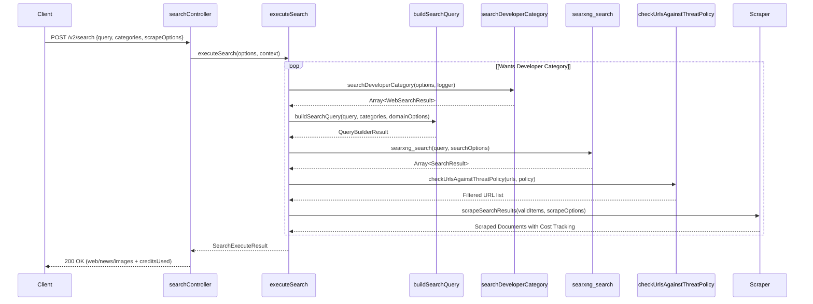

# Search Endpoints

> **Relevant source files**
> * [apps/api/src/__tests__/lib/search-query-builder.test.ts](https://github.com/firecrawl/firecrawl/blob/f84845c8/apps/api/src/__tests__/lib/search-query-builder.test.ts)
> * [apps/api/src/__tests__/snips/v1/lib.ts](https://github.com/firecrawl/firecrawl/blob/f84845c8/apps/api/src/__tests__/snips/v1/lib.ts)
> * [apps/api/src/__tests__/snips/v1/search.test.ts](https://github.com/firecrawl/firecrawl/blob/f84845c8/apps/api/src/__tests__/snips/v1/search.test.ts)
> * [apps/api/src/__tests__/snips/v2/key-restriction.test.ts](https://github.com/firecrawl/firecrawl/blob/f84845c8/apps/api/src/__tests__/snips/v2/key-restriction.test.ts)
> * [apps/api/src/__tests__/snips/v2/search-feedback.test.ts](https://github.com/firecrawl/firecrawl/blob/f84845c8/apps/api/src/__tests__/snips/v2/search-feedback.test.ts)
> * [apps/api/src/__tests__/snips/v2/search.test.ts](https://github.com/firecrawl/firecrawl/blob/f84845c8/apps/api/src/__tests__/snips/v2/search.test.ts)
> * [apps/api/src/controllers/v2/__tests__/search-developer-ledger.test.ts](https://github.com/firecrawl/firecrawl/blob/f84845c8/apps/api/src/controllers/v2/__tests__/search-developer-ledger.test.ts)
> * [apps/api/src/controllers/v2/search-schema.test.ts](https://github.com/firecrawl/firecrawl/blob/f84845c8/apps/api/src/controllers/v2/search-schema.test.ts)
> * [apps/api/src/lib/key-restriction.test.ts](https://github.com/firecrawl/firecrawl/blob/f84845c8/apps/api/src/lib/key-restriction.test.ts)
> * [apps/api/src/lib/key-restriction.ts](https://github.com/firecrawl/firecrawl/blob/f84845c8/apps/api/src/lib/key-restriction.ts)
> * [apps/api/src/lib/request-origin.ts](https://github.com/firecrawl/firecrawl/blob/f84845c8/apps/api/src/lib/request-origin.ts)
> * [apps/api/src/lib/search-query-builder.ts](https://github.com/firecrawl/firecrawl/blob/f84845c8/apps/api/src/lib/search-query-builder.ts)
> * [apps/api/src/search/alexandria.test.ts](https://github.com/firecrawl/firecrawl/blob/f84845c8/apps/api/src/search/alexandria.test.ts)
> * [apps/api/src/search/alexandria.ts](https://github.com/firecrawl/firecrawl/blob/f84845c8/apps/api/src/search/alexandria.ts)
> * [apps/api/src/search/developer.test.ts](https://github.com/firecrawl/firecrawl/blob/f84845c8/apps/api/src/search/developer.test.ts)
> * [apps/api/src/search/developer.ts](https://github.com/firecrawl/firecrawl/blob/f84845c8/apps/api/src/search/developer.ts)
> * [apps/api/src/search/searxng.ts](https://github.com/firecrawl/firecrawl/blob/f84845c8/apps/api/src/search/searxng.ts)
> * [apps/api/src/search/v2/searxng.ts](https://github.com/firecrawl/firecrawl/blob/f84845c8/apps/api/src/search/v2/searxng.ts)
> * [apps/api/src/services/alexandria/contracts.test.ts](https://github.com/firecrawl/firecrawl/blob/f84845c8/apps/api/src/services/alexandria/contracts.test.ts)
> * [apps/api/src/services/alexandria/contracts.ts](https://github.com/firecrawl/firecrawl/blob/f84845c8/apps/api/src/services/alexandria/contracts.ts)

## Purpose and Scope

This document details the architecture, request handling, category routing (including `developer` and `gov` categories), search options, and result scraping for Firecrawl's search endpoints. Search endpoints integrate with multiple upstream backends and providers (such as SearXNG, DuckDuckGo, and Fire Engine) to retrieve query results, apply threat protection, optionally execute code/research upstream proxies, and feed results through the standard scraping and highlighting pipelines.

Sources: [apps/api/src/controllers/v1/search.ts L1-L78](https://github.com/firecrawl/firecrawl/blob/f84845c8/apps/api/src/controllers/v1/search.ts#L1-L78)

 [apps/api/src/controllers/v2/search.ts L1-L50](https://github.com/firecrawl/firecrawl/blob/f84845c8/apps/api/src/controllers/v2/search.ts#L1-L50)

 [apps/api/src/search/developer.ts L1-L10](https://github.com/firecrawl/firecrawl/blob/f84845c8/apps/api/src/search/developer.ts#L1-L10)

---

## API Versions and Endpoints

Search capabilities are exposed across multiple API versions, supporting flat arrays, structured multi-source responses, and specialized category queries:

| Endpoint | API Version | Response Format | Key Features |
| --- | --- | --- | --- |
| `POST /v0/search` | v0 | Flat array | Legacy support, basic search options [apps/api/src/controllers/v0/search.ts L182-L250](https://github.com/firecrawl/firecrawl/blob/f84845c8/apps/api/src/controllers/v0/search.ts#L182-L250) |
| `POST /v1/search` | v1 | Flat array | Optional scraping, `includeDomains`, `excludeDomains` [apps/api/src/controllers/v1/search.ts L96-L150](https://github.com/firecrawl/firecrawl/blob/f84845c8/apps/api/src/controllers/v1/search.ts#L96-L150) |
| `POST /v2/search` | v2 | Structured (`web`, `news`, `images`, `developer`) | Categories, agent task context (`objective`, `clientModel`), feedback tracking [apps/api/src/controllers/v2/search.ts L45-L100](https://github.com/firecrawl/firecrawl/blob/f84845c8/apps/api/src/controllers/v2/search.ts#L45-L100) |

Sources: [apps/api/src/controllers/v0/search.ts L182-L250](https://github.com/firecrawl/firecrawl/blob/f84845c8/apps/api/src/controllers/v0/search.ts#L182-L250)

 [apps/api/src/controllers/v1/search.ts L96-L150](https://github.com/firecrawl/firecrawl/blob/f84845c8/apps/api/src/controllers/v1/search.ts#L96-L150)

 [apps/api/src/controllers/v2/search.ts L45-L100](https://github.com/firecrawl/firecrawl/blob/f84845c8/apps/api/src/controllers/v2/search.ts#L45-L100)

---

## Search Categories and Query Building

Query parsing and category expansion are handled by `buildSearchQuery` and specialized category dispatchers. Categories allow users to target specific corpuses (such as `github`, `research`, `pdf`, `developer`, and `gov`).

### Query Building Logic (buildSearchQuery)

The `buildSearchQuery` function [apps/api/src/lib/search-query-builder.ts L57-L130](https://github.com/firecrawl/firecrawl/blob/f84845c8/apps/api/src/lib/search-query-builder.ts#L57-L130)

 constructs the final search query string by appending domain filters and site restrictions:

* **String and Object Categories**: Evaluates `category` inputs [apps/api/src/lib/search-query-builder.ts L67-L100](https://github.com/firecrawl/firecrawl/blob/f84845c8/apps/api/src/lib/search-query-builder.ts#L67-L100)  For example, `github` appends `site:github.com`, while `research` applies a set of academic domain operators (`arxiv.org`, `scholar.google.com`, etc.) [apps/api/src/lib/search-query-builder.ts L24-L39](https://github.com/firecrawl/firecrawl/blob/f84845c8/apps/api/src/lib/search-query-builder.ts#L24-L39)
* **Domain Filtering**: Appends `includeDomains` and `excludeDomains` operators directly to ensure strict domain containment [apps/api/src/lib/search-query-builder.ts L113-L124](https://github.com/firecrawl/firecrawl/blob/f84845c8/apps/api/src/lib/search-query-builder.ts#L113-L124)

### Developer Category (searchDeveloperCategory)

When requests specify the `developer` category (or aliases like `repo`, `code`, `docs`, `developer_index`) [apps/api/src/controllers/v2/__tests__/search-developer-ledger.test.ts L189-L208](https://github.com/firecrawl/firecrawl/blob/f84845c8/apps/api/src/controllers/v2/__tests__/search-developer-ledger.test.ts#L189-L208)

 routing delegates to `searchDeveloperCategory` [apps/api/src/search/developer.ts L12-L62](https://github.com/firecrawl/firecrawl/blob/f84845c8/apps/api/src/search/developer.ts#L12-L62)

 rather than standard web scrapers:

* **Upstream Integration**: Queries the `/v2/code/search` research proxy endpoint via `fetchResearchUpstream` [apps/api/src/search/developer.ts L17-L23](https://github.com/firecrawl/firecrawl/blob/f84845c8/apps/api/src/search/developer.ts#L17-L23)
* **Normalization**: Maps code passages into the standard `WebSearchResult` shape, using passage text as the description while keeping upstream internal payloads isolated [apps/api/src/search/developer.ts L36-L57](https://github.com/firecrawl/firecrawl/blob/f84845c8/apps/api/src/search/developer.ts#L36-L57)
* **Ledger Logging**: Developer and code searches record an entry in the `code_searches` table via `logResearchEndpoint` [apps/api/src/controllers/v2/__tests__/search-developer-ledger.test.ts L173-L187](https://github.com/firecrawl/firecrawl/blob/f84845c8/apps/api/src/controllers/v2/__tests__/search-developer-ledger.test.ts#L173-L187)

Sources: [apps/api/src/lib/search-query-builder.ts L57-L180](https://github.com/firecrawl/firecrawl/blob/f84845c8/apps/api/src/lib/search-query-builder.ts#L57-L180)

 [apps/api/src/search/developer.ts L1-L62](https://github.com/firecrawl/firecrawl/blob/f84845c8/apps/api/src/search/developer.ts#L1-L62)

 [apps/api/src/controllers/v2/__tests__/search-developer-ledger.test.ts L136-L208](https://github.com/firecrawl/firecrawl/blob/f84845c8/apps/api/src/controllers/v2/__tests__/search-developer-ledger.test.ts#L136-L208)

---

## Search Execution Flow

The system delegates query execution to `executeSearch`, which coordinates search providers, threat evaluation, domain mapping, and optional result scraping.

Diagram: Search Execution Data Flow

Sources: [apps/api/src/controllers/v2/search.ts L223-L280](https://github.com/firecrawl/firecrawl/blob/f84845c8/apps/api/src/controllers/v2/search.ts#L223-L280)

 [apps/api/src/search/execute.ts L77-L182](https://github.com/firecrawl/firecrawl/blob/f84845c8/apps/api/src/search/execute.ts#L77-L182)

 [apps/api/src/search/developer.ts L12-L62](https://github.com/firecrawl/firecrawl/blob/f84845c8/apps/api/src/search/developer.ts#L12-L62)

 [apps/api/src/lib/search-query-builder.ts L57-L130](https://github.com/firecrawl/firecrawl/blob/f84845c8/apps/api/src/lib/search-query-builder.ts#L57-L130)

---

## Search Highlights and Feedback Loop

### Indexed Search Highlights

To improve snippet quality without incurring full scrape costs, `runIndexedSearchHighlights` queries the Firecrawl index cache [apps/api/src/search/highlights.ts L68-L120](https://github.com/firecrawl/firecrawl/blob/f84845c8/apps/api/src/search/highlights.ts#L68-L120)

 It hashes target URLs, retrieves recently indexed 2xx content from PostgreSQL/Redis storage layers, and extracts salient context matching the search terms.

### Search Feedback and Credit Refunds

Users can submit feedback on search executions via search feedback endpoints (recording ratings like `good`, `partial`, or `bad`, along with valuable sources and missing content) [apps/api/src/__tests__/snips/v2/search-feedback.test.ts L73-L98](https://github.com/firecrawl/firecrawl/blob/f84845c8/apps/api/src/__tests__/snips/v2/search-feedback.test.ts#L73-L98)

* **Idempotency**: Submissions are tracked in `search_feedback` tables, ensuring duplicate feedback for the same `searchId` returns an existing status and prevents double-refunds [apps/api/src/__tests__/snips/v2/search-feedback.test.ts L114-L152](https://github.com/firecrawl/firecrawl/blob/f84845c8/apps/api/src/__tests__/snips/v2/search-feedback.test.ts#L114-L152)
* **Refund Automation**: First-time positive or detailed feedback triggers credit adjustments via Autumn integration [apps/api/src/__tests__/snips/v2/search-feedback.test.ts L40-L112](https://github.com/firecrawl/firecrawl/blob/f84845c8/apps/api/src/__tests__/snips/v2/search-feedback.test.ts#L40-L112)

Sources: [apps/api/src/search/highlights.ts L68-L120](https://github.com/firecrawl/firecrawl/blob/f84845c8/apps/api/src/search/highlights.ts#L68-L120)

 [apps/api/src/__tests__/snips/v2/search-feedback.test.ts L38-L195](https://github.com/firecrawl/firecrawl/blob/f84845c8/apps/api/src/__tests__/snips/v2/search-feedback.test.ts#L38-L195)

---

## Zero Data Retention (ZDR) and Billing

Search executions comply with enterprise ZDR and credit management rules:

* **Credit Projection**: `projectSearchTotalCredits` estimates total credit expenditure prior to execution, taking into account optional result scraping and threat checks [apps/api/src/controllers/v2/search.ts L197-L212](https://github.com/firecrawl/firecrawl/blob/f84845c8/apps/api/src/controllers/v2/search.ts#L197-L212)
* **Keyless Reserves**: Unauthenticated or keyless requests reserve credits via `reserveKeylessCredits`, returning structured 429 errors (`keyless limit reached`) when exhausted [apps/api/src/controllers/v2/__tests__/search-developer-ledger.test.ts L137-L158](https://github.com/firecrawl/firecrawl/blob/f84845c8/apps/api/src/controllers/v2/__tests__/search-developer-ledger.test.ts#L137-L158)
* **ZDR Enforcement**: When ZDR flags are active, logs and tracking identifiers are scrubbed or routed securely to prevent persistence of sensitive search queries.

Sources: [apps/api/src/controllers/v2/search.ts L54-L170](https://github.com/firecrawl/firecrawl/blob/f84845c8/apps/api/src/controllers/v2/search.ts#L54-L170)

 [apps/api/src/controllers/v2/__tests__/search-developer-ledger.test.ts L136-L187](https://github.com/firecrawl/firecrawl/blob/f84845c8/apps/api/src/controllers/v2/__tests__/search-developer-ledger.test.ts#L136-L187)
